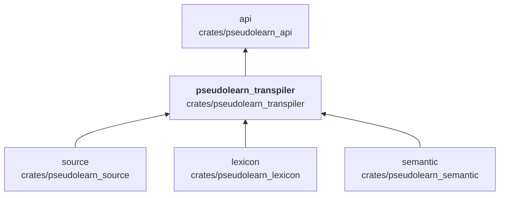
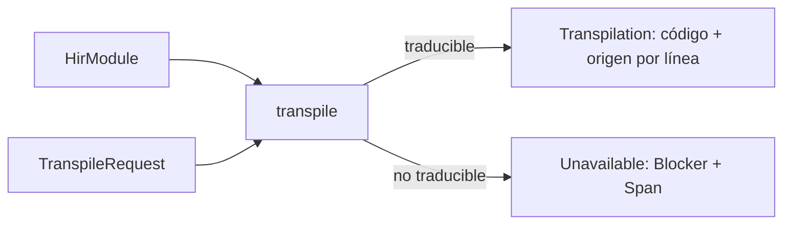

# pseudolearn_transpiler

Traduce el modelo semántico (`HirModule`) a código Rust o Python equivalente. Escribe cada construcción en el destino,
emite el soporte necesario (biblioteca, texto, tiempo, archivos, canales, tareas, anfitrión), desambigua nombres que el
destino no distingue y conserva el origen de cada línea generada. Si algo no se puede traducir devuelve los bloqueos con
su posición en vez de generar código incompleto.

**No hace:** analizar ni ejecutar el programa, ni compilar el código generado.

## Dónde encaja

`syntax` lo usa solo en pruebas (dependencia de desarrollo).

## Arquitectura

Importa `source`, `lexicon` y `semantic`; no tiene dependencias externas.

| Pieza                                                                              | Responsabilidad                                                                                       |
|------------------------------------------------------------------------------------|-------------------------------------------------------------------------------------------------------|
| `lib` (`transpile`), `target`, `outcome`                                           | `TranspileRequest`, `TargetLanguage` (`Rust`, `Python`) y `TranspileOutcome` (`Code` o `Unavailable`) |
| `rust_target/`                                                                     | Generación de Rust: declaraciones, expresiones, control, clases, tareas y el soporte que acompaña     |
| `python_target/`                                                                   | Generación de Python con la misma estructura                                                          |
| `identifier_spelling`, `member_spellings`, `reserved_names`, `reserved_type_names` | Escritura de nombres y evitación de reservados del destino                                            |
| `module_view`, `code_lines`, `support_requests`, `effect_functions`                | Vista del módulo, líneas con origen y soporte pedido por el programa                                  |

## Flujo principal

Flujo de datos, no dependencias.

## Reglas que conviene saber

- Solo importa `source`, `lexicon` y `semantic`; no conoce la VM ni el backend nativo.
- La salida es determinista: el mismo módulo y la misma solicitud dan el mismo texto (`deterministic_output_crates`).
- Sin `unsafe`.

## Comandos útiles

| Para qué              | Comando                                |
|-----------------------|----------------------------------------|
| Tests del crate       | `cargo test -p pseudolearn_transpiler` |
| Verificación completa | `cargo xtask verify`                   |

Se ejecutan desde `packages/pseudolearn_engine`.
