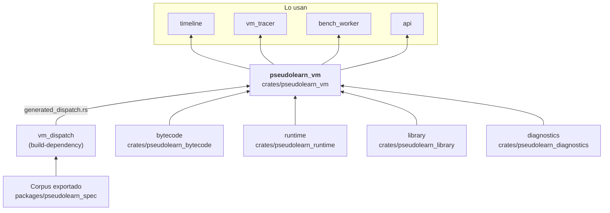
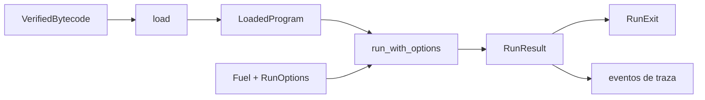

# pseudolearn_vm

Máquina virtual cooperativa que ejecuta el bytecode verificado: carga el programa (`load`), crea una `Machine`,
ejecuta con combustible y límites, emite eventos de traza, avanza paso a paso (`step_into`, `step_over`, `step_out`,
`step_to_line`), se suspende ante entrada o efectos pendientes y puede guardar y restaurar su estado (`MachineImage`,
`MachineDelta`). Gestiona tareas y canales sobre el montón de `runtime` y la biblioteca de `library`.

**No hace:** compilar el bytecode (`bytecode`), reconstruir el estado de un instante pasado (`timeline`) ni atender
efectos reales: los efectos pendientes se devuelven a quien la llama (`RunExit::AwaitingEffect`).

## Dónde encaja

## Arquitectura

Importa `bytecode`, `runtime`, `library` y `diagnostics`; en compilación, `vm_dispatch`. No tiene dependencias
externas. `build.rs` combina el corpus con `data/dispatch_forms.json` y emite `generated_dispatch.rs`, incluido desde
`dispatch.rs`.

| Módulo                 | Responsabilidad                                                                                 |
|------------------------|-------------------------------------------------------------------------------------------------|
| `load`                 | `load` y `LoadedProgram`: instrucciones, memoria, metadatos y puntos de interrupción            |
| `machine`              | `Machine`, registros, celdas, llamadas, tareas, canales, efectos e imagen/diferencial de estado |
| `dispatch`, `evaluate` | Despacho generado y evaluadores de enteros, reales, caracteres, lógica y matemática             |
| `step`                 | Depuración paso a paso                                                                          |
| `events`               | `TraceEvent`, `TraceClass` y el búfer de cambios                                                |
| `options`, `model`     | `RunOptions` (semilla, profundidad, límites, cancelación), `RunExit`, `RunResult`               |
| `trap`, `vocabulary`   | `VmTrap` y vocabulario de salida                                                                |

## Flujo principal

Flujo de datos, no dependencias.

`run` y `run_loaded` son atajos sobre el mismo camino; `create_machine` y `resume_machine` permiten conservar la
máquina entre pausas.

## Reglas que conviene saber

- Solo importa lo que permite `architecture.yaml`: `bytecode`, `runtime`, `library`, `diagnostics` y `vm_dispatch`.
- La salida de una ejecución es determinista para un programa, una configuración, una semilla y unas entradas
  (`deterministic_output_crates`).
- El resultado es siempre un `RunExit` (`Completed`, `AwaitingInput`, `AwaitingEffect`, `Cancelled`, `LimitReached`,
  `Service`, `Trap`); los fallos de ejecución son `VmTrap`, no excepciones.
- `RunOptions::twin_mode` elige entre `Fast`, `Probed` y `Differential`.
- Sin `unsafe`.

## Comandos útiles

| Para qué              | Comando                        |
|-----------------------|--------------------------------|
| Tests del crate       | `cargo test -p pseudolearn_vm` |
| Verificación completa | `cargo xtask verify`           |

Se ejecutan desde `packages/pseudolearn_engine`; la compilación necesita el corpus exportado.
