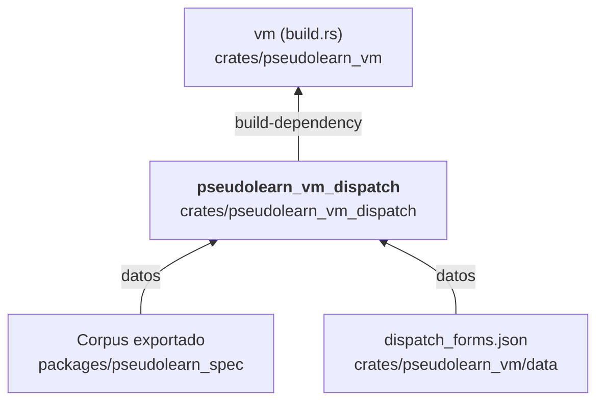

# pseudolearn_vm_dispatch

Generador del despacho de la VM: lee `IR.INSTRUCTIONS` de la exportación del corpus y la tabla de formas
`crates/pseudolearn_vm/data/dispatch_forms.json`, y produce el código Rust que `build.rs` de `pseudolearn_vm` escribe
como `generated_dispatch.rs`: la clasificación de cada opcode, las operaciones de despacho y el `match` del paso de
ejecución.

**No hace:** ejecutar programas, enlazarse en la VM en tiempo de ejecución ni decidir semántica: lo que hace cada
operación está en los manejadores escritos a mano de `pseudolearn_vm`.

## Dónde encaja

## Arquitectura

No importa crates del motor; la única dependencia externa es `serde_json`. No tiene binario: la VM la usa como
`build-dependency`.

| Módulo    | Responsabilidad                                                                  |
|-----------|----------------------------------------------------------------------------------|
| `lib`     | `generate(export_path, forms_path)`: orquesta y devuelve el código Rust          |
| `catalog` | Nombres de las instrucciones y familia de despacho de cada opcode                |
| `forms`   | Expansión de cada fila de la tabla en formas de registro, inmediato y fusionadas |
| `render`  | Emisión del código de despacho                                                   |

## Reglas que conviene saber

- Es herramienta (`tooling: true`) con `may_import` vacío; solo la VM la usa, y solo en compilación.
- Cambiar la exportación del corpus o `dispatch_forms.json` recompila la VM (`cargo:rerun-if-changed`).
- Sin `unsafe`.

## Comandos útiles

| Para qué              | Comando                                 |
|-----------------------|-----------------------------------------|
| Tests del crate       | `cargo test -p pseudolearn_vm_dispatch` |
| Verificación completa | `cargo xtask verify`                    |

Se ejecutan desde `packages/pseudolearn_engine`.
