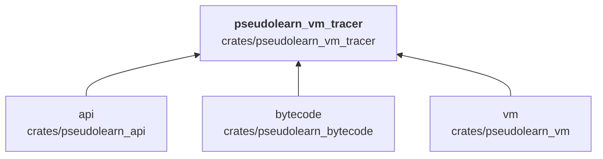
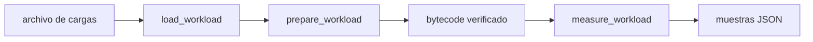

# pseudolearn_vm_tracer

Trabajador de medición de la VM sin observador: carga una carga de trabajo, compila su texto a bytecode verificado
antes del intervalo cronometrado, ejecuta `pseudolearn_vm` directamente y devuelve las muestras en JSON. Admite un
perfil de superinstrucciones (`compareBranch`, `fusedArithmetic`) y un modo `profile` para recoger conteos.

**No hace:** pasar por la API pública de ejecución, definir un protocolo público ni formar parte del producto.

## Dónde encaja

Nadie en el monorepo lo importa: es un binario (`vm-tracer`) y una biblioteca mínima.

## Arquitectura

Importa `api`, `bytecode` y `vm`; la externa es `serde_json`.

| Módulo     | Responsabilidad                                                       |
|------------|-----------------------------------------------------------------------|
| `workload` | `Workload` y `load_workload`: identificador, fuente y salida esperada |
| `measure`  | `prepare_workload*`, `measure_workload` y `profile_workload`          |
| `main`     | Subcomandos `worker` y `profile`                                      |

## Flujo principal

Flujo de datos, no dependencias.

## Reglas que conviene saber

- Es herramienta (`tooling: true`): ningún otro crate del motor lo importa.
- El bytecode se prepara fuera del intervalo medido; cada muestra se valida contra la salida esperada.
- Argumentos inválidos o un perfil de superinstrucciones desconocido terminan con código distinto de cero y un mensaje
  en `stderr`.
- Sin `unsafe`.

## Comandos útiles

| Para qué        | Comando                                                                                                   |
|-----------------|-----------------------------------------------------------------------------------------------------------|
| Medir una carga | `cargo run --release -p pseudolearn_vm_tracer --bin vm-tracer -- worker <cargas> <id> <proceso> <perfil>` |
| Tests del crate | `cargo test -p pseudolearn_vm_tracer`                                                                     |

Se ejecutan desde `packages/pseudolearn_engine`.
