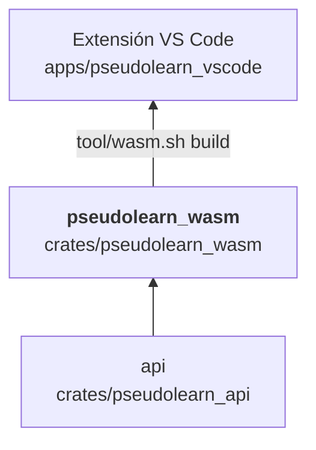

# pseudolearn_wasm

Módulo WebAssembly del motor para el navegador: expone `WasmSession`, que envuelve una `ApiSession` y recibe y devuelve
JSON como texto. `call` devuelve la respuesta tal cual y `callProjected` añade una proyección en la que los números
viajan como cadenas para que JavaScript no pierda precisión. También incluye el binario `wasm_native_probe`, que ejecuta
las mismas operaciones de forma nativa desde la entrada estándar para comparar ambos entornos.

**No hace:** lógica del lenguaje ni de la API (todo está en `pseudolearn_api`), ni red nativa ni backend nativo: el
grafo para `wasm32` los excluye.

## Dónde encaja

La flecha final es de artefacto: la extensión ejecuta `build:wasm` (`tool/wasm.sh build`) y empaqueta el módulo
generado; no hay dependencia en manifiestos de Cargo.

## Arquitectura

Importa solo `pseudolearn_api`; las externas son `serde_json` y `wasm-bindgen`.

| Pieza                   | Responsabilidad                                                      |
|-------------------------|----------------------------------------------------------------------|
| `lib` (`WasmSession`)   | `call` y `callProjected`: JSON de entrada y de salida como texto     |
| `projection`            | Convierte cada número JSON en cadena                                 |
| `bin/wasm_native_probe` | Lee `operación<TAB>argumentos` por línea y escribe la respuesta JSON |
| `browser/`              | Arnés de pruebas en Chrome (Playwright) y host de red por `fetch`    |

## Reglas que conviene saber

- Es una de las tres únicas capas con `unsafe` permitido (`unsafe_allowed`), solo porque las macroexpansiones de
  `wasm-bindgen` pueden generarlo; el código escrito a mano no contiene `unsafe`.
- Para `wasm32`, `architecture.yaml` prohíbe `pseudolearn_codegen`, `pseudolearn_aot_rt`, `cranelift-*`, la
  característica `test-host` y las bibliotecas de red nativa (`hyper`, `reqwest`, `rustls`…). `tool/wasm.sh build` lo
  comprueba con `cargo tree` antes de compilar.
- `wasm-bindgen` debe ser exactamente la versión 0.2.129 y el perfil es `wasm-release` (`opt-level = "z"`, LTO fat,
  `panic = "abort"`).
- Un JSON de argumentos inválido se rechaza con un error de JavaScript (`Result<String, JsValue>`).

## Comandos útiles

| Para qué               | Comando                          |
|------------------------|----------------------------------|
| Generar el módulo Wasm | `bash tool/wasm.sh build`        |
| Probarlo en Chrome     | `bash tool/wasm.sh test`         |
| Tests del crate        | `cargo test -p pseudolearn_wasm` |

Se ejecutan desde `packages/pseudolearn_engine`. Requisitos: target `wasm32-unknown-unknown`, `wasm-bindgen-cli`
0.2.129 y, para `test`, `pnpm`.
