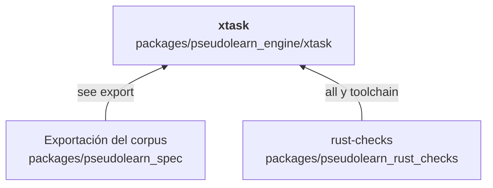
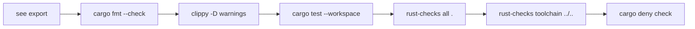

# xtask

Orquestador de la verificación completa del motor: `cargo xtask verify` encadena, en orden, la exportación del corpus,
el formato, Clippy, los tests, los verificadores mecánicos de `pseudolearn_rust_checks` y la auditoría de dependencias,
y se detiene en el primer paso que falle.

**No hace:** compilar ni ejecutar el lenguaje, ni medir rendimiento; tampoco publica nada. No tiene tests propios: es un
guion de comandos.

## Dónde encaja

Aquí las flechas indican qué comandos invoca `xtask`; no hay dependencias de Cargo: no importa ningún crate del motor y
no tiene dependencias externas.

## Flujo principal

Flujo de ejecución, en orden.

## Reglas que conviene saber

- Sin argumentos distintos de `verify`, termina con un mensaje de uso y código de salida distinto de cero.
- Es herramienta (`tooling: true`) con `may_import` vacío y sin `unsafe`.
- Los pasos se ejecutan con `workspace`: Clippy y los tests cubren todos los crates del motor, incluidos `xtask` y las
  herramientas.

## Comandos útiles

| Para qué                        | Comando              |
|---------------------------------|----------------------|
| Verificación completa del motor | `cargo xtask verify` |

Se ejecuta desde `packages/pseudolearn_engine` (el alias `xtask` está en `.cargo/config.toml`). Requisitos: la
toolchain de `rust-toolchain.toml`, `cargo-deny` y el repositorio completo, porque el motor invoca
`../pseudolearn_spec` y `../pseudolearn_rust_checks` por ruta relativa.
