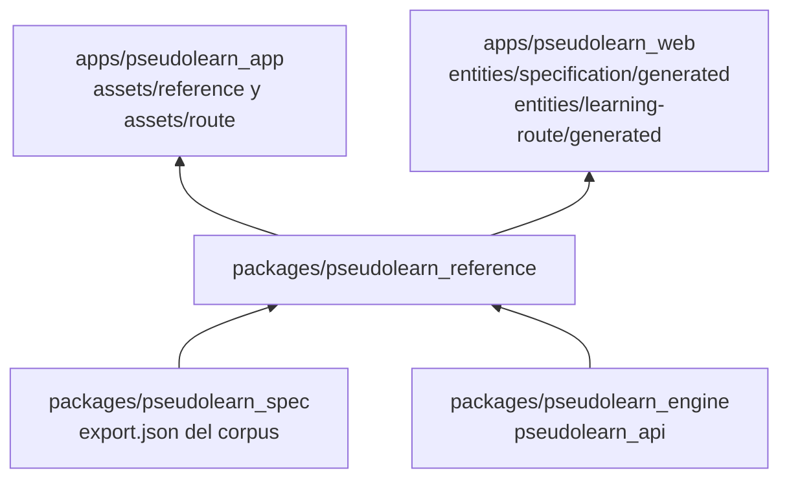
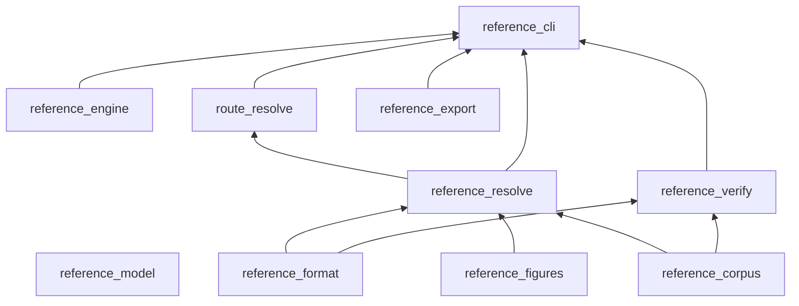
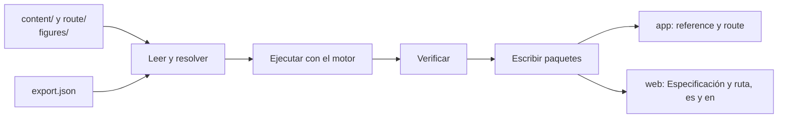

# pseudolearn_reference

Compilador de los dos libros de PseudoLearn: la **Especificación ilustrada** (`content/`) y la **ruta de aprendizaje**
(`route/`). Lee fuentes en Markdown con directivas y figuras SVG, ejecuta cada programa con el motor real, verifica lo
que promete el texto y publica paquetes de datos neutrales (JSON y SVG) que consumen la app Flutter y la web.

**No hace:** definir el lenguaje (eso es el corpus de `pseudolearn_spec`), pintar nada ni desplegarse. Es una
herramienta de construcción: el binario se llama `reference`.

## Dónde encaja

## Arquitectura

Un crate por capa. El diagrama omite las aristas hacia `reference_model`, que todos importan.

También se omiten las aristas de `reference_corpus`, `reference_figures` y `reference_format` hacia `reference_cli`, y
la de `reference_format` hacia `route_resolve`.

| Crate               | Responsabilidad                                                                    |
|---------------------|------------------------------------------------------------------------------------|
| `reference_model`   | Documento fuente, bloques, secciones publicadas, violaciones y puerto `CodeEngine` |
| `reference_format`  | Lector del Markdown con directivas                                                 |
| `reference_corpus`  | Léxico, fichas, diagnósticos y gramática leídos de la exportación del corpus       |
| `reference_engine`  | Adaptador del puerto sobre `pseudolearn_api` (tokenizar, traducir, ejecutar, vista) |
| `reference_figures` | Contrato SVG, kit de piezas y capas por paso                                       |
| `reference_resolve` | Fuente → sección publicada de la Especificación                                    |
| `route_resolve`     | Lección y ejercicio fuente → lección y ejercicio publicados                        |
| `reference_verify`  | Verificadores `REF-*` y `RUTA-*` y cobertura                                       |
| `reference_export`  | Paquetes por edición con manifiesto de huellas                                     |
| `reference_cli`     | Binario `reference`; única capa que toca el disco                                  |
| `xtask`             | `cargo xtask verify`                                                               |

## Flujo principal

Flujo de datos de `reference build`, no de dependencias.

Las ediciones de la app viven en `<idioma>/keywords-<perfil>/` y las web contienen solo `es/keywords-es` y
`en/keywords-en`, publicadas como `es` y `en`. La de la Especificación lleva `toc.json` y las secciones; la de la
ruta lleva `toc.json`, las lecciones y los ejercicios, porque la web muestra lecciones y ejercicios reales en vez de
describirlos. `reference check` informa la segunda como `RUTA-WEB-BUNDLE-STALE`. Los esquemas de los paquetes están en
`schemas/`.

## Reglas que conviene saber

- Cada capa solo importa lo que `architecture.yaml` le permite; solo `reference_engine` depende del motor
  (`pseudolearn_api` con `test-host`).
- Archivos de 300 líneas, funciones de 40 y 4 parámetros posicionales como máximo; nombres de al menos tres caracteres.
- Sin `unsafe`, sin comentarios y sin `allow`/`expect`; el contenido va en español e inglés con paridad estructural.
- Los paquetes de la app y de la web se generan con `reference build`; nunca se editan a mano (`GEN-NO-HAND-COPY`).
  `reference check` falla si están obsoletos.
- Las figuras ocupan 340 unidades de ancho y usan roles de color, no colores fijos.
- **El perfil lleva el prefijo `keywords-`** (`es/keywords-en`, nunca `es/en`): el empaquetado MSIX de Windows lee
  cada carpeta con nombre de idioma como un calificador de recursos, y dos idiomas anidados hacen que `makepri` dé por
  duplicados los archivos de ediciones distintas y aborte. `reference_cli/src/edition_key.rs` es el único lugar que
  compone y separa esa ruta.
- **`categories.json` es del libro**: la categoría de resaltado de cada palabra reservada es una decisión de presentación de los lectores, no comportamiento del lenguaje, así que no sube al corpus; `reference` la exige completa y la app la compara con su tabla en `keyword_highlight_categories_test.dart`.
- **La comilla (`quote`) está excluida de la cobertura de vocabulario** (`coverage-exclusions.json`) porque el resaltado la incluye en el literal de texto y nunca aparece como ficha suelta.
- **Programas de la edición inglesa de la ruta**: un `programa` vacío en `route/en` reutiliza el español, con el vocabulario del lenguaje traducido y los identificadores y textos entre comillas sin cambiar. Un `programa` con cuerpo en `route/en` es la versión propia de la edición inglesa: se escribe con las palabras clave del perfil español (el canal que ya traduce, ejecuta y verifica cada programa) pero con identificadores y textos en inglés, y la `salida`, los `casos` y la prosa que lo citan van en inglés. `RUTA-PARITY` exige que el esqueleto de ambas versiones coincida (palabras clave, números y signos iguales, identificadores y textos reducidos a marcadores), de modo que solo cambian los nombres y los mensajes; no compara las salidas porque la edición inglesa publica la suya, ejecutada por el motor y contrastada con su propia `salida`. Toda la ruta inglesa tiene programas propios. En el esqueleto solo cuentan como fijas las palabras reservadas y las funciones del léxico español, y las frases de varias palabras (`Por Valor`, `De Otro Modo`, `Con Paso`) se reconocen enteras, de modo que sus palabras sueltas (`valor`, `otro`, `paso`) siguen siendo nombres libres fuera de la frase; el nombre que sigue a `Algoritmo` también es un identificador, aunque coincida con una palabra reservada (`Exportar`). Las contextuales y los nombres de operación de la biblioteca se tratan como identificadores. Siguen en español los miembros y operaciones de la biblioteca que el motor ejecuta con el perfil español (`Claves`, `Estado()`, `CuerpoTexto()`) y las salidas del motor (`Verdadero`, `Falso`, `SintaxisInvalida`).
- `RUTA-NEW-TOOL`: una lección de tipo `leccion` que declara `necesita` e `introduce` conceptos lleva la sección «La herramienta nueva» con el ancla `herramienta`; las aperturas, los proyectos y la primera lección quedan exentos.
- Las aserciones estructurales de los ejercicios (`aserciones`) se validan contra la solución de referencia: el puerto `CodeEngine` publica `program_view`, una proyección mínima de `API.PROGRAM.VIEW` (recuentos de construcciones por `syntax_kind`, subprogramas con su aridad y miembros de clase con su visibilidad), y `reference_verify` comprueba cada aserción sobre esa vista con `RUTA-EXERCISE-VERIFIED`. Una aserción que la referencia no cumple, o una referencia sin vista, falla; no se acepta en silencio. El mapa `syntax_kind` → construcción vive en `reference_engine` porque es una decisión del adaptador, no del verificador, que solo conoce las construcciones del catálogo cerrado.

## Comandos útiles

| Para qué                                      | Comando                                                                                  |
|-----------------------------------------------|------------------------------------------------------------------------------------------|
| Exportar el corpus (previo a compilar)        | `(cd ../pseudolearn_spec && cargo run --locked -p see_cli --bin see -- export --root .)` |
| Compilar y escribir los cuatro paquetes       | `cargo run -p reference_cli -- build`                                                    |
| Verificar todo y detectar paquetes obsoletos  | `cargo run -p reference_cli -- check`                                                    |
| Informe de cobertura de ambos libros          | `cargo run -p reference_cli -- coverage`                                                 |
| Registrar las huellas de las anclas revisadas | `cargo run -p reference_cli -- lock`                                                     |
| Verificación completa del miembro             | `cargo xtask verify`                                                                     |

Opciones: `--root`, `--out`, `--out-ruta`, `--out-web`, `--out-web-ruta` y `--borrador` (escribe aunque haya violaciones; solo para
redactar). Requisitos: `cargo` y `rustup` con la versión de `rust-toolchain.toml`, y `cargo-deny`.
