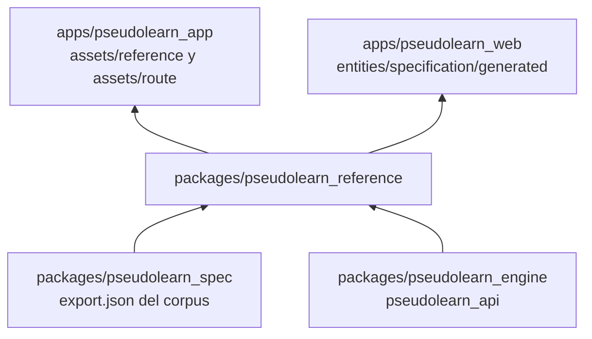
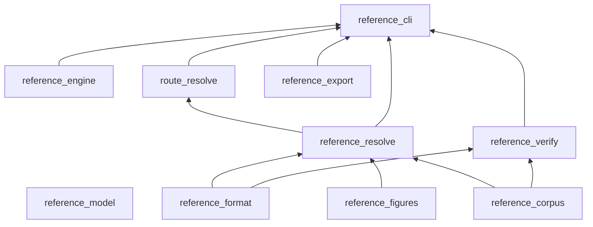
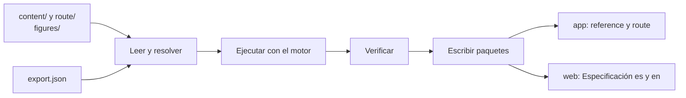

# pseudolearn_reference

Compilador de los dos libros de PseudoLearn: la **Especificación ilustrada** (`content/`) y la **ruta de aprendizaje**
(`route/`). Lee fuentes en Markdown con directivas y figuras SVG, ejecuta cada programa con el motor real, verifica lo
que promete el texto y publica paquetes de datos neutrales (JSON y SVG) que consumen la app Flutter y la web.

**No hace:** definir el lenguaje (eso es el corpus de `pseudolearn_spec`), pintar nada ni desplegarse. Es una
herramienta de construcción: el binario se llama `reference`.

## Dónde encaja

## Arquitectura

Un crate por capa. El diagrama omite las aristas hacia `reference_model`, que todos importan.

También se omiten las aristas de `reference_corpus`, `reference_figures` y `reference_format` hacia `reference_cli`, y
la de `reference_format` hacia `route_resolve`.

| Crate               | Responsabilidad                                                                    |
|---------------------|------------------------------------------------------------------------------------|
| `reference_model`   | Documento fuente, bloques, secciones publicadas, violaciones y puerto `CodeEngine` |
| `reference_format`  | Lector del Markdown con directivas                                                 |
| `reference_corpus`  | Léxico, fichas, diagnósticos y gramática leídos de la exportación del corpus       |
| `reference_engine`  | Adaptador del puerto sobre `pseudolearn_api` (tokenizar, traducir, ejecutar)       |
| `reference_figures` | Contrato SVG, kit de piezas y capas por paso                                       |
| `reference_resolve` | Fuente → sección publicada de la Especificación                                    |
| `route_resolve`     | Lección y ejercicio fuente → lección y ejercicio publicados                        |
| `reference_verify`  | Verificadores `REF-*` y `RUTA-*` y cobertura                                       |
| `reference_export`  | Paquetes por edición con manifiesto de huellas                                     |
| `reference_cli`     | Binario `reference`; única capa que toca el disco                                  |
| `xtask`             | `cargo xtask verify`                                                               |

## Flujo principal

Flujo de datos de `reference build`, no de dependencias.

La edición web contiene solo `es/es` y `en/en`, y solo `toc.json` y las secciones. Los esquemas de los paquetes están en
`schemas/`.

## Reglas que conviene saber

- Cada capa solo importa lo que `architecture.yaml` le permite; solo `reference_engine` depende del motor
  (`pseudolearn_api` con `test-host`).
- Archivos de 300 líneas, funciones de 40 y 4 parámetros posicionales como máximo; nombres de al menos tres caracteres.
- Sin `unsafe`, sin comentarios y sin `allow`/`expect`; el contenido va en español e inglés con paridad estructural.
- Los paquetes de la app y de la web se generan con `reference build`; nunca se editan a mano (`GEN-NO-HAND-COPY`).
  `reference check` falla si están obsoletos.
- Las figuras ocupan 340 unidades de ancho y usan roles de color, no colores fijos.

## Comandos útiles

| Para qué                                      | Comando                                                                                  |
|-----------------------------------------------|------------------------------------------------------------------------------------------|
| Exportar el corpus (previo a compilar)        | `(cd ../pseudolearn_spec && cargo run --locked -p see_cli --bin see -- export --root .)` |
| Compilar y escribir los tres paquetes         | `cargo run -p reference_cli -- build`                                                    |
| Verificar todo y detectar paquetes obsoletos  | `cargo run -p reference_cli -- check`                                                    |
| Informe de cobertura de ambos libros          | `cargo run -p reference_cli -- coverage`                                                 |
| Registrar las huellas de las anclas revisadas | `cargo run -p reference_cli -- lock`                                                     |
| Verificación completa del miembro             | `cargo xtask verify`                                                                     |

Opciones: `--root`, `--out`, `--out-ruta`, `--out-web` y `--borrador` (escribe aunque haya violaciones; solo para
redactar). Requisitos: `cargo` y `rustup` con la versión de `rust-toolchain.toml`, y `cargo-deny`.
