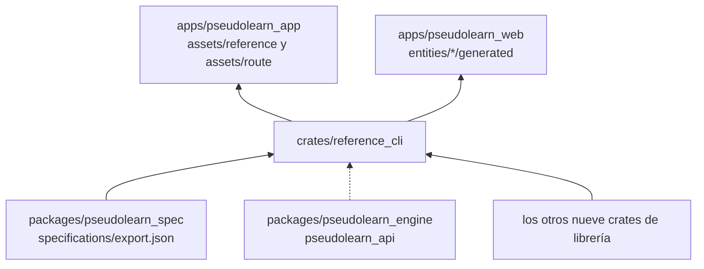
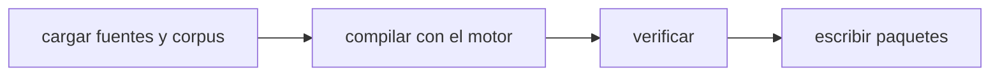

# reference_cli

Binario `reference`: carga las fuentes y el corpus, compila ambos libros, ejecuta los verificadores y escribe o compara
los paquetes de datos. Es el único crate del miembro que toca el disco.

**No hace:** no define reglas ni formatos; los orquesta. No pinta ni se despliega.

## Dónde encaja

La línea punteada es indirecta: el motor llega por `reference_engine`.

## Arquitectura

| Pieza                                               | Responsabilidad                                                                       |
|-----------------------------------------------------|---------------------------------------------------------------------------------------|
| `commands`                                          | Argumentos, comandos `build`, `check`, `coverage` y `lock` y códigos de salida        |
| `workspace`, `workspace_files`, `route_workspace`   | Lectura de `content/`, `route/`, `figures/`, `categories.json`, candado y exclusiones |
| `book`, `route_book`                                | Compilación de ediciones y paquetes con el motor                                      |
| `checks`, `route_checks`, `route_coverage`, `links` | Ejecución de verificadores y cobertura                                                |
| `bundle_files`, `web_bundles`, `edition_key`        | Escritura y comparación de paquetes; ruta de cada edición; web `es` y `en`            |

## Flujo principal

Flujo de datos de `reference build`, no de dependencias.

`build` solo escribe si no hay violaciones, salvo con `--borrador`. `check` añade las violaciones `*-BUNDLE-STALE`
cuando lo escrito difiere de lo compilado.

## Reglas que conviene saber

- Salida 0: sin violaciones; 1: hay violaciones; 2: argumentos o lectura inválidos.
- Por defecto escribe en `apps/pseudolearn_app/assets/reference` y `assets/route`, y en
  `apps/pseudolearn_web/src/entities/specification/generated` y `learning-route/generated`; los paquetes generados no se
  editan a mano.
- Importa los otros nueve crates de librería; su única dependencia externa es `serde_json`.
- Lee el corpus de `../pseudolearn_spec/specifications/export.json`, así que la exportación debe existir antes.

## Comandos útiles

| Para qué                       | Comando                                  |
|--------------------------------|------------------------------------------|
| Compilar y escribir paquetes   | `cargo run -p reference_cli -- build`    |
| Verificar y detectar obsoletos | `cargo run -p reference_cli -- check`    |
| Cobertura de ambos libros      | `cargo run -p reference_cli -- coverage` |
| Registrar las anclas revisadas | `cargo run -p reference_cli -- lock`     |
| Probar este crate              | `cargo test -p reference_cli`            |

Opciones: `--root`, `--out`, `--out-ruta`, `--out-web`, `--out-web-ruta` y `--borrador`. Requisitos: la exportación del
corpus generada y el Rust de `rust-toolchain.toml`.
