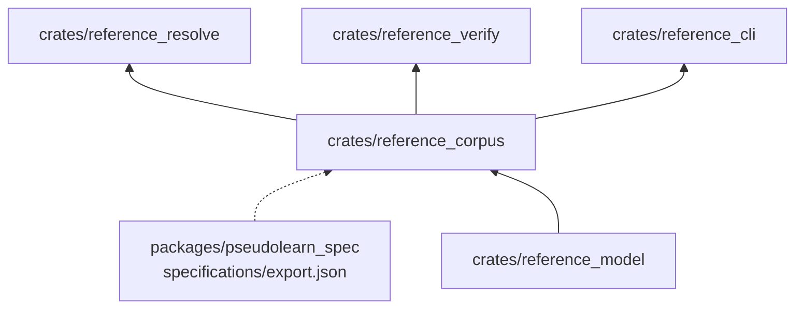

# reference_corpus

Vista de solo lectura del corpus de especificaciones: léxico, especificaciones con sus reglas y huellas, diagnósticos,
fichas, funciones y producciones de la gramática, leídos del `export.json`.

**No hace:** no define el lenguaje ni lee archivos; recibe el texto de la exportación ya cargado.

## Dónde encaja

La línea punteada es un dato, no una dependencia: lo lee `reference_cli` y se lo entrega a `Corpus::from_export`.

## Arquitectura

| Pieza                        | Responsabilidad                                                                    |
|------------------------------|------------------------------------------------------------------------------------|
| `Corpus`                     | `from_export`, `rule_exists` y `anchor_digest`; guarda también la huella del texto |
| `lexicon`, `lexicon_loading` | Léxico por familia (reservada, contextual, función, operación) y `fold`            |
| `specifications`             | `SpecificationEntry` y `anchor_parts` para separar especificación y regla          |
| `catalogs`                   | Fichas, diagnósticos, funciones y producciones                                     |

## Reglas que conviene saber

- Solo importa `reference_model`; dependencias externas: `serde`, `serde_json` y `sha2` (`architecture.yaml`).
- Un `export.json` sin la clave `resources` devuelve error; no se supone un corpus vacío.
- El corpus es la fuente de verdad del lenguaje: este crate no añade ni corrige entradas.

## Comandos útiles

| Para qué          | Comando                          |
|-------------------|----------------------------------|
| Probar este crate | `cargo test -p reference_corpus` |
| Verificar todo    | `cargo xtask verify`             |

Requisitos: ejecutar desde `packages/pseudolearn_reference` con el Rust de `rust-toolchain.toml`.
