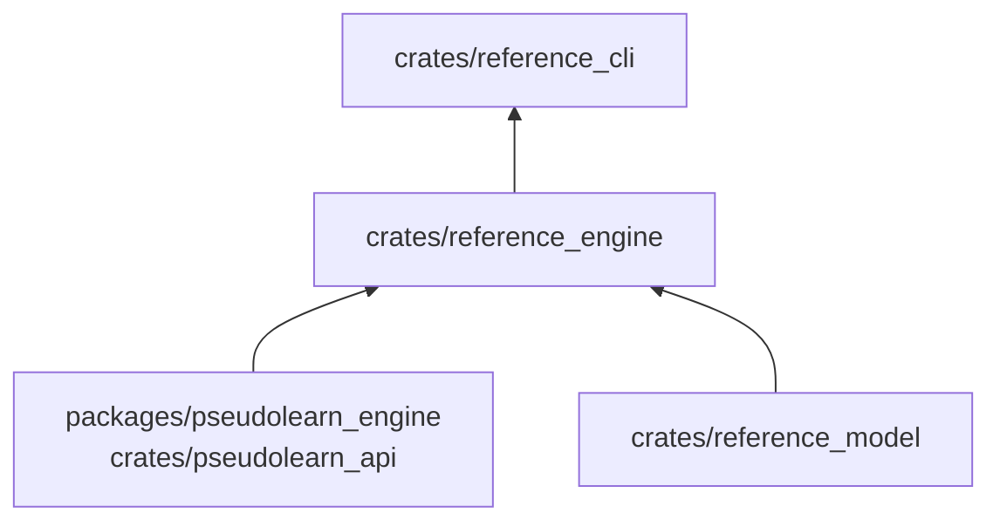

# reference_engine

Adaptador que implementa el puerto `CodeEngine` sobre `pseudolearn_api`: tokeniza, traduce entre perfiles, ejecuta
programas, devuelve el código intermedio y la vista del programa.

**No hace:** no interpreta los resultados ni decide qué ejemplo es válido; devuelve lo que el motor produce.

## Dónde encaja

## Arquitectura

| Pieza       | Responsabilidad                                                                               |
|-------------|-----------------------------------------------------------------------------------------------|
| `ApiEngine` | Implementa `tokenize`, `translate`, `execute`, `intermediate`, `program_view` y `fingerprint` |
| `tokens`    | Fichas del motor convertidas a `RawToken`                                                     |
| `offsets`   | Línea y columna a desplazamiento en el texto                                                  |
| `execution` | Petición y respuesta de `execute_program`, con semilla fija 42                                |
| `view`      | Proyección del programa a `ProgramView`                                                       |

`fingerprint` concatena la versión del motor y la del protocolo, así que cambia cuando el motor cambia.

## Reglas que conviene saber

- Es el único crate del miembro que depende del motor (`pseudolearn_api` con la característica `test-host`).
- Un documento de anfitrión con JSON inválido produce un informe `rejected` con el diagnóstico `invalidHostDocument`, no
  un error.
- La semilla es 42 en toda ejecución, para que las salidas se repitan.

## Comandos útiles

| Para qué          | Comando                          |
|-------------------|----------------------------------|
| Probar este crate | `cargo test -p reference_engine` |
| Verificar todo    | `cargo xtask verify`             |

Requisitos: ejecutar desde `packages/pseudolearn_reference` con el Rust de `rust-toolchain.toml`.
