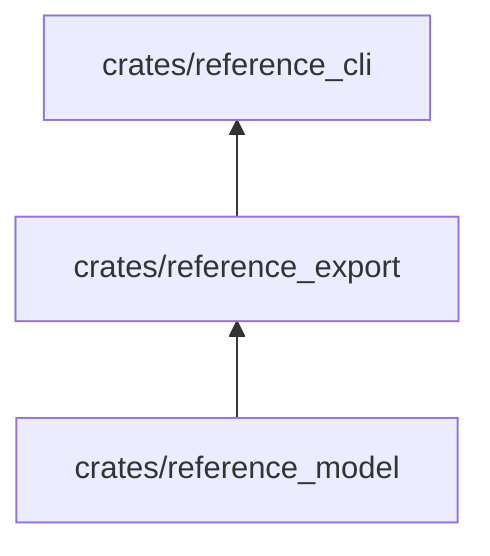

# reference_export

Arma los paquetes de datos de cada edición: secciones, lecciones y ejercicios en JSON, índice, búsqueda, enlaces y un
manifiesto con la huella de cada archivo.

**No hace:** no escribe en disco ni decide dónde van los paquetes; devuelve mapas de ruta a texto.

## Dónde encaja

## Arquitectura

| Pieza          | Responsabilidad                                                                                                            |
|----------------|----------------------------------------------------------------------------------------------------------------------------|
| `bundle`       | `build_bundle`: `sections/<id>.json`, `toc.json`, `search.json`, `links.json` y `manifest.json`                            |
| `route_bundle` | `build_route_bundle`: `lessons/<id>.json`, `exercises/<id>.json`, `toc.json`, `terms.json` y `manifest.json`; `spec_links` |
| `parts`        | `parse_parts`: partes y orden del índice                                                                                   |
| `search`       | Entradas de búsqueda a partir de las secciones                                                                             |
| `manifest`     | `digest` (SHA-256 en hexadecimal) y el manifiesto con formato, idioma, perfil, corpus y motor                              |

Los formatos son `pseudolearn-reference/1` (`FORMAT`) y `pseudolearn-route/1` (`ROUTE_FORMAT`).

## Reglas que conviene saber

- Solo importa `reference_model`; dependencias externas: `serde`, `serde_json` y `sha2`.
- El manifiesto lista la huella SHA-256 de todos los archivos del paquete salvo la suya.
- Sin entrada ni salida: la escritura y la comparación con lo publicado son de `reference_cli`.

## Comandos útiles

| Para qué              | Comando                               |
|-----------------------|---------------------------------------|
| Probar este crate     | `cargo test -p reference_export`      |
| Escribir los paquetes | `cargo run -p reference_cli -- build` |

Requisitos: ejecutar desde `packages/pseudolearn_reference` con el Rust de `rust-toolchain.toml`.
