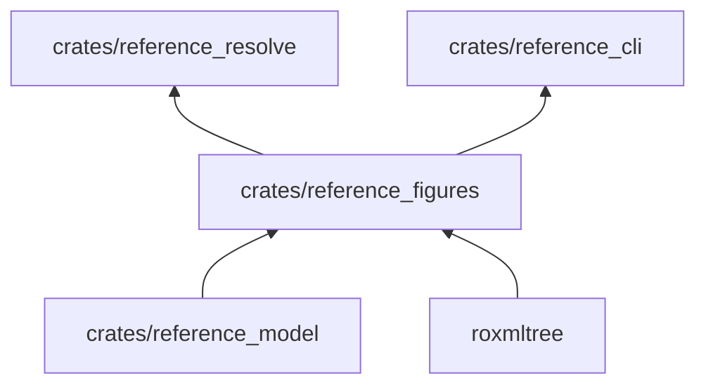
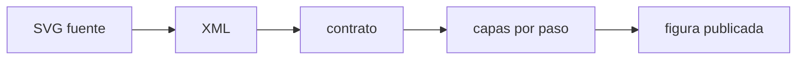

# reference_figures

Renderiza las figuras SVG de los libros: valida el contrato, sustituye marcadores, aplica la paleta por roles y separa
las capas por paso.

**No hace:** no dibuja en pantalla ni elige el contenido de las figuras; recibe el SVG fuente y devuelve SVG neutral.

## Dónde encaja

## Arquitectura

| Pieza          | Responsabilidad                                                                              |
|----------------|----------------------------------------------------------------------------------------------|
| `contract`     | Ancho fijo `FIGURE_WIDTH` (340), tamaño mínimo de letra 12, elementos y atributos permitidos |
| `palette`      | Trece `ColorRole` con marcadores y las familias `IBMPlexSans` e `IBMPlexMono`                |
| `placeholders` | `FigureContext` y la sustitución de marcadores de texto                                      |
| `kit`          | Piezas de la figura: cajas y flechas                                                         |
| `steps`        | Atributos `data-paso` y `data-hasta`; `step_count`                                           |
| `writer`       | `render_figure`: recorre el XML y emite `RenderedFigure` con sus `RenderedLayer`             |

## Flujo principal

Los incumplimientos devuelven una lista de `Violation`, no un SVG parcial.

## Reglas que conviene saber

- Solo importa `reference_model`; dependencia externa única: `roxmltree`.
- Una figura solo usa los elementos y atributos permitidos y colores como roles, no valores fijos.
- Un tamaño de letra menor de 12 o un `viewBox` que no mide 340 de ancho se rechazan con `REF-FIGURE-NARROW`; el resto
  de incumplimientos, con `REF-FIGURE-CONTRACT`.

## Comandos útiles

| Para qué          | Comando                           |
|-------------------|-----------------------------------|
| Probar este crate | `cargo test -p reference_figures` |
| Verificar todo    | `cargo xtask verify`              |

Requisitos: ejecutar desde `packages/pseudolearn_reference` con el Rust de `rust-toolchain.toml`.
