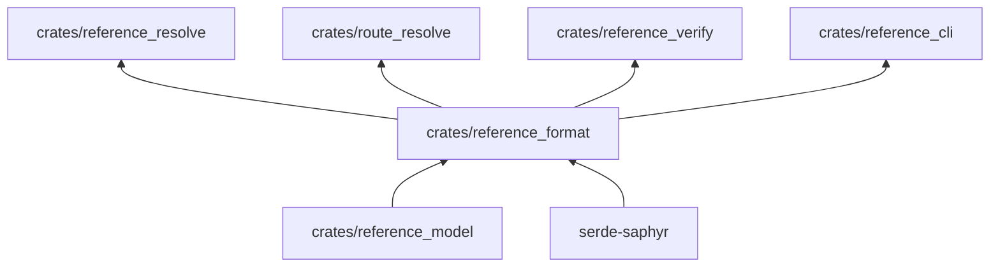
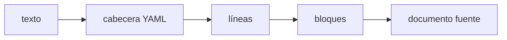

# reference_format

Lector del Markdown con directivas: separa la cabecera YAML, clasifica las líneas, ensambla los bloques y devuelve
documentos fuente tipados.

**No hace:** no resuelve enlaces, no ejecuta programas ni valida el contenido; solo reconoce la forma del texto.

## Dónde encaja

## Arquitectura

| Pieza                                      | Responsabilidad                                                 |
|--------------------------------------------|-----------------------------------------------------------------|
| `front_matter`                             | Exige el bloque `---` inicial y lo deserializa como YAML        |
| `line_kind`, `assembly`                    | Clasifican cada línea y las agrupan en bloques                  |
| `fence`, `fence_blocks`, `route_fences`    | Vallas de código con nombre y atributos (`parse_fence_opening`) |
| `anatomy_body`, `figure_body`, `table_row` | Cuerpos de las directivas de anatomía, figura y tabla           |
| `inline_parser`, `summary_tags`            | Texto en línea (`parse_inline`) y etiquetas de resumen          |
| `lib`                                      | `parse_document`, `parse_lesson` y `parse_exercise`             |

## Flujo principal

Un fallo no lanza error: devuelve una `Violation` con `REF-FORMAT` (Especificación) o `RUTA-FORMAT` (ruta).

## Reglas que conviene saber

- Solo importa `reference_model`; dependencias externas: `serde` y `serde-saphyr` (`architecture.yaml`).
- Un documento sin `---` inicial o con la cabecera sin cerrar se rechaza.
- No hace entrada o salida: recibe la ruta y el texto ya leídos.

## Comandos útiles

| Para qué          | Comando                          |
|-------------------|----------------------------------|
| Probar este crate | `cargo test -p reference_format` |
| Verificar todo    | `cargo xtask verify`             |

Requisitos: ejecutar desde `packages/pseudolearn_reference` con el Rust de `rust-toolchain.toml`.
