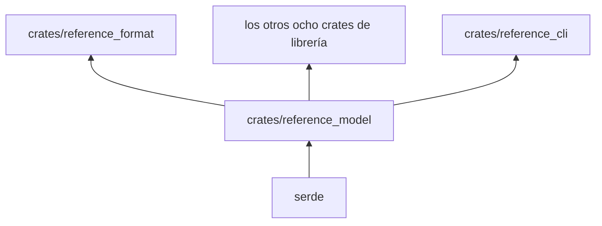

# reference_model

Vocabulario compartido de `pseudolearn_reference`: los documentos fuente (Especificación y ruta), las secciones,
lecciones y ejercicios publicados, las violaciones `REF-*` y `RUTA-*` y el puerto `CodeEngine`.

**No hace:** no lee archivos, no ejecuta código ni verifica nada; solo define tipos y su serialización.

## Dónde encaja

## Arquitectura

| Grupo                                                        | Contenido                                                                                 |
|--------------------------------------------------------------|-------------------------------------------------------------------------------------------|
| Fuente: `source_*`, `route_source`, `route_header`, `header` | Documentos, bloques, programas, figuras, cabeceras y `Profile` (`es` y `en`)              |
| Publicado: `published*`, `route_published`, `route_exercise` | Secciones, programas con ejecuciones, lecciones y ejercicios tal como se escriben en JSON |
| `violation`                                                  | `RuleId` (códigos serializados como `REF-FORMAT`, `RUTA-ANATOMY`…) y `Violation`          |
| `engine_port`, `program_view`                                | Rasgo `CodeEngine` y sus tipos de petición, informe y vista del programa                  |
| `route_check`, `category`, `callout`, `section_kind`         | Comprobaciones de la ruta, categorías de ficha, tipos de llamada y de sección             |

## Reglas que conviene saber

- Única dependencia: `serde` (con `serde_json` solo en pruebas); `architecture.yaml` permite `serde` y `serde_json`.
- `CodeEngine` es el único punto por el que el resto del miembro toca el motor; su implementación vive en
  `reference_engine`.
- Ningún tipo de este crate hace entrada o salida.

## Comandos útiles

| Para qué          | Comando                         |
|-------------------|---------------------------------|
| Probar este crate | `cargo test -p reference_model` |
| Verificar todo    | `cargo xtask verify`            |

Requisitos: ejecutar desde `packages/pseudolearn_reference` con el Rust de `rust-toolchain.toml`.
