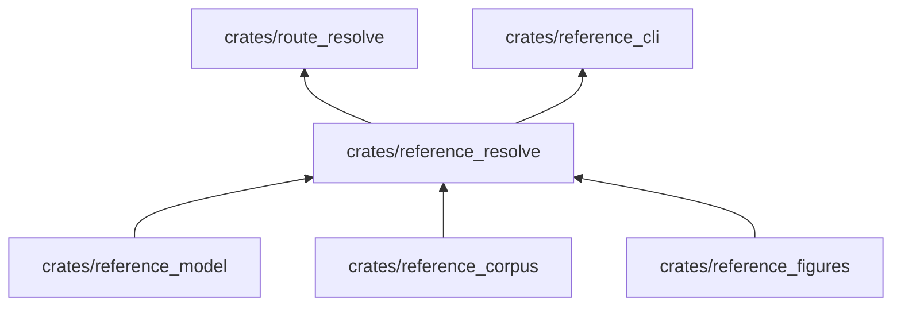

# reference_resolve

Convierte un documento fuente de la Especificación en una sección publicada: resuelve bloques, programas, figuras,
tablas generadas, llamadas y trazas ejecutando el código con el motor.

**No hace:** no lee archivos, no verifica reglas del libro ni resuelve la ruta; eso es de `reference_cli`,
`reference_verify` y `route_resolve`.

## Dónde encaja

`reference_format` es dependencia solo de pruebas.

## Arquitectura

| Pieza                                                      | Responsabilidad                                                                    |
|------------------------------------------------------------|------------------------------------------------------------------------------------|
| `section`, `blocks`                                        | `resolve_section` y `resolve_blocks`: recorren el documento y publican cada bloque |
| `programs`, `runs`, `trace`                                | Programas ejecutados, fichas coloreadas y trazas del motor                         |
| `anatomy`, `forms`, `callouts`                             | Anatomías de sintaxis, formas y llamadas                                           |
| `figures`                                                  | `figure_block`: delega el SVG en `reference_figures`                               |
| `generated`, `generated_tables`                            | Tablas derivadas del corpus                                                        |
| `section_index`, `categories`, `language_pack`, `spelling` | Índice de secciones, `CategoryTable`, textos de interfaz y ortografía canónica     |
| `resolution`, `cached_engine`                              | `Resolution`, `Collector`, `SpanishReuse` y `CachedEngine`, que memoriza al motor  |

## Reglas que conviene saber

- Importa `reference_model`, `reference_corpus`, `reference_figures` y `reference_format`; dependencias externas:
  `serde` y `serde_json` (`architecture.yaml`).
- Recibe el motor por el rasgo `CodeEngine`; `CachedEngine` guarda fichas, traducciones y ejecuciones para no repetir
  trabajo.
- Un fallo se acumula como `Violation` en el `Collector`; la resolución sigue y devuelve todas.
- `SpanishReuse` deja que la edición inglesa reutilice los programas de la española.

## Comandos útiles

| Para qué          | Comando                           |
|-------------------|-----------------------------------|
| Probar este crate | `cargo test -p reference_resolve` |
| Verificar todo    | `cargo xtask verify`              |

Requisitos: ejecutar desde `packages/pseudolearn_reference` con el Rust de `rust-toolchain.toml`.
