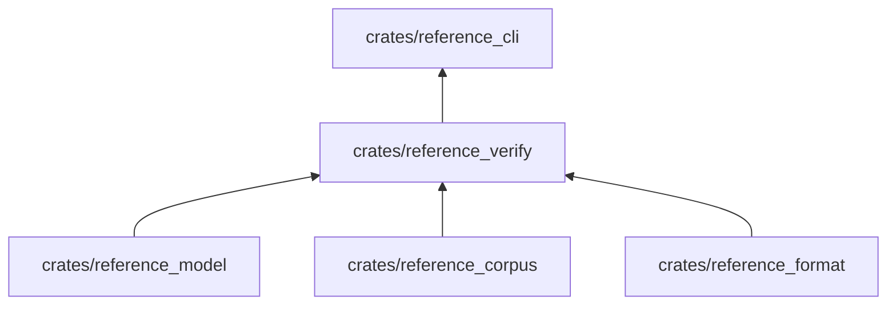

# reference_verify

Verificadores de los libros: reglas `REF-*` de la Especificación, reglas `RUTA-*` de la ruta, el candado de anclas y la
medición de cobertura contra el corpus.

**No hace:** no lee archivos, no escribe paquetes ni resuelve contenido; recibe documentos ya leídos y devuelve
`Violation`.

## Dónde encaja

## Arquitectura

| Pieza                                                                   | Responsabilidad                                                                           |
|-------------------------------------------------------------------------|-------------------------------------------------------------------------------------------|
| `anchors`                                                               | `check_anchors`, `check_lock`, `build_lock` y `AnchorLock`                                |
| `anatomy`, `parity`, `inline_code`, `internal_ids`, `links`, `examples` | Reglas `REF-*` sobre la Especificación                                                    |
| `coverage`, `coverage_items`                                            | `measure_coverage`: léxico, fichas, diagnósticos y especificaciones cubiertos             |
| `route_*`                                                               | Reglas `RUTA-*`: anatomía, términos, enlaces, mezcla de ejercicios, paridad y ejecuciones |
| `program_parity`, `program_skeleton`                                    | Paridad estructural de los programas entre ediciones                                      |
| `route_book`                                                            | `RouteBook`: lecciones, ejercicios y términos como una sola vista                         |
| `source_walk`                                                           | Recorrido común de los bloques fuente                                                     |

## Reglas que conviene saber

- Importa `reference_model`, `reference_corpus` y `reference_format`; dependencias externas: `serde`, `serde_json` y
  `sha2` (`architecture.yaml`).
- La cobertura mide los prefijos `LANG.`, `LIB.`, `ENG.`, `MEM.` y `RT.`; las exclusiones se leen de
  `coverage-exclusions.json`, y cada una lleva su motivo.
- Las aserciones estructurales de un ejercicio (`route_structure`) se contrastan con la vista del programa de la
  solución de referencia, que obtiene `route_resolve`.

## Comandos útiles

| Para qué               | Comando                                  |
|------------------------|------------------------------------------|
| Probar este crate      | `cargo test -p reference_verify`         |
| Verificar ambos libros | `cargo run -p reference_cli -- check`    |
| Ver la cobertura       | `cargo run -p reference_cli -- coverage` |

Requisitos: ejecutar desde `packages/pseudolearn_reference` con el Rust de `rust-toolchain.toml`.
