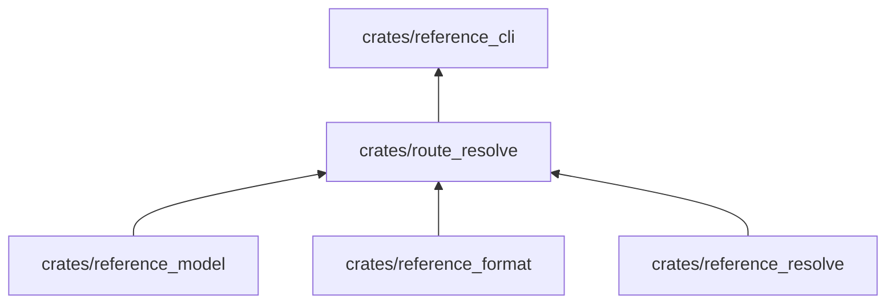

# route_resolve

Convierte las lecciones y los ejercicios fuente de la ruta de aprendizaje en lecciones y ejercicios publicados, con el
catálogo de términos y ejercicios que los une.

**No hace:** no lee archivos ni escribe paquetes, y no repite la Especificación: la enlaza.

## Dónde encaja

`reference_corpus` es dependencia solo de pruebas.

## Arquitectura

| Pieza                                                | Responsabilidad                                                                                                          |
|------------------------------------------------------|--------------------------------------------------------------------------------------------------------------------------|
| `catalog`                                            | `build_catalog`: `RouteCatalog` con `TermCard` y `ExerciseSummary`                                                       |
| `lesson`, `lesson_blocks`, `route_callouts`, `zones` | `resolve_lesson`, sus bloques y llamadas, y las entradas de lista por zona                                               |
| `exercise`, `exercise_runs`                          | `resolve_exercise` y las ejecuciones de la solución de referencia                                                        |
| `evaluation`, `evaluation_order`                     | Casos y comprobación del ejercicio (`exercise_check`), vallas reutilizadas del español y orden de aserciones y programas |
| `laps`                                               | `instrument`: inserta sondas `⟦ ⟧` para observar las filas de una tabla de vueltas                                       |
| `ordering`                                           | `shuffled_order`: orden determinista a partir de una semilla de texto                                                    |
| `context`                                            | `RouteContext`: resolución, catálogo, Especificación publicada y lección actual                                          |

## Reglas que conviene saber

- Importa `reference_model`, `reference_format` y `reference_resolve`; no declara dependencias externas.
- El orden barajado es estable: la misma semilla da siempre el mismo orden, y nunca devuelve la identidad si hay más de
  un elemento.
- Reutiliza `Collector` y `SpanishReuse` de `reference_resolve`, igual que la Especificación.

## Comandos útiles

| Para qué          | Comando                       |
|-------------------|-------------------------------|
| Probar este crate | `cargo test -p route_resolve` |
| Verificar todo    | `cargo xtask verify`          |

Requisitos: ejecutar desde `packages/pseudolearn_reference` con el Rust de `rust-toolchain.toml`.
