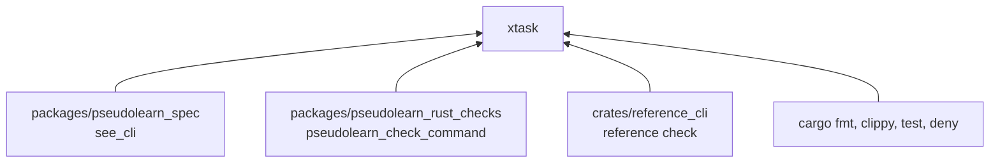
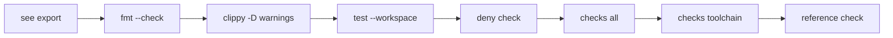

# xtask

Puerta de calidad de `pseudolearn_reference`: exporta el corpus y ejecuta en orden los verificadores del miembro,
incluido `reference check`. Se invoca con el alias `cargo xtask`.

**No hace:** no compila ni escribe los paquetes de datos; eso lo hace el binario `reference`.

## Dónde encaja

`xtask/Cargo.toml` no declara dependencias: todo se invoca como proceso de `cargo`.

## Flujo principal

Orden de ejecución; el primer paso que falla detiene el resto.

`export` corre en `../pseudolearn_spec`; el resto, en la carpeta del miembro. `checks toolchain ../..` revisa la raíz
del monorepo y `reference check` falla si hay violaciones o paquetes obsoletos.

## Reglas que conviene saber

- Único argumento aceptado: `verify`; cualquier otro imprime el uso y termina con error.
- Capa `tooling` sin imports ni dependencias externas en `architecture.yaml`.
- Las rutas a los otros miembros son relativas, así que solo funciona desde `packages/pseudolearn_reference`.

## Comandos útiles

| Para qué              | Comando               |
|-----------------------|-----------------------|
| Verificación completa | `cargo xtask verify`  |
| Probar este crate     | `cargo test -p xtask` |

Requisitos: Rust 1.99.0 con rustfmt y Clippy, `cargo-deny` y las cadenas de `pseudolearn_spec` y
`pseudolearn_rust_checks`.
