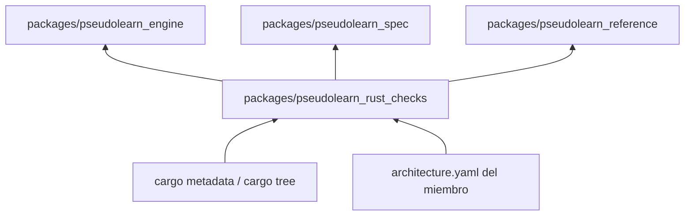
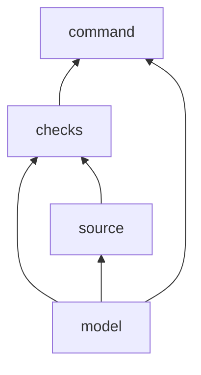
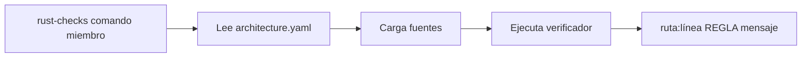

# pseudolearn_rust_checks

Verificadores mecánicos para los miembros Rust del monorepo: comentarios, nombres, tamaños, capas, aislamiento por
destino, `unsafe` y atributos. Cada miembro declara sus reglas en su `architecture.yaml` y este paquete las hace
cumplir.

**No hace:** no implementa el lenguaje ni el sistema `see`, y no verifica miembros que no sean Rust.

## Dónde encaja

Los tres consumidores lo invocan desde su `xtask` con `--manifest-path ../pseudolearn_rust_checks/Cargo.toml`. El
paquete también se verifica a sí mismo.

## Arquitectura

`xtask` queda aparte, sin dependencias internas.

| Pieza   | Crate                       | Responsabilidad                                               |
|---------|-----------------------------|---------------------------------------------------------------|
| model   | `pseudolearn_check_model`   | Reglas (`Architecture`) y diagnósticos (`Violation`)          |
| source  | `pseudolearn_check_source`  | Lee `architecture.yaml` y los fuentes Rust; tokeniza          |
| checks  | `pseudolearn_checks`        | Un módulo por verificador, más `declarative` y `toolchain`    |
| command | `pseudolearn_check_command` | Binario `rust-checks`: argumentos, salida y código de salida  |
| xtask   | `xtask`                     | `cargo xtask verify`: la puerta de calidad del propio paquete |

## Flujo principal

Flujo de ejecución, no de dependencias.

`layers` e `isolation` no cargan fuentes: usan `cargo metadata` y `cargo tree`. Salida 0: válido; 1: violaciones; 2:
configuración o lectura inválida.

## Reglas que conviene saber

- Cada capa declara en `architecture.yaml` qué puede importar y qué dependencias externas admite.
- Sin `unsafe`: `#![forbid(unsafe_code)]` en todo el workspace y `unsafe_allowed: false` en todas las capas.
- Clippy deniega `unwrap`, `expect`, `panic`, indexado, aritmética implícita y `as`.
- Límites: 300 líneas por archivo, 40 por función, 4 parámetros, anidación 3 y 7 métodos públicos por tipo.
- Los fixtures de `fixtures/` son violaciones deliberadas; no son fuentes del producto.
- **Licencia**: el miembro no se publica (`publish = false` en todos sus crates). `LICENSE` y `NOTICE` son idénticos a los de la raíz, de modo que quien lo lea en el repositorio tiene los mismos términos que el resto; publicar en un registro sería una decisión nueva que cambiaría `publish`.

## Comandos útiles

| Para qué                                                                                | Comando                                                                       |
|-----------------------------------------------------------------------------------------|-------------------------------------------------------------------------------|
| Verificación completa                                                                   | `cargo xtask verify`                                                          |
| Todos los verificadores sobre un miembro                                                | `cargo run -p pseudolearn_check_command --bin rust-checks -- all <miembro>`   |
| Uno solo (`layers`, `isolation`, `comments`, `names`, `limits`, `unsafe`, `attributes`) | `cargo run -p pseudolearn_check_command --bin rust-checks -- comments .`      |
| Versión de Rust idéntica entre miembros                                                 | `cargo run -p pseudolearn_check_command --bin rust-checks -- toolchain ../..` |
| Tests                                                                                   | `cargo test --workspace`                                                      |
| Binario de release                                                                      | `cargo build --release` (salida en `target/release/rust-checks`)              |

Requisitos: Rust 1.99.0 con rustfmt y Clippy (`rust-toolchain.toml`) y `cargo-deny`
(`cargo install cargo-deny --locked`). `all` no incluye `toolchain`.
