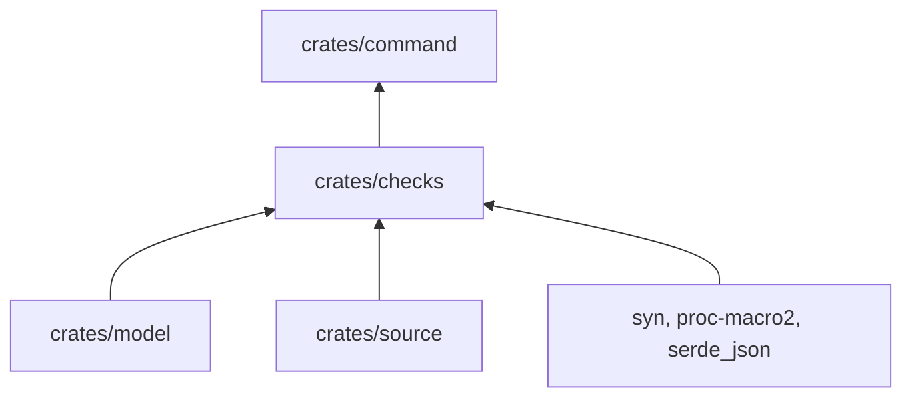

# pseudolearn_checks

Los verificadores: un módulo por regla mecánica de calidad, más la comprobación declarativa de capas y la de versión de
Rust. Cada uno recibe las reglas del miembro y devuelve `Violation`.

**No hace:** no tiene interfaz de línea de comandos ni imprime; eso es de `pseudolearn_check_command`.

## Dónde encaja

## Arquitectura

| Módulo       | Qué verifica                                                                                                        | Reglas                                            |
|--------------|---------------------------------------------------------------------------------------------------------------------|---------------------------------------------------|
| `layers`     | Cada crate de `cargo metadata` está declarado y solo depende de lo permitido; `declarative` lo hace sin manifiestos | `LAYER-DECLARED`, `LAYER-DIRECTION`, `SPEC-FIRST` |
| `isolation`  | Paquetes y características alcanzables con `cargo tree` por destino                                                 | `LAYER-DIRECTION`                                 |
| `comments`   | Comentarios y atributos `doc`                                                                                       | `QUALITY-NO-COMMENTS`                             |
| `attributes` | `allow` y `expect`, incluso dentro de `cfg_attr`                                                                    | `QUALITY-NO-COMMENTS`                             |
| `names`      | Longitud mínima y componentes o archivos prohibidos                                                                 | `QUALITY-SEMANTIC-NAMES`                          |
| `limits`     | Líneas por archivo y función, parámetros, anidación y métodos públicos                                              | `SIZE-*`                                          |
| `safety`     | `unsafe` solo en capas permitidas, en funciones breves y con fila en la tabla del README                            | `QUALITY-UNSAFE-INVARIANT`                        |
| `toolchain`  | Todos los `rust-toolchain.toml` de un árbol fijan la misma versión exacta                                           |                                                   |

`verify("all", …)` ejecuta los siete primeros; `toolchain` va aparte.

## Reglas que conviene saber

- Importa `pseudolearn_check_model` y `pseudolearn_check_source`; dependencias externas: `syn`, `proc-macro2` y
  `serde_json`.
- Un fallo esperable es una `Violation`; un `Err` solo significa que la configuración o la lectura son inválidas.
- `safety` lee el `README.md` de cada capa: el archivo debe existir y, si la capa tiene `unsafe`, contener la tabla
  «Invariantes de `unsafe`» con una fila por función, en ambos sentidos.
- `layers` en modo `declarative` exige un `README.md` por capa declarada y rechaza carpetas de crate no declaradas.
- Los fixtures de `fixtures/` son violaciones deliberadas y se prueban como casos negativos.

## Comandos útiles

| Para qué                  | Comando                                                                       |
|---------------------------|-------------------------------------------------------------------------------|
| Probar este crate         | `cargo test -p pseudolearn_checks`                                            |
| Aplicar un verificador    | `cargo run -p pseudolearn_check_command --bin rust-checks -- names <miembro>` |
| Verificar todo el paquete | `cargo xtask verify`                                                          |

Requisitos: ejecutar desde `packages/pseudolearn_rust_checks` con el Rust de `rust-toolchain.toml`; `layers` e
`isolation` necesitan `cargo` en el `PATH`.
