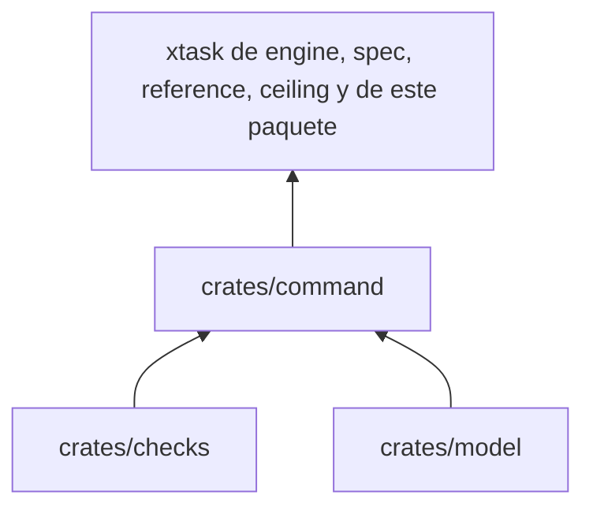
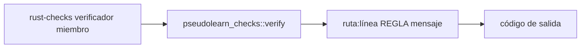

# pseudolearn_check_command

Binario `rust-checks`: recibe un verificador y la carpeta de un miembro, ejecuta `pseudolearn_checks` e imprime los
hallazgos con su código de salida.

**No hace:** no contiene reglas ni lógica de verificación; solo traduce argumentos y resultados.

## Dónde encaja

## Flujo principal

Flujo de ejecución, no de dependencias.

Verificadores aceptados: `all`, `layers`, `isolation`, `comments`, `names`, `limits`, `unsafe`, `attributes` y
`toolchain`. `toolchain` no imprime hallazgos: devuelve un error o éxito.

## Reglas que conviene saber

- Salida 0: sin violaciones; 1: hay violaciones; 2: argumentos incorrectos o configuración ilegible.
- Exige exactamente dos argumentos; con otra cantidad imprime el uso y sale con 2.
- Importa `pseudolearn_checks` y `pseudolearn_check_model`; no declara dependencias externas.
- Los demás miembros lo invocan con
  `--manifest-path ../pseudolearn_rust_checks/Cargo.toml -p pseudolearn_check_command`.

## Comandos útiles

| Para qué                       | Comando                                                                          |
|--------------------------------|----------------------------------------------------------------------------------|
| Todos los verificadores        | `cargo run -p pseudolearn_check_command --bin rust-checks -- all <miembro>`      |
| Uno solo                       | `cargo run -p pseudolearn_check_command --bin rust-checks -- comments <miembro>` |
| Versión de Rust entre miembros | `cargo run -p pseudolearn_check_command --bin rust-checks -- toolchain <raíz>`   |
| Binario de release             | `cargo build --release` (salida en `target/release/rust-checks`)                 |

Requisitos: ejecutar desde `packages/pseudolearn_rust_checks` con el Rust de `rust-toolchain.toml`.
