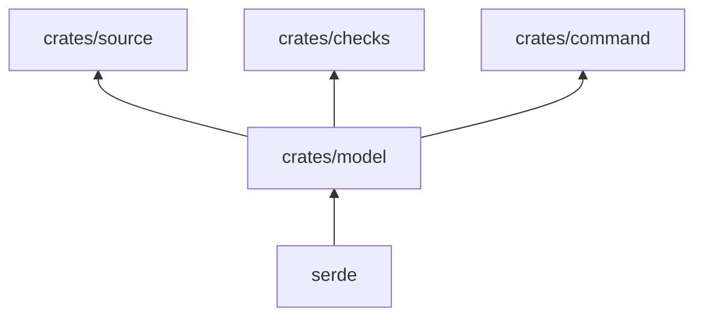

# pseudolearn_check_model

Tipos compartidos del verificador: `Architecture` (el contenido de `architecture.yaml`) y `Violation`, el hallazgo que
imprime `rust-checks`.

**No hace:** no lee archivos ni ejecuta verificaciones; solo define los datos.

## Dónde encaja

## Arquitectura

| Tipo           | Contenido                                                                                                  |
|----------------|------------------------------------------------------------------------------------------------------------|
| `Architecture` | Paquete, capas, límites, nombres, aislamiento, fuentes generadas y crates de salida determinista           |
| `Layer`        | Nombre, ruta, imports permitidos, dependencias externas y de ruta, `unsafe_allowed`, `tooling` y `pending` |
| `Limits`       | Seis límites numéricos: archivo, función, parámetros, anidación, métodos públicos y `unsafe`               |
| `Names`        | Longitud mínima, nombres cortos permitidos, componentes y archivos prohibidos                              |
| `Isolation`    | Paquete, destinos y paquetes o características prohibidos                                                  |
| `Violation`    | Ruta, línea, regla y mensaje; ordenable, y `violation()` para construirla                                  |

## Reglas que conviene saber

- Los tipos de reglas usan `deny_unknown_fields`: una clave desconocida en `architecture.yaml` es un error, no se
  ignora.
- Única dependencia: `serde`; no importa ninguna otra capa.
- Una `Violation` se ordena por ruta, línea, regla y mensaje, lo que da salida estable.

## Comandos útiles

| Para qué          | Comando                                 |
|-------------------|-----------------------------------------|
| Probar este crate | `cargo test -p pseudolearn_check_model` |
| Verificar todo    | `cargo xtask verify`                    |

Requisitos: ejecutar desde `packages/pseudolearn_rust_checks` con el Rust de `rust-toolchain.toml`.
