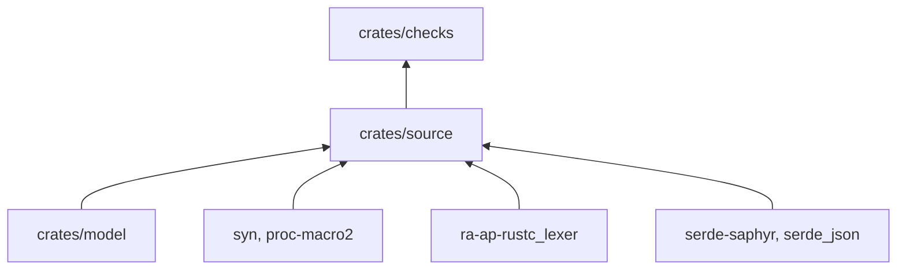
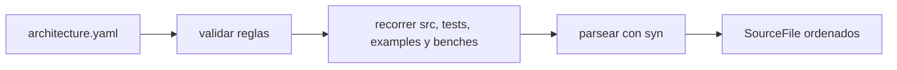

# pseudolearn_check_source

Lee `architecture.yaml` y los fuentes Rust de un miembro: los valida, los parsea con `syn` y ofrece utilidades de fichas
para localizar comentarios y palabras.

**No hace:** no decide qué es una violación; entrega fuentes y reglas ya leídas a `pseudolearn_checks`.

## Dónde encaja

## Arquitectura

| Pieza     | Responsabilidad                                                                                            |
|-----------|------------------------------------------------------------------------------------------------------------|
| `loading` | `read_architecture`, `load_sources`, `read_text` y `SourceFile` (ruta, texto, sintaxis, capa y si es test) |
| `tokens`  | `comment_lines` y `word_lines`, con el lexer de rustc                                                      |

## Flujo principal

## Reglas que conviene saber

- Importa solo `pseudolearn_check_model`; dependencias externas: `syn`, `proc-macro2`, `ra-ap-rustc_lexer`,
  `serde-saphyr` y `serde_json`.
- `read_architecture` rechaza paquete o capas vacíos, capas duplicadas, rutas fuera del miembro, imports a capas no
  declaradas y límites en cero.
- Un enlace simbólico dentro de las carpetas de fuentes es un error; las fuentes declaradas como generadas se excluyen.
- Además de `src`, `tests`, `examples` y `benches`, se lee el `build.rs` de cada capa.

## Comandos útiles

| Para qué          | Comando                                  |
|-------------------|------------------------------------------|
| Probar este crate | `cargo test -p pseudolearn_check_source` |
| Verificar todo    | `cargo xtask verify`                     |

Requisitos: ejecutar desde `packages/pseudolearn_rust_checks` con el Rust de `rust-toolchain.toml`.
