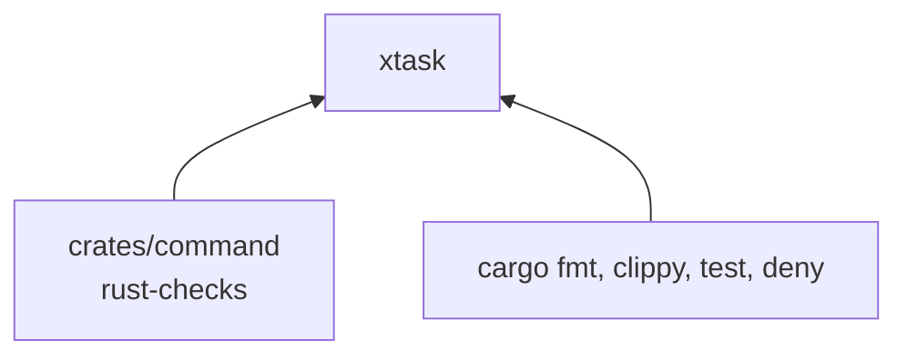
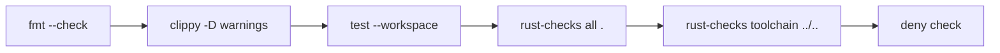

# xtask

Puerta de calidad de `pseudolearn_rust_checks`: formato, Clippy, tests, los propios verificadores del paquete aplicados
a sí mismo y `cargo-deny`. Se invoca con el alias `cargo xtask`.

**No hace:** no verifica otros miembros; para eso cada uno tiene su propio `xtask` que llama al binario `rust-checks`.

## Dónde encaja

`xtask/Cargo.toml` no declara dependencias: todo se invoca como proceso de `cargo`.

## Flujo principal

Orden de ejecución; el primer paso que falla detiene el resto.

`fmt`, `clippy` y `test` cubren todo el workspace (`clippy` con `--all-targets`). `toolchain ../..` revisa la raíz del
monorepo.

## Reglas que conviene saber

- Único argumento aceptado: `verify`; cualquier otro imprime el uso y termina con error.
- Capa `tooling` sin imports ni dependencias externas en `architecture.yaml`.
- Llama al binario desde su propio workspace (`-p pseudolearn_check_command --bin rust-checks`), a diferencia de los
  demás miembros, que usan `--manifest-path`.

## Comandos útiles

| Para qué              | Comando               |
|-----------------------|-----------------------|
| Verificación completa | `cargo xtask verify`  |
| Probar este crate     | `cargo test -p xtask` |

Requisitos: Rust 1.99.0 con rustfmt y Clippy y `cargo-deny`.
