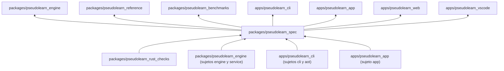
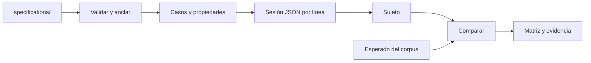

# pseudolearn_spec

Sistema de Especificaciones Ejecutables (SEE): el corpus normativo de PseudoLearn en formato `see/1`
y la herramienta `see` que lo valida, ancla, exporta y contrasta contra cada implementación. El corpus
dice qué debe hacer el lenguaje; `see` comprueba que el corpus sea íntegro y que los sujetos lo cumplan.

**No hace:** no implementa el lenguaje (eso es del motor), no se despliega ni se publica a un registro,
y registrar un vínculo regla–código no cuenta como evidencia de que se cumple.

## Dónde encaja



Aquí las flechas indican qué provee a qué: los verificadores y los sujetos alimentan la conformidad, y
los consumidores leen `specifications/export.json` (el motor lo lee en sus `build.rs`) o las fichas de
agente generadas. El paquete no declara dependencias de otros miembros en `Cargo.toml`.

## Arquitectura

Un workspace Cargo con un crate por capa. Cada flecha va de la dependencia a quien la usa; se omiten
las aristas hacia `see_model` y `see_format`, que casi todos importan.

```mermaid
flowchart BT
    model["see_model"]
    format["see_format"] --> graph["see_graph"]
    format --> change["see_change"]
    graph --> validation["see_validation"]
    change --> validation
    change --> export["see_export"]
    translation["see_translation"] --> generators["see_generators"]
    translation --> conformance["see_conformance"]
    generators --> conformance
    oracles["see_oracles"] --> conformance
    format --> report["see_report"]
    validation --> cli["see_cli"]
    conformance --> cli
    export --> cli
    report --> cli
```

| Crate | Responsabilidad |
|---|---|
| `see_model` | Entidades de los contratos |
| `see_format` | Lectura de Markdown y YAML |
| `see_oracles` | Oráculos independientes de enteros, racionales y celdas |
| `see_graph` | Dependencias e impacto entre especificaciones |
| `see_change` | Hash canónico y clasificación de cambios |
| `see_validation` | Integridad del corpus: esquema, referencias, ciclo de vida, cobertura y recursos |
| `see_translation` | Reimpresión léxica entre perfiles |
| `see_generators` | Programas bien tipados por semilla e índice |
| `see_conformance` | Protocolo con los sujetos, peticiones por operación y comparación |
| `see_export` | Exportación de los contratos y sus recursos |
| `see_report` | Matriz de conformidad, cobertura de RI, estados y características |
| `see_cli` | La orden `see`: orquesta todo lo anterior |
| `xtask` | Puerta local `cargo xtask verify` |

Los datos viven fuera de los crates: `specifications/` (el corpus), `schemas/`, `fixtures/` (violaciones
deliberadas), `results/` (evidencia generada, ignorada por git) y `agents/` (selección editorial de la ficha
para agentes). Los vínculos de cada sujeto con el corpus están en sus archivos `conformance*.yaml`.

## Flujo principal

Flujo de datos de `see conform`, no de dependencias:



Los sujetos activos son `engine`, `aot`, `service`, `cli` y `app`; cada uno se lanza como un proceso aparte
(`subject_adapters.rs`). El sujeto `reference` está retirado: conserva su manifiesto en `subjects/reference/`
y pedir su ejecución produce `SEE-SUBJECT-RETIRED`.

## Reglas que conviene saber

- Cada capa solo importa las capas listadas en `architecture.yaml`; `xtask` no importa ningún crate del
  producto y `see_oracles` no depende de ningún otro.
- Límites por archivo y función: 300 líneas por archivo, 40 por función, 4 parámetros posicionales y 3
  niveles de anidación.
- Sin `unsafe` en ningún crate (`unsafe_code = "forbid"`), y Clippy deniega `unwrap`, `expect`, `panic`,
  indexado y aritmética implícita y conversiones con `as`.
- Un artefacto generado desde el corpus (`export.json`, las fichas de agente, la gramática del editor)
  se regenera, nunca se edita a mano. Las verificaciones fallan con `SEE-STALE` o `SEE-HASH` si hay desfase.
- Los sujetos solo se alcanzan por proceso: un sujeto bloqueado es un error operativo, nunca cumplimiento.

## Comandos útiles

Se ejecutan desde `packages/pseudolearn_spec`. `see` es `cargo run -p see_cli --bin see --`.

| Para qué | Comando |
|---|---|
| Verificación completa del paquete | `cargo xtask verify` |
| Validar el corpus | `see validate` |
| Crear un borrador de especificación | `see new <ID> --domain <dominio>` |
| Ver o comprobar los anclajes | `see lock --check` · `see lock --refresh ID,ID` |
| Comparar contra una revisión de Git | `see diff <rev>` |
| Ver el impacto de una especificación | `see impact <ID>` |
| Grafo de dependencias | `see graph [--focus ID] [--dot]` |
| Contrastar un sujeto | `see conform --subject <engine\|aot\|service\|cli\|app> [--only ID]` |
| Contrastar sus propiedades | `see conform --subject engine --operation properties` |
| Matriz regla × sujeto | `see matrix` |
| Regenerar o comprobar la exportación | `see export [--check]` |
| Regenerar o comprobar las fichas de agente | `see agent-sheet [--check]` |

`cargo xtask verify` ejecuta formato, Clippy estricto, tests, `cargo-deny`, los verificadores de
`pseudolearn_rust_checks`, `see validate`, `export --check`, `agent-sheet --check` y la conformidad del
motor. Todas las órdenes de `see` admiten `--root <directorio>`.

Requisitos: Rust `1.99.0` con rustfmt y Clippy (`rust-toolchain.toml`) y `cargo-deny`. Los sujetos `cli`,
`aot` y `app` necesitan además lo que pida su propio miembro (Dart y su biblioteca nativa para `app`).
