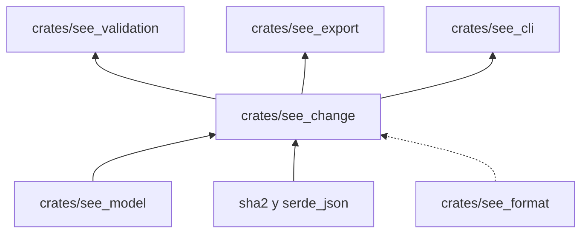

# see_change

Calcula el hash canónico de una especificación, clasifica sus cambios entre dos versiones y gestiona el archivo de
anclaje (`specifications.lock`): lo genera y lo comprueba. El archivo se versiona con el corpus y es el ancla de la última publicación: cualquier cambio normativo posterior exige subir la versión y declarar `cambio`.

**No hace:** leer ni escribir el archivo; eso lo hace `see_cli`. La comprobación rechaza (`SEE-HASH`) el contenido que
cambia sin cambiar la versión.

## Dónde encaja

La línea punteada es una `dev-dependency`: `see_format` solo se usa en los tests.

## Piezas

| Pieza                      | Qué hace                                                                                                                                                                                                    |
|----------------------------|-------------------------------------------------------------------------------------------------------------------------------------------------------------------------------------------------------------|
| `hash`                     | SHA-256 del contenido normativo (identidad, dominio, edición, sujetos, dependencias, reemplazo y bloques salvo `pregunta`)                                                                                  |
| `elements`                 | Mapa de id de bloque a tipo de bloque, que se guarda en el anclaje                                                                                                                                          |
| `classification::classify` | Clases de cambio entre dos versiones: `deprecacion`, `verificacion_anadida`, `ampliacion_candidata`, `cambio_significado_candidato`, `restriccion_candidata`, `retirada`, `editorial` y `requiere_revision` |
| `locking::generate`        | Construye el anclaje del corpus conservando el historial; falla con `SEE-HASH` si una versión ya registrada cambia de hash                                                                                  |
| `locking::check`           | Detecta `SEE-HASH` (contenido cambiado sin versión) y `SEE-IDENTITY` (especificación quitada sin lápida)                                                                  |

## Reglas que conviene saber

- Importa `see_model`; `see_format` solo en tests. Sus dependencias externas son `serde_json` y `sha2`.
- Las preguntas abiertas (`pregunta`) no entran en el hash: pueden editarse sin tocar el anclaje.
- Un fallo esperable es un `Result` con código estable, no una excepción.
- Sin comentarios, sin `unsafe`; 300 líneas por archivo, 40 por función, 4 parámetros posicionales y 3 niveles de
  anidación.

## Comandos útiles

Desde `packages/pseudolearn_spec`.

| Para qué                            | Comando                                                                   |
|-------------------------------------|---------------------------------------------------------------------------|
| Tests de este crate                 | `cargo test -p see_change`                                                |
| Generar o comprobar el ancla        | `cargo run -p see_cli --bin see -- lock` · `lock --check`                 |
| Comparar contra una revisión de Git | `cargo run -p see_cli --bin see -- diff REV`                              |
| Verificación completa del paquete   | `cargo xtask verify`                                                      |

Requisitos: Rust `1.99.1` con rustfmt y Clippy (`rust-toolchain.toml`).
