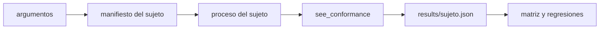

# see_cli

La orden `see`: la CLI del sistema SEE. Lee el corpus y los archivos de conformidad, orquesta los demás crates y
escribe o comprueba los artefactos generados (anclaje, exportación, fichas de agente, evidencia y matrices).

**No hace:** la lógica de validación, comparación o informes; delega en `see_validation`, `see_conformance` y
`see_report`. Tampoco implementa ningún sujeto: los lanza como procesos aparte.

## Dónde encaja

```mermaid
flowchart BT
    model["crates/see_model"] --> cli["crates/see_cli"]
    format["crates/see_format"] --> cli
    graph["crates/see_graph"] --> cli
    change["crates/see_change"] --> cli
    validation["crates/see_validation"] --> cli
    conformance["crates/see_conformance"] --> cli
    report["crates/see_report"] --> cli
    export["crates/see_export"] --> cli
    translation["crates/see_translation"] --> cli
    cli -.-> xtask["xtask"]
```

La línea punteada es un proceso: `xtask` ejecuta `cargo run -p see_cli --bin see`, no lo importa. `see_oracles` y
`see_generators` los usa `see_conformance`, no este crate. Las dependencias externas son `serde_json`, `serde-saphyr`
y `serde`.

## Arquitectura

El binario se llama `see`. `main.rs` interpreta los argumentos (`arguments.rs`) y despacha en `commands.rs`.

| Órdenes                                            | Módulos                                                                                                     |
|----------------------------------------------------|-------------------------------------------------------------------------------------------------------------|
| `new`, `validate`, `graph`, `impact`               | `commands`, `templates`, `storage`                                                                          |
| `lock`, `diff`                                     | `storage` y `history` (clasificación contra una revisión de Git)                                            |
| `export`, `agent-sheet`                            | `resources` y `agent_sheet`: generan o comprueban (`--check`) los artefactos                                |
| `conform`, `matrix`, `feature`                     | `conformance`, `subject_adapters`, `bindings`, `rule_status`, `structural_evidence`                         |
| `conform --operation properties`                   | `property_execution`, `property_registry`, `property_selection`, `native_properties`, `native_artifacts`    |
| `differential`, `target-parity`, `budget`          | `differential`, `target_parity` y `target_evidence`, `e10`: evidencia comparativa entre sujetos y objetivos |
| `runtime-fixtures`, `math-arguments`, `math-check` | `runtime_fixtures`, `math_contrast` y `math_verdicts`                                                       |

`bindings.rs` fija dónde está el manifiesto de vínculos de cada sujeto (`conformance.yaml` del paquete para `see`,
y el `conformance*.yaml` de cada miembro para `engine`, `aot`, `service`, `cli` y `app`). `subject_adapters.rs` fija
cómo se lanza cada uno.

## Flujo principal

Flujo de datos de `see conform`, no de dependencias.



Los sujetos se lanzan con `cargo run` en su miembro (`engine` y `service` desde `pseudolearn_engine`, `cli` y `aot`
desde `apps/pseudolearn_cli`) o con `dart run` para `app`. Un sujeto cuyo manifiesto está `retirado` no se lanza:
produce `SEE-SUBJECT-RETIRED`.

## Reglas que conviene saber

- Es la capa más alta del paquete: importa nueve de los once crates anteriores (`architecture.yaml`).
- Solo acepta las opciones declaradas en `arguments.rs`; una opción desconocida o repetida es un error.
- Un artefacto generado se compara con `--check` y falla con `SEE-STALE` si el archivo en disco no coincide.
- Un sujeto bloqueado o caído es un error operativo, nunca un cumplimiento.
- Sin comentarios, sin `unsafe`; 300 líneas por archivo, 40 por función, 4 parámetros posicionales y 3 niveles de
  anidación.

## Comandos útiles

Desde `packages/pseudolearn_spec`. `see` es `cargo run -p see_cli --bin see --`; todas las órdenes admiten
`--root <directorio>`.

| Para qué                                   | Comando                                                              |
|--------------------------------------------|----------------------------------------------------------------------|
| Tests de este crate                        | `cargo test -p see_cli`                                              |
| Validar el corpus                          | `see validate`                                                       |
| Crear un borrador de especificación        | `see new <ID> --domain <dominio>`                                    |
| Ver o comprobar los anclajes               | `see lock --check` · `see lock --refresh ID,ID`                      |
| Comparar contra una revisión de Git        | `see diff <rev>`                                                     |
| Contrastar un sujeto                       | `see conform --subject <engine\|aot\|service\|cli\|app> [--only ID]` |
| Matriz regla × sujeto                      | `see matrix [--subject SUJETO]`                                      |
| Regenerar o comprobar la exportación       | `see export [--check]`                                               |
| Regenerar o comprobar las fichas de agente | `see agent-sheet [--check]`                                          |
| Verificación completa del paquete          | `cargo xtask verify`                                                 |

Requisitos: Rust `1.99.0` con rustfmt y Clippy (`rust-toolchain.toml`); cada sujeto necesita lo que pida su propio
miembro.
