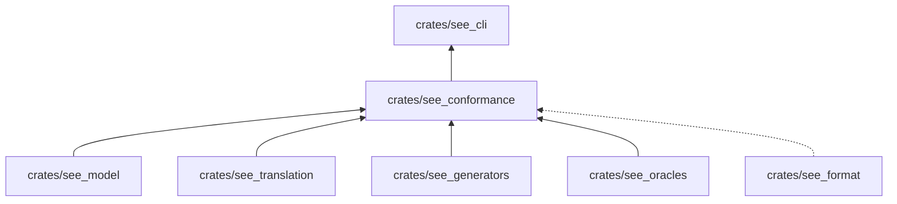
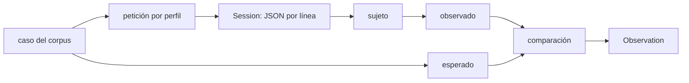

# see_conformance

Contrasta un sujeto (el motor, la CLI, el servicio, la app) contra el corpus: construye las peticiones de cada caso,
las envía por el protocolo de sesión, compara lo observado con lo esperado y ejecuta las propiedades sembradas.
Produce la evidencia (`Evidence`) con la que `see_report` arma la matriz.

**No hace:** lanzar el proceso del sujeto, elegir qué sujeto o qué casos correr ni escribir la evidencia en disco. Eso
es de `see_cli`. Tampoco calcula resultados esperados matemáticos: los pide a `see_oracles`.

## Dónde encaja

La línea punteada es una `dev-dependency`: `see_format` solo se usa en los tests.

## Arquitectura

| Grupo                | Módulos                                                                                        | Qué hace                                                                                                      |
|----------------------|------------------------------------------------------------------------------------------------|---------------------------------------------------------------------------------------------------------------|
| Protocolo            | `protocol`                                                                                     | `Session`: proceso hijo con peticiones y respuestas JSON por línea, y tiempos límite                          |
| Casos                | `requests`, `execution`, `target_programs`                                                     | Petición por caso y perfil, disponibilidad del sujeto (`Available`, `Pending`, `Unavailable`) y observaciones |
| Comparación          | `comparison`, `tool_comparison`, `event_identity`, `dap_comparison`, `program_view_comparison` | Qué campos esperados coinciden con lo observado                                                               |
| Propiedades          | `properties` y los `property_*`                                                                | Ejecución de cada propiedad versionada con semilla y muestras                                                 |
| Contraste matemático | `math_arguments`, `math_power_arguments`, `math_sampling`, `math_contrast`                     | Argumentos sembrados y esperado de `see_oracles`                                                              |
| Fixtures             | `runtime_fixtures`, `memory_fixtures`, `recording_replay`, `recording_tape_mutation`           | Casos de ejecución, de memoria y de grabación                                                                 |

## Flujo principal

Flujo de datos de un caso, no de dependencias.

`execution::execute` recorre los casos que aplican al sujeto, anunciado en el saludo (`hello`) de la sesión, y arma una
`Evidence` con protocolo `see-protocol/1`. Si el saludo no anuncia el perfil o una capacidad que el caso exige, el caso
queda no disponible; si solo falta `observe`, queda pendiente. Una propiedad cuya capacidad falta produce un pendiente
con cero muestras completadas, nunca un cumplimiento (`properties::run`).

## Reglas que conviene saber

- Importa `see_model`, `see_translation`, `see_generators` y `see_oracles`; `see_format` solo en tests. Dependencias
  externas: `serde_json` y `sha2`.
- `Session` es el único lugar donde este crate lanza procesos; la lógica de contraste depende del trait
  `PropertySubject`, así que los tests pueden sustituir el sujeto por un doble que introduce una violación.
- Los resultados esperados salen del corpus o de `see_oracles`, nunca de la respuesta del sujeto.
- Un fallo operativo (proceso caído, tiempo agotado) se propaga como error; no se cuenta como incumplimiento ni como
  cumplimiento.
- Sin comentarios, sin `unsafe`; 300 líneas por archivo, 40 por función, 4 parámetros posicionales y 3 niveles de
  anidación.

## Comandos útiles

Desde `packages/pseudolearn_spec`. `see` es `cargo run -p see_cli --bin see --`.

| Para qué                          | Comando                                                              |
|-----------------------------------|----------------------------------------------------------------------|
| Tests de este crate               | `cargo test -p see_conformance`                                      |
| Contrastar un sujeto              | `see conform --subject <engine\|aot\|service\|cli\|app> [--only ID]` |
| Contrastar sus propiedades        | `see conform --subject engine --operation properties`                |
| Verificación completa del paquete | `cargo xtask verify`                                                 |

Requisitos: Rust `1.99.1` con rustfmt y Clippy (`rust-toolchain.toml`); cada sujeto necesita lo que pida su propio
miembro.
