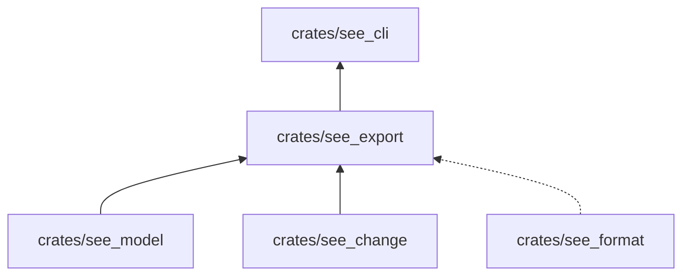
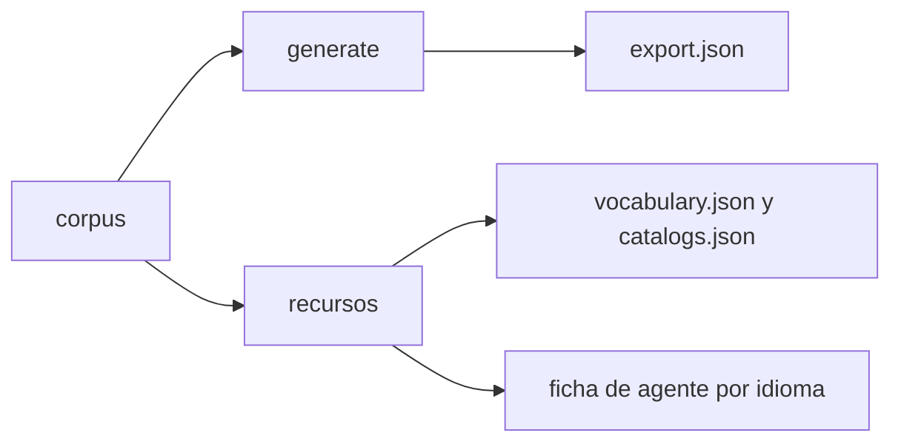

# see_export

Produce, a partir del corpus, los artefactos que consumen otros miembros: el documento de exportación
`see-export/1`, los recursos normativos (vocabulario, gramática, catálogos) y la ficha del lenguaje para agentes en
Markdown.

**No hace:** escribir archivos ni validar el corpus. Devuelve los valores; `see_cli` los guarda o los compara con lo
que ya hay en disco.

## Dónde encaja

La línea punteada es una `dev-dependency`: `see_format` solo se usa en los tests.

## Arquitectura

| Módulo                   | Qué hace                                                                                                                                                                                     |
|--------------------------|----------------------------------------------------------------------------------------------------------------------------------------------------------------------------------------------|
| `lib.rs`                 | `generate`: especificaciones (metadatos, bloques y hash), áreas por prefijo de identidad y recursos                                                                                          |
| `resources`              | `generate` reúne los bloques `definicion` con `valor` por su `termino` (un duplicado es `SEE-RESOURCE`); `vocabulary` aplana vocabulario, vocabulario contextual y funciones en un solo mapa |
| `agent_sheet`            | `render` compone la ficha por idioma: título, introducción, principios, vocabulario, biblioteca, gramática, diferencias y ejemplos                                                           |
| `agent_sheet_vocabulary` | Secciones de vocabulario y de biblioteca de la ficha                                                                                                                                         |
| `agent_sheet_examples`   | Sección de ejemplos de la ficha                                                                                                                                                              |

## Flujo principal

Flujo de datos, no de dependencias.

`see export` escribe `specifications/export.json`, `specifications/cases/vocabulary.json` y
`specifications/cases/catalogs.json`. `see agent-sheet` escribe, según `agents/agent-sheet.json`, la ficha `es` y
`en` en `apps/pseudolearn_app`, `apps/pseudolearn_web` y `apps/pseudolearn_cli`. Ambas órdenes aceptan `--check`
para fallar si el archivo en disco no coincide.

## Reglas que conviene saber

- Importa `see_model` y `see_change`; `see_format` solo en tests. Su única dependencia externa es `serde_json`.
- Los textos de la ficha vienen de `agents/agent-sheet.json` (etiquetas, principios, diferencias y ejemplos); si falta
  una etiqueta del idioma, el error lleva el código `SEE-AGENT-SHEET`.
- Un artefacto generado no se edita a mano: se regenera con la orden de `see`.
- Sin comentarios, sin `unsafe`; 300 líneas por archivo, 40 por función, 4 parámetros posicionales y 3 niveles de
  anidación.

## Comandos útiles

Desde `packages/pseudolearn_spec`. `see` es `cargo run -p see_cli --bin see --`.

| Para qué                                   | Comando                     |
|--------------------------------------------|-----------------------------|
| Tests de este crate                        | `cargo test -p see_export`  |
| Regenerar o comprobar la exportación       | `see export [--check]`      |
| Regenerar o comprobar las fichas de agente | `see agent-sheet [--check]` |
| Verificación completa del paquete          | `cargo xtask verify`        |

Requisitos: Rust `1.99.1` con rustfmt y Clippy (`rust-toolchain.toml`).
