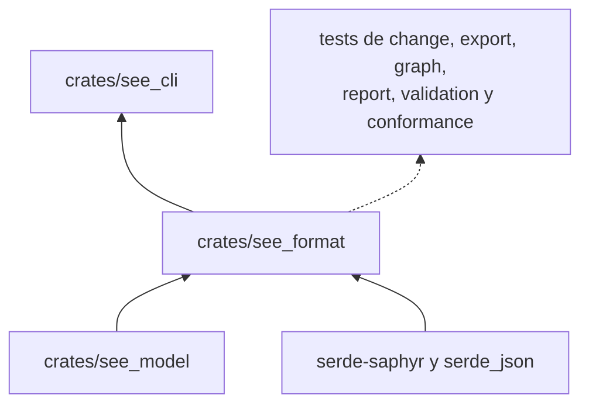
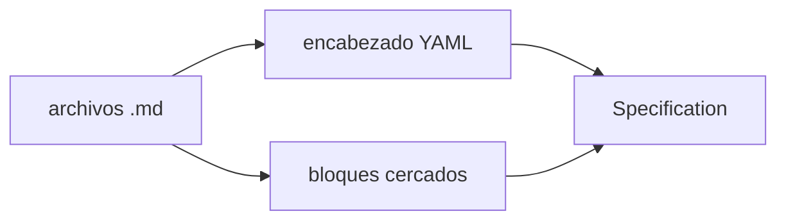

# see_format

Lee las especificaciones del corpus (Markdown con encabezado YAML y bloques cercados tipados) y las convierte en
`Specification`; también las escribe de vuelta en forma canónica.

**No hace:** validar el contenido de los bloques ni resolver referencias entre especificaciones. Eso es de
`see_validation`. La prosa fuera de los bloques no entra al modelo.

## Dónde encaja

La línea punteada son `dev-dependencies`: esos crates solo la usan para leer corpus de prueba.

## Flujo principal

`read(root)` recorre `root` en orden alfabético, omite las carpetas `fixtures` y parsea cada `.md`. `parse` rechaza
con un código estable cuando falta o no cierra el encabezado (`SEE-FORMAT`), cuando el YAML no encaja con
`Metadata` (`SEE-SCHEMA`), cuando hay un bloque cercado de tipo desconocido o sin cerrar (`SEE-FORMAT`) y cuando el
texto trae `www.` o un enlace Markdown con `://` (`SEE-REFERENCE`).

Los tipos de bloque admitidos son `regla`, `caso`, `definicion`, `error`, `propiedad`, `invariante`,
`precondicion`, `resultado`, `lapida`, `pregunta`, `medicion`, `instruccion` y `cobertura`; los cercados `yaml`,
`json`, `text` y `markdown` se ignoran. Los saltos de línea CRLF se normalizan.

## Reglas que conviene saber

- Solo importa `see_model` (`may_import` en `architecture.yaml`); sus dependencias externas son `serde-saphyr` y
  `serde_json`.
- Un fallo de lectura o de formato es un `Result`, nunca un `panic`.
- Una dirección `http://` o `https://` es admisible como dato dentro de un bloque; lo que se rechaza es el enlace
  Markdown a documentación externa.
- Sin comentarios, sin `unsafe`; 300 líneas por archivo, 40 por función, 4 parámetros posicionales y 3 niveles de
  anidación.

## Comandos útiles

Desde `packages/pseudolearn_spec`.

| Para qué                          | Comando                    |
|-----------------------------------|----------------------------|
| Tests de este crate               | `cargo test -p see_format` |
| Verificación completa del paquete | `cargo xtask verify`       |

Requisitos: Rust `1.99.0` con rustfmt y Clippy (`rust-toolchain.toml`).
