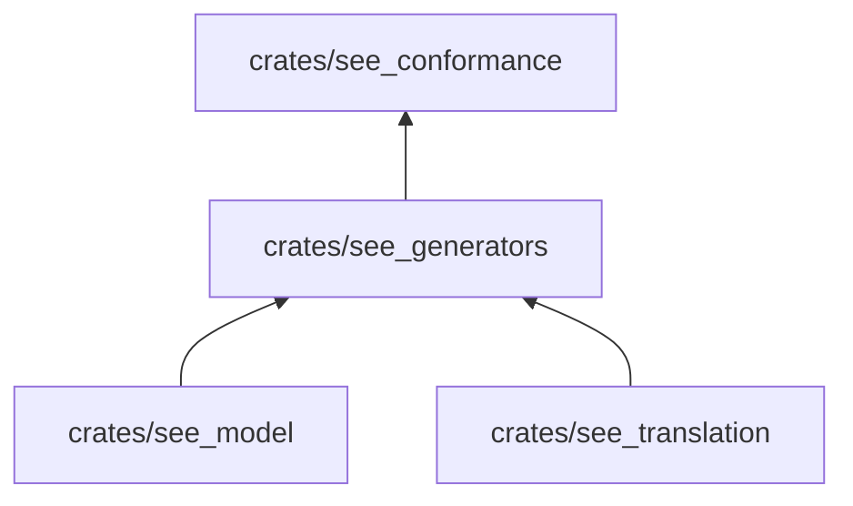

# see_generators

Genera programas de PseudoLearn bien tipados de forma determinista: la misma semilla y el mismo índice de muestra
producen siempre el mismo programa, en el perfil `es` o `en`.

**No hace:** ejecutar el programa ni decidir qué resultado esperar. Entrega el código fuente y los parámetros con los
que se generó; el esperado lo calcula el contraste.

## Dónde encaja

## Flujo principal

Flujo de datos de una muestra, no de dependencias.

`generate(GenerationSeed { seed, sample }, profile, vocabulary)` sortea cuántos elementos tiene el arreglo (0 a 16),
el valor inicial (−10 a 10) y la entrada (0 a 100), rellena una plantilla de programa fija y la resuelve con el
vocabulario del perfil. Un perfil distinto de `es` y `en` devuelve error. `GeneratedProgram` conserva `source`,
`initial`, `elements` e `input`.

## Reglas que conviene saber

- Importa `see_model` y `see_translation` (`architecture.yaml`); no tiene dependencias externas en producción.
- La aleatoriedad es propia (`random.rs`) y depende solo de la semilla y la muestra: ninguna fuente del sistema.
- El vocabulario llega como parámetro; el crate no lee archivos.
- Sin comentarios, sin `unsafe`; 300 líneas por archivo, 40 por función, 4 parámetros posicionales y 3 niveles de
  anidación.

## Comandos útiles

Desde `packages/pseudolearn_spec`.

| Para qué                          | Comando                        |
|-----------------------------------|--------------------------------|
| Tests de este crate               | `cargo test -p see_generators` |
| Verificación completa del paquete | `cargo xtask verify`           |

Requisitos: Rust `1.99.0` con rustfmt y Clippy (`rust-toolchain.toml`).
