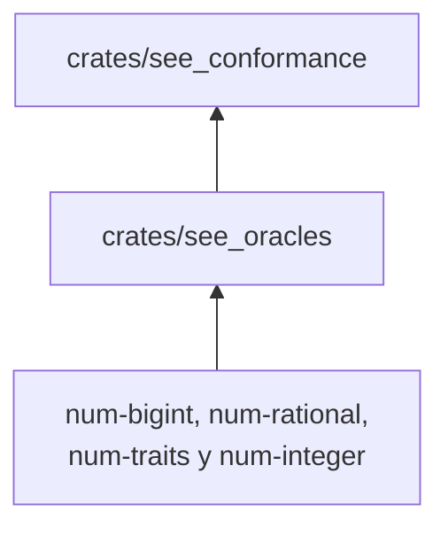

# see_oracles

Los oráculos independientes de `see_conformance`: calculan el resultado esperado de operaciones enteras, de
funciones matemáticas y del conteo de celdas alcanzables sin usar el motor, la biblioteca matemática del anfitrión ni
código de ningún sujeto.

**No hace:** ejecutar sujetos, comparar resultados ni leer el corpus. Solo calcula valores esperados a partir de sus
argumentos.

## Dónde encaja

No depende de ningún otro crate del paquete.

## Arquitectura

| Módulo                                                                                                        | Qué calcula                                                                                                                                                      |
|---------------------------------------------------------------------------------------------------------------|------------------------------------------------------------------------------------------------------------------------------------------------------------------|
| `lib.rs`                                                                                                      | `integer_sum` y `iterations` (cantidad de vueltas de un `para`), con `i128` y comprobación del dominio `i64`                                                     |
| `integer_expression`                                                                                          | Evalúa un árbol de expresiones enteras (`+ − × ÷ mod ^`) con pila explícita y conserva el origen de la primera trampa                                            |
| `cells`                                                                                                       | Cuenta las celdas alcanzables desde unas raíces: los alias cuentan una vez y los ciclos terminan                                                                 |
| `mathematics`                                                                                                 | `rounded` y `power`: valor correctamente redondeado a binario64 de raíz, logaritmos, exponencial, trigonométricas y potencia; `enclose` da el intervalo racional |
| `rounding`                                                                                                    | `round_binary64` y `midpoint`: redondeo de un racional exacto a binario64                                                                                        |
| `interval`                                                                                                    | Intervalos racionales con extremos exactos                                                                                                                       |
| `exact_power`, `series`, `bounded_series`, `transcendentals`, `small_angle`, `extended`, `dyadic`, `rational` | Soporte interno: series con cota de resto, reducción de argumento, potencias exactas y aritmética racional (`atan2` se reexporta)                                |

La función matemática se refina hasta que los dos extremos del intervalo redondean al mismo binario64. Los
resultados exactos que caen en un punto medio entre binarios64 (algunas potencias) se resuelven antes de refinar,
porque el refinamiento no terminaría.

## Reglas que conviene saber

- No importa ningún crate del paquete (`may_import: []`). Sus cuatro dependencias externas llevan versión exacta (`=`) y
  solo aportan aritmética de precisión arbitraria en Rust, sin GMP.
- Los errores del oráculo llevan un código fijo (`ORACLE-DOMAIN`, `ORACLE-PRECISION`, `integerOverflow`,
  `forStepZero`); un dominio inválido nunca devuelve un valor.
- El evaluador de expresiones y el conteo de celdas usan pila explícita, no recursión.
- Sin comentarios, sin `unsafe`; 300 líneas por archivo, 40 por función, 4 parámetros posicionales y 3 niveles de
  anidación.

## Comandos útiles

Desde `packages/pseudolearn_spec`.

| Para qué                          | Comando                     |
|-----------------------------------|-----------------------------|
| Tests de este crate               | `cargo test -p see_oracles` |
| Verificación completa del paquete | `cargo xtask verify`        |

Requisitos: Rust `1.99.0` con rustfmt y Clippy (`rust-toolchain.toml`).
