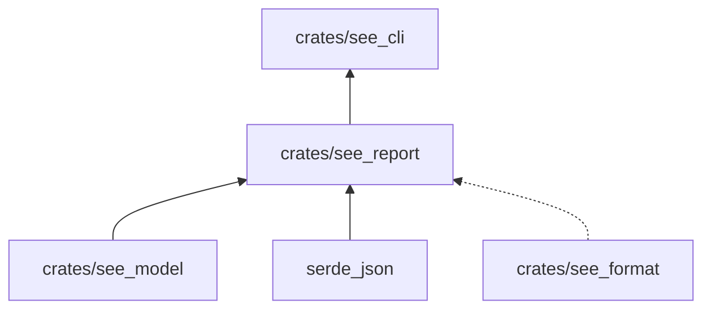

# see_report

Los informes del sistema SEE: la matriz regla × sujeto, las regresiones, la cobertura del corpus y el estado
agregado de una característica.

**No hace:** ejecutar sujetos ni leer evidencia de disco. Recibe el corpus, los vínculos y la evidencia ya cargados y
devuelve filas JSON.

## Dónde encaja

La línea punteada es una `dev-dependency`: `see_format` solo se usa en los tests.

## Piezas

| Función                  | Qué hace                                                                                                                                                                           |
|--------------------------|------------------------------------------------------------------------------------------------------------------------------------------------------------------------------------|
| `matrix`                 | Una fila por regla de cada especificación que declara el sujeto: vínculo (`binding`), veredicto medido, casos, mediciones y estado                                                 |
| `regressions`            | Filas `SEE-REGRESSION`: reglas activas (estables, o experimentales activadas) vinculadas como `cumple` cuya medición no cumple; un sujeto retirado no produce ninguna              |
| `feature`                | Estado de una característica: el peor de los estados de sus especificaciones (de `rechazada` a `estable`), con su lista y sus criterios; `SEE-FEATURE` si falta una especificación |
| `coverage::table`        | Filas de los bloques `cobertura`: regla, instrucciones y `sin_ri`                                                                                                                  |
| `coverage::states`       | Conteo de especificaciones por dominio y estado                                                                                                                                    |
| `coverage::measurements` | Mediciones que cita una regla en su campo `verificacion`                                                                                                                           |

Las filas de un sujeto retirado salen con vínculo y medición `no aplicable`.

## Reglas que conviene saber

- Importa `see_model`; `see_format` solo en tests. Su única dependencia externa es `serde_json`.
- Una regla sin vínculo aparece como `sin vinculo`; un vínculo registrado no cuenta como medición.
- Sin comentarios, sin `unsafe`; 300 líneas por archivo, 40 por función, 4 parámetros posicionales y 3 niveles de
  anidación.

## Comandos útiles

Desde `packages/pseudolearn_spec`. `see` es `cargo run -p see_cli --bin see --`.

| Para qué                                                                           | Comando                         |
|------------------------------------------------------------------------------------|---------------------------------|
| Tests de este crate                                                                | `cargo test -p see_report`      |
| Matriz regla × sujeto (por omisión, `engine`)                                      | `see matrix [--subject SUJETO]` |
| Estado de una característica (manifiesto en `specifications/features/NOMBRE.yaml`) | `see feature NOMBRE`            |
| Verificación completa del paquete                                                  | `cargo xtask verify`            |

Requisitos: Rust `1.99.1` con rustfmt y Clippy (`rust-toolchain.toml`).
