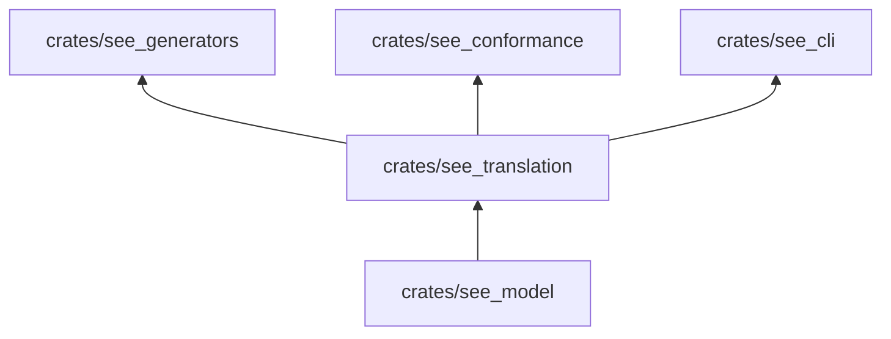

# see_translation

Reimprime un programa de PseudoLearn de un perfil léxico a otro (`es` ↔ `en`) con el vocabulario del corpus, y
resuelve los marcadores `{{lexema:clave}}` de las plantillas de programa.

**No hace:** analizar ni ejecutar programas. Sustituye palabras; no entiende la gramática.

## Dónde encaja

## Piezas

| Función             | Qué hace                                                                                 |
|---------------------|------------------------------------------------------------------------------------------|
| `translate`         | Reemplaza cada palabra del perfil origen por la del destino; la más larga primero        |
| `collisions`        | Palabras del programa que son vocabulario del perfil destino y no del origen             |
| `is_contextual`     | Distingue las entradas con prefijo `contextual:`, que `translate` no sustituye           |
| `lexemes::resolve`  | Sustituye los marcadores `{{lexema:clave}}` por la palabra del perfil                    |
| `lexemes::validate` | Comprueba que la salida esperada de un caso se pueda resolver en cada perfil que declara |

`translate` deja intactos los comentarios `//` y los literales entre comillas, y no traduce el nombre de una función
que el propio programa declara. Si origen y destino son el mismo perfil, devuelve el programa tal cual.

## Reglas que conviene saber

- Solo importa `see_model` y no tiene dependencias externas (`architecture.yaml`).
- El vocabulario llega como parámetro (`Vocabulary`); el crate no lee archivos.
- Un fallo esperable (léxico ausente, marcador sin cerrar, literal sin cerrar) es un `Result`, no un `panic`.
- Sin comentarios, sin `unsafe`; 300 líneas por archivo, 40 por función, 4 parámetros posicionales y 3 niveles de
  anidación.

## Comandos útiles

Desde `packages/pseudolearn_spec`.

| Para qué                          | Comando                         |
|-----------------------------------|---------------------------------|
| Tests de este crate               | `cargo test -p see_translation` |
| Verificación completa del paquete | `cargo xtask verify`            |

Requisitos: Rust `1.99.1` con rustfmt y Clippy (`rust-toolchain.toml`).
