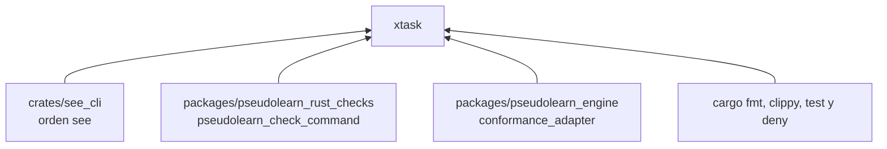

# xtask

La puerta local del paquete: `cargo xtask verify` ejecuta, en orden, todas las comprobaciones que deben estar en verde
para dar por buena una fase de `pseudolearn_spec`. Además aloja tres verificadores propios: el de referencias a
documentación transitoria, el de dependencias retiradas y el de términos erradicados.

**No hace:** definir cómo se valida el corpus ni cómo se contrasta un sujeto; llama a `see` y a los verificadores de
`pseudolearn_rust_checks` por proceso. No se despliega ni se publica.

## Dónde encaja

Las flechas son procesos que `xtask` lanza, no imports: no depende de ningún crate (`may_import: []`) ni de
dependencias externas. El alias `cargo xtask` está en `.cargo/config.toml` del paquete.

## Flujo principal

Orden de `cargo xtask verify`; se detiene en el primer fallo.

```mermaid
flowchart LR
    export["see export<br/>regenera el corpus exportado"] --> retired["dependencias retiradas"]
    retired --> docs["referencias transitorias"]
    docs --> erased["términos erradicados"]
    erased --> rust["fmt, clippy, test y deny"]
    rust --> checks["rust_checks: all y toolchain"]
    checks --> build["compilar conformance_adapter"]
    build --> see["see validate, export y<br/>agent-sheet --check"]
    see --> conform["conform engine:<br/>propiedades y casos"]
```

| Verificador                               | Qué rechaza                                                                                                                                                                                                                                             |
|-------------------------------------------|---------------------------------------------------------------------------------------------------------------------------------------------------------------------------------------------------------------------------------------------------------|
| `retirement` (`RETIRED-DEPENDENCY`)       | Imports o exports Dart de `package:pseudolearn_core/` en `apps/pseudolearn_app/lib` y `tool`; referencias a `pseudolearn_core` en los YAML de `.github` y en los `pubspec.yaml` de la app y de los benchmarks; y que exista `packages/pseudolearn_core` |
| `documentation` (`DOC-NO-TRANSIENT-REFS`) | En todo archivo de texto versionado fuera de `docs/`: rutas a documentos de `docs/`, nombres de documentos de `docs/` (salvo `README.md`) y citas de sección por prefijo numérico                                                                       |
| `eradication` (`ERADICATION`)             | En todo archivo de texto versionado o nuevo, salvo las rutas permitidas: los identificadores y textos de concesiones y simulación retirados que lista `eradicated-terms.txt`; `fixtures/eradication/` guarda la violación deliberada                     |

Los tres tienen tests hermanos (`retirement_tests.rs`, `documentation_tests.rs`, `eradication_tests.rs`) con casos aceptados y
rechazados.

## Reglas que conviene saber

- Solo usa la biblioteca estándar y lanza todo lo demás por proceso; no importa ningún crate del producto ni sujetos.
- `retirement`, `documentation` y `eradication` reciben la raíz del repositorio (`../..`) y fallan con un mensaje que nombra el
  archivo.
- Las comprobaciones de Clippy usan `-D warnings`; `cargo deny check` aplica `deny.toml` del paquete.
- Sin comentarios, sin `unsafe`; 300 líneas por archivo, 40 por función, 4 parámetros posicionales y 3 niveles de
  anidación.

## Comandos útiles

Desde `packages/pseudolearn_spec`.

| Para qué                          | Comando               |
|-----------------------------------|-----------------------|
| Verificación completa del paquete | `cargo xtask verify`  |
| Tests de este miembro             | `cargo test -p xtask` |

Requisitos: Rust `1.99.0` con rustfmt y Clippy (`rust-toolchain.toml`), `cargo-deny`, `git` en el `PATH` (lo usan
`documentation` y `eradication`) y la cadena de `pseudolearn_rust_checks` y `pseudolearn_engine`.
