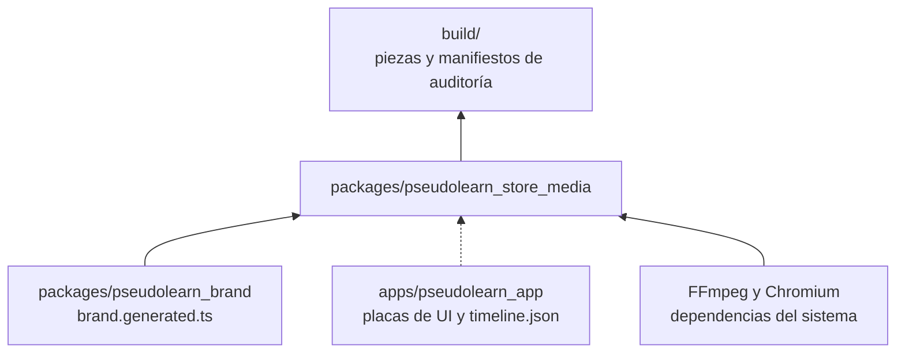
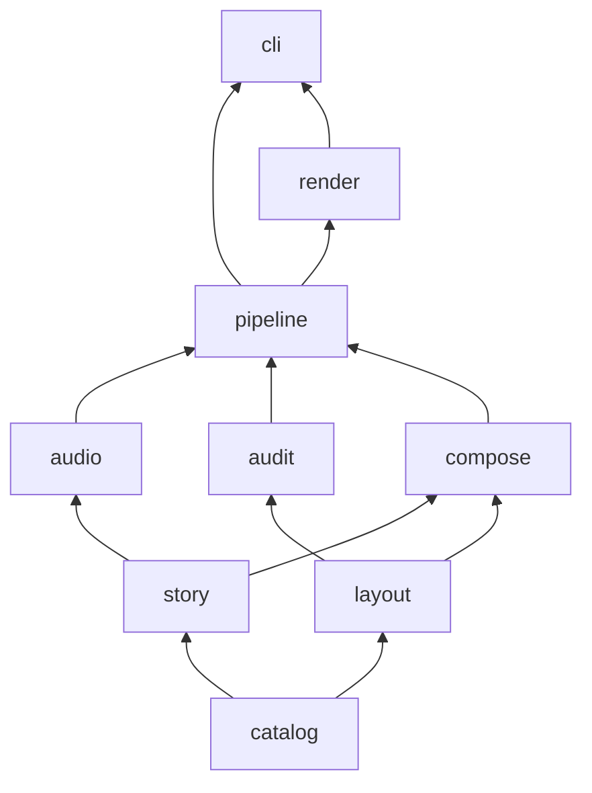
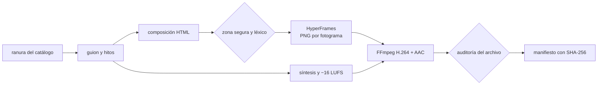
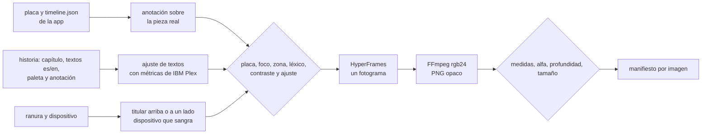
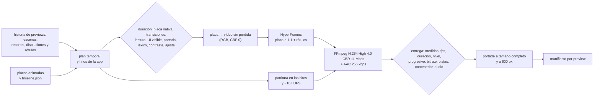

# pseudolearn_store_media

Motor que produce de forma automática y determinista los assets de las tiendas donde se publica PseudoLearn: capturas,
app previews, vídeos de encabezado y de búsqueda, imagen universal y arte de Microsoft Store. Compone en HTML con
HyperFrames, sintetiza la banda sonora, codifica con FFmpeg y audita cada pieza contra el catálogo de su ranura antes
de darla por buena.

**No hace:** generar imágenes, vídeo ni audio con IA, inventar interfaz (la UI real llega como placas exportadas por
la app), subir nada a App Store Connect ni al Centro de partners, ni decidir la narrativa: los guiones se aprueban con
la persona antes de escribirse.

## Dónde encaja

La línea punteada es un contrato de datos (`story/plate_timeline.ts`), no un import.

## Arquitectura

Se omiten las aristas hacia `catalog`, que todas las capas pueden importar, y las de `story` y `layout` hacia
`pipeline` y de `audit` hacia `render`.

| Capa       | Qué hace                                                                                         |
|:-----------|:-------------------------------------------------------------------------------------------------|
| `catalog`  | Lee y valida `catalog/slots.json` y `catalog/lexicon.json`: ranuras, dispositivos, códecs, sonoridad, léxico, límites de leyendas y títulos |
| `story`    | Guiones con hitos (`Beat`), historias de capturas (App Store y escritorio), de previews, de la lente y del tráiler, plan temporal de escenas y lectura de las placas de la app |
| `layout`   | Zonas seguras, recorte por dispositivo, muestreo de todos los fotogramas, lámina de revisión, métricas de fuentes, ajuste de textos, geometría editorial, rótulos de preview, anclaje de anotaciones, ventana de escritorio, río de barras y lente muda |
| `audio`    | Partitura, síntesis en bucle exacto, ganancia y codificación WAV, sin dependencias              |
| `audit`    | Hallazgos con regla estable: medidas, alfa, códec, fps, duración, audio, bucle, placa, léxico, contraste, ajuste, entrega (GOP, fotogramas B, *Fast Start*, listas de edición), transiciones, UI visible, portada, tiempo de lectura, contenido añadido y longitud de leyendas |
| `compose`  | Composiciones HyperFrames en HTML: calibración, captura editorial, preview con placas animadas, lámina de zona segura, ventana de escritorio, lente muda y tráiler del termostato |
| `pipeline` | Plan objetivo × idioma, producción de capturas, vídeo y previews, banda sonora y manifiesto, contra puertos |
| `render`   | Adaptadores: productor de HyperFrames, FFmpeg y ffprobe, ensamblado de placas, archivos y catálogo |
| `cli`      | `plan`, `calibrate`, `screenshots`, `previews`, `creative`, `desktop-screenshots`, `hero`, `trailer` y `audit-image` |

## Flujo principal

Flujo de datos de una pieza de vídeo, no de dependencias.

Flujo de una captura fija:

Cada imagen tiene su manifiesto `<nn>-<capítulo>.audit.json` con un hallazgo por regla incumplida. Si falla una regla
previa (placa ausente o de otra medida, texto fuera del margen, léxico, contraste o titular que no cabe), la imagen no
se renderiza.

Flujo de una app preview:

Cada preview tiene su manifiesto `<nn>-<preview>.audit.json`, su portada a tamaño completo y su portada con el lado
largo a 600 px para revisarla como se verá con la reproducción automática apagada. Si falla una regla previa, la
preview no se renderiza.

## Fuentes de Apple para las app previews

Leídas el 2026-11-10. Cada regla del motor que viene de Apple sale de esta tabla; lo que no aparece aquí es una
**decisión propia** y figura como tal en «Decisiones y su porqué».

| Fuente | Qué dice | Qué hace el motor |
|:--|:--|:--|
| [App previews](https://developer.apple.com/app-store/app-previews/) | Metraje capturado de la app; solo contenido de la propia app, sin personas, manos ni planos del dispositivo | Las escenas son placas grabadas de la UI real con el motor real; `MEDIA-APP-UI` exige UI en todos los fotogramas |
| ↑ | Hasta tres previews por idioma y hasta 30 s; cada una enseña algo nuevo | La historia admite de 1 a 3 previews; el reparto se decide en el diálogo |
| ↑ | Se permiten gráficos como puntos de toque; se recomienda la resolución nativa de la UI en vez de ampliar | Los toques salen de los eventos `tap` que graba la app; `MEDIA-PLATE` rechaza una placa que no mida exactamente la ranura |
| ↑ | Transiciones sencillas, como disoluciones y fundidos, que no sugieran funciones inexistentes | Entre escenas solo hay disolución (`MEDIA-TRANSITION`); los rótulos entran y salen con fundido |
| ↑ | Suena en silencio por defecto: texto legible y en pantalla el tiempo necesario; sin precios, fechas ni referencias de temporada | `TEXT-READ-TIME`, `TEXT-FIT`, `TEXT-CONTRAST` y el léxico (`price`, `timely`) |
| ↑ | Si hay compras, suscripción o inicio de sesión, se indica en el metraje o en el fotograma final | Rótulo de rol `disclosure` |
| ↑ | Una sola banda sonora para dar continuidad; efectos de la UI y narración opcionales | Una partitura sintetizada por preview, anclada a los hitos de la app |
| ↑ | Portada que transmita la esencia; cambiarla en una preview aprobada exige una versión nueva | `posterSeconds` en la historia, `MEDIA-POSTER` y portada a 600 px |
| [Especificaciones](https://developer.apple.com/help/app-store-connect/reference/app-information/app-preview-specifications) | De 15 a 30 s, 500 MB, hasta tres por tamaño de dispositivo e idioma | `MEDIA-DURATION`, `MEDIA-SIZE` y la historia |
| ↑ | H.264 progresivo hasta High 4.0, 10–12 Mbps, 30 fps como máximo, en .mov, .m4v o .mp4 | Perfil `apple-preview` en CBR a 11 Mbps; `MEDIA-CODEC`, `MEDIA-BITRATE`, `MEDIA-FPS`, `MEDIA-CONTAINER` |
| ↑ | Audio estéreo AAC de 256 kbps a 44,1 o 48 kHz; todas las pistas habilitadas | AAC 256 kbps a 48 kHz; `MEDIA-AUDIO` y `MEDIA-TRACKS` |
| ↑ | iPhone 886 × 1920 (también Duo y Dynamic Island), iPad 13" 1200 × 1600, Mac 1920 × 1080 solo horizontal | Una ranura por medida, con su dispositivo de grabación |
| ↑ | Portada por defecto en el segundo 5; la preview va antes que las capturas y, si su proporción difiere, en «A Closer Look» | La portada se fija en la historia; las previews se graban en vertical en iPhone, como las capturas |
| [Guías de revisión 2.3](https://developer.apple.com/app-store/review/guidelines/) | 2.3.4: solo capturas de vídeo de la app, con narración y superposiciones de vídeo o texto para explicar | Igual que la fila de metraje: placas de la app y superposiciones |
| ↑ | 2.3.2 y 2.3.7: indicar compras; sin precios ni términos. 2.3.8: apto 4+. 2.3.9: derechos y datos de cuenta ficticios. 2.3.10: sin otras plataformas | Rótulo `disclosure`, léxico (`price`, `other-platform`) y la cuenta ficticia de las placas |
| [Catálogo de la API](https://developer.apple.com/documentation/appstoreconnectapi) `GET /v1/appAssetLibraryRefData` | `audioRequired: true`, 23–30 fps, 500 MB, tres por grupo; duración `PT5S`–`PT30S` con `shortName` `t15~30` | Audio obligatorio, 30 fps y 15–30 s (lo más estricto de las dos fuentes) |

## Fuentes de Apple para los creative assets

Leídas el 2026-11-10, junto con el catálogo de la API (solo `GET`). Lo que no aparece aquí es decisión propia.

| Fuente | Qué dice | Qué hace el motor |
|:--|:--|:--|
| [Creative assets](https://developer.apple.com/help/app-store-connect/reference/app-information/creative-assets-specifications/) | Encabezado 21:9 de 3840 × 1646; búsqueda 3:2 de 1920 × 1280 a 3840 × 2560; universal 16:9 de 5244 × 2950 solo PNG; sin alfa | Una ranura por medida en `slots.json`; `MEDIA-DIMENSIONS` y `MEDIA-ALPHA` |
| ↑ | Vídeo a 30 o 60 fps, de 5 a 30 s, en .mov, .m4v o .mp4; silenciado por defecto (en búsqueda no se puede activar el sonido); se reproduce en bucle en los dos sitios | `MEDIA-FPS`, `MEDIA-DURATION`, `MEDIA-LOOP`; la búsqueda va sin pista |
| ↑ | Disponibles en iOS 27 y iPadOS 27 o posteriores | Las piezas no se hacen por plataforma; ninguna fuente menciona macOS |
| [Buenas prácticas](https://developer.apple.com/app-store/asset-best-practices/) | Una sola idea clara; texto, si lo hay, en una frase corta que acompañe; funciona primero en silencio; bucle sin saltos ni cortes; portada impactante (el primer fotograma); lo esencial en la zona segura y el centro | Zona segura comprobada en cada fotograma, costura del bucle medida contra el propio movimiento y lámina de revisión por dispositivo |
| ↑ | Sin precios, URL, ©, premios no verificables, otras plataformas ni reconocimientos de Apple; apto 4+ | Léxico `app-store` |
| Catálogo `appAssetLibraryRefData` | Encabezado: vídeo `t10~30`, sin audio obligatorio, imagen solo PNG; búsqueda: vídeo `t15~30`, sin audio obligatorio; universal sin vídeo; 500 MB por archivo; grupo `DEFAULT_PROFILE` de plataforma `ANY` | Encabezado de 10 a 30 s y búsqueda de 15 a 30 s; `MEDIA-SIZE` a 524 288 000 bytes |
| Plantilla Sketch de Apple (2026-08-28) | Rectángulo «Art Safe Area» de cada mesa | `safeArea` de cada ranura, en fracciones del lienzo |

## Fuentes de Microsoft

Leídas el 2026-11-10. Lo que no aparece aquí es **decisión propia** y figura como tal en «Decisiones y su porqué».

| Fuente | Qué dice | Qué hace el motor |
|:--|:--|:--|
| [Screenshots, images and trailers (MSIX)](https://learn.microsoft.com/en-us/windows/apps/publish/publish-your-app/msix/screenshots-and-images) | Capturas PNG de 50 MB como máximo; escritorio de 1366 × 768 o más, admite 4K; de 1 a 10, se recomiendan al menos cuatro | Ranura de 3840 × 2160 con `maxBytes` de 50 MB; el conjunto rechaza más de 10; la historia trae cinco |
| ↑ | Sin logotipos, iconos ni mensajes de marketing añadidos; lo crítico en los dos tercios superiores; leyenda de 200 caracteres como máximo | Reglas `no-added-text` y `critical-top-two-thirds` (`MEDIA-CONTENT`, `MEDIA-SAFE-AREA`); las leyendas son datos con `TEXT-LENGTH` y van a `captions.json` |
| ↑ | Icono de tile 1:1 de 300 × 300 recomendado; si falta, la tienda usa el del paquete | No se genera: el paquete MSIX ya lleva el icono de la marca |
| ↑ | Póster 2:3 (720 × 1080 o 1440 × 2160) y caja 1:1 (1080 × 1080 o 2160 × 2160): para juegos, «no aplica a apps»; texto y lo clave fuera del tercio inferior | Se generan por decisión de la persona, a 1440 × 2160 y 2160 × 2160, con la regla de los dos tercios |
| ↑ | *Super hero art* 16:9 de 1920 × 1080 o 3840 × 2160: sin título ni texto, sin UI, nada clave en el tercio inferior, lo importante al centro porque algunas disposiciones recortan | Ranura de 3840 × 2160 con `no-text`, `no-interface`, `critical-top-two-thirds` y `key-info-centered`; la auditoría también busca texto visible en el HTML |
| ↑ | Tráiler de 1920 × 1080, 60 s o menos recomendado, hasta 15, cada uno con vídeo, miniatura PNG de 1920 × 1080 y título de 255 caracteres como máximo; algunas disposiciones recortan arriba y abajo; sin clasificaciones por edad | Ranuras `microsoft.trailer` y `microsoft.trailer-thumbnail`; título con `TEXT-LENGTH`; 10 % de margen arriba y abajo; léxico `age-rating` |
| ↑ | MP4: H.264 High progresivo, 2 fotogramas B consecutivos, GOP cerrado de medio segundo, CABAC, 50 Mbps; AAC-LC estéreo a 48 kHz y 384 kbps; sin listas de edición; `moov` al principio | Perfil `microsoft-trailer`; la auditoría de entrega lee los tipos de fotograma y las cajas MP4 del archivo (`MEDIA-CODEC`, `MEDIA-CONTAINER`, `MEDIA-BITRATE`) |
| ↑ | Sonoridad recomendada de −16 LUFS (solo en la sección MOV) | −16 LUFS con la tolerancia del catálogo |
| [Store listing info (MSIX)](https://learn.microsoft.com/en-us/windows/apps/publish/publish-your-app/msix/add-and-edit-store-listing-info) | Límites de texto del listado; describir suscripciones y compras | La leyenda de Nodo indica sesión y suscripción |
| [Store Policies v7.20](https://learn.microsoft.com/en-us/windows/apps/publish/store-policies) | 10.1: capturas y tráileres reflejan fielmente la app. 11.16: declarar la IA generativa en vivo en los metadatos | Capturas de la UI real; el tráiler termina con UI real; Nodo siempre lleva «IA» en la leyenda |
| Centro de partners | Rotula «9:16» un póster de 720 × 1080, que es 2:3 | Se siguen las medidas de la documentación |

## Decisiones y su porqué

- **HyperFrames y FFmpeg, no el flujo Swift de traceiron.** Node ya es una cadena del monorepo; Swift sería una sexta.
  HTML da tipografía y movimiento expresivos, y la vista previa en el navegador sirve para dialogar el estilo. Se
  reutilizan de traceiron las ideas (catálogo, zona segura, auditorías), no el código.
- **HyperFrames entrega PNG y el motor codifica.** El productor no garantiza los perfiles que exigen las tiendas
  (nivel 4.0, GOP cerrado de Microsoft, Rec.709, AAC a 256 o 384 kbps). Por eso se le pide `png-sequence` y FFmpeg
  codifica con argumentos que el motor controla y prueba.
- **GSAP local.** Las composiciones cargan `gsap.min.js` copiado de `node_modules`, nunca de una CDN: el render no
  depende de la red. GSAP tiene licencia «Standard no charge» y solo se usa como herramienta interna.
- **Telemetría apagada.** Antes de usar HyperFrames, el CLI fija `HYPERFRAMES_NO_TELEMETRY=1` y `DO_NOT_TRACK=1`.
- **Banda sonora sintetizada.** Sin muestras, bibliotecas de música ni IA. El colchón usa frecuencias con un número
  entero de ciclos en la duración del vídeo, y la cola de una nota tardía vuelve al principio, así el bucle no salta.
  Se normaliza a −16 LUFS con pico verdadero ≤ −1 dBTP. Los −16 LUFS son la recomendación de Microsoft para tráileres;
  el pico de −1 dBTP es **decisión propia**: ni Microsoft ni Apple fijan uno. El vídeo de búsqueda no lleva pista:
  Apple no deja activar su sonido.
- **Zonas seguras oficiales.** Encabezado, búsqueda y universal usan el rectángulo «Art Safe Area» de la plantilla
  Sketch de Apple (2026-08-28). Las de Microsoft salen de su documentación: lo crítico en los dos tercios superiores
  de capturas y arte, y un 10 % de margen arriba y abajo en tráileres, porque Microsoft solo dice que algunas
  disposiciones recortan «ligeramente».
- **Duraciones conservadoras.** Encabezado de 10 a 30 s y previews de 15 a 30 s: cumplen a la vez el campo
  `duration` y el `shortName` del catálogo de la API de App Store Connect, que no coinciden.
- **El catálogo es dato.** Añadir una ranura es una entrada en `slots.json`; el parser rechaza claves desconocidas,
  perfiles de códec inexistentes y zonas fuera del lienzo.
- **Dispositivos como datos.** `slots.json` declara cada dispositivo de captura con su tamaño lógico, la escala de su
  placa, el radio de pantalla, el tipo de marco y el eje del pliegue. Los tamaños del iPhone Duo son los medidos en el
  simulador (ver el README de la app). La app lee esta misma lista para grabar sus placas, así que no hay una segunda
  copia. Cada placa mide exactamente la ranura de su captura (por ejemplo, 951 × 669 pt × 3 = 2853 × 2007 px). El Mac
  es la excepción deliberada: se graba a 1152 × 720 pt × 2,5 en vez de 1440 × 900 × 2, para que la UI se lea un 25 %
  más grande dentro del portátil; sigue en la clase expandida de la app (más de 960 pt).
- **Concepto editorial (aprobado por la persona en F2).** Cada capítulo tiene su color de campo, su número y un
  titular grande con palabras subrayadas como con marcador (`*…*` en la historia). El pseudocódigo del programa de
  demostración aparece gigante y tenue como textura. El dispositivo sangra por abajo en vertical y por la derecha en
  apaisado. Una anotación con punto señala la pieza real de la UI que el capítulo cuenta, y un velo oscurece el resto
  de la pantalla. La primera captura es un manifiesto sin anotación: titular, subtítulo y un programa válido en una
  tarjeta de código. Se descartaron en el diálogo tres variantes de fondo liso con la captura al centro y dos
  conceptos más (panorama oscuro continuo y escenario negro con 3D).
- **La anotación sale de la UI real.** La placa de cada capítulo trae en `timeline.json` los rectángulos de sus
  piezas; la historia elige una (`focus`) y un punto relativo (`pin`). Si la placa no la grabó, `MEDIA-PLATE` rechaza
  la imagen. Un rectángulo que se sale de la placa (zona con desplazamiento) se recorta a ella.
- **Eje del pliegue del Duo: supuesto.** Apple no publica la posición de la bisagra. Se supone en el centro: vertical
  en la pantalla interior apaisada y horizontal en la vertical. Las dos mitades se giran 10° en 3D como un libro
  abierto; los puntos de las anotaciones se proyectan con el coseno de ese ángulo, sin perspectiva, así que pueden
  desviarse unos píxeles.
- **Margen de las capturas.** Apple no publica zona segura para capturas. El motor reserva un 4 % a los lados y un 3 %
  arriba y abajo (`text-inside-margin`) para que el texto no toque las esquinas redondeadas de las miniaturas. Es una
  decisión propia, no de Apple.
- **Los textos se ajustan antes de renderizar.** El motor lee los anchos de avance de `IBMPlexSans-Bold.ttf` (titular,
  número y anotación) y de `IBMPlexMono-Medium.ttf` (subtítulo y código) con sus tablas `cmap` formato 4 y `hmtx`, sin
  kerning, que solo estrecha, así que la medida es conservadora. Busca el mayor tamaño con el que todas las líneas
  caben; si ni el mínimo cabe, `TEXT-FIT` rechaza la imagen. Los saltos de línea se escriben en la historia; el motor
  no parte frases. Las fuentes se leen de `pseudolearn_brand/assets/fonts`, dueño de la identidad. Los glifos que IBM
  Plex no tiene (como ✓) se evitan en la historia, porque el navegador los sustituiría por otra fuente.
- **Captura fija con HyperFrames.** Se renderiza un único fotograma a 1 fps y FFmpeg lo reescribe en `rgb24`, porque
  Chromium entrega PNG con canal alfa aunque sea opaco. La auditoría de imagen vuelve a comprobar medida y alfa.
- **Historia como datos.** `stories/app-store-screenshots.json` fija el orden de capítulos, los textos `es` y `en`, el
  tipo (`manifesto` o `device`), la paleta (`paper`, `mint`, `sand`, `deep`, `peach`, `mist`), el tema de la app en la
  placa y la anotación. Las paletas viven en `compose` y la auditoría de contraste las prueba todas. El código que
  muestra el manifiesto lo verifica la app con el analizador real antes de grabar placas.
- **Léxico heredado.** Las reglas de titular de la composición antigua de la app que el catálogo no tenía (versiones
  previas y llamadas a la acción) pasaron a `lexicon.json` como `pre-release` y `call-to-action`.
- **Previews: placas animadas, a la medida exacta de la ranura.** La app graba cada escena en vivo, fotograma a
  fotograma, con su motor real y su tamaño lógico; el motor la dibuja a 1:1, sin ampliar ni reducir. Por eso las
  previews no llevan marcos de dispositivo. Los tamaños son decisión propia: iPhone 443 × 960 pt × 2 (clase compacta),
  iPad el tamaño real del iPad de 13", 1032 × 1376 pt × 1200/1032 (en doble precisión da exactamente 1200 × 1600), y
  Mac 1280 × 720 pt × 1,5 (clase expandida). Se descartaron 600 × 800 pt y 960 × 540 pt: el iPad graba así el
  tamaño de un iPad real, y en esos anchos, justo en el borde de clase, la app aún desbordaba su barra de ejecución.
- **Áreas seguras reales en las previews.** iPhone graba con 62 pt arriba y 34 abajo, e iPad con 24 y 20, como un
  dispositivo real; el Mac, sin márgenes. La barra de estado no se dibuja: no es UI de la app.
- **Fotogramas repetidos.** La app escribe un PNG solo cuando la imagen cambia y repite el nombre en `timeline.json`.
  El motor enlaza los fotogramas en orden y los ensambla en un vídeo RGB sin pérdida (`libx264rgb`, CRF 0) que
  HyperFrames reproduce con `data-media-start` y extracción en PNG.
- **CBR con relleno.** Una UI quieta comprime a menos de 1 Mbps, por debajo de los 10–12 Mbps de Apple; la
  calibración de F2 salía a 0,71 Mbps. El perfil `apple-preview` usa `nal-hrd=cbr` a 11 Mbps, así que el archivo queda
  en 10,9 Mbps aunque la imagen no cambie.
- **Umbrales de preview (decisiones propias).** Disolución entre 0,4 y 1,5 s; cada escena se ve sola al menos 2 s,
  para evitar cortes rápidos; un rótulo dura al menos 1 s más un tercio de segundo por palabra, nunca menos de 2 s; en
  cada fotograma se ve al menos el 50 % de la UI; el texto visible en la portada mide al menos 11 px con el lado largo
  a 600 px; los rótulos entran y salen en 0,3 s y un toque se ve 0,6 s. Las pistas habilitadas se leen de la
  disposición `default` que ffprobe deriva de la marca `enabled` de cada pista.
- **Concepto de las previews (aprobado por la persona en F3): tarjeta de marca sobre UI real.** Cada preview abre con
  el logotipo en una tarjeta breve (2,3 s) sobre la app ya en marcha y cierra con otra tarjeta (3,3 s) abajo; la UI
  sigue viéndose a su alrededor, como superposición que admite la guía 2.3.4. Entre medias, la UI a pantalla completa
  con el titular con marcador de F2 en la paleta del capítulo, puntos de toque y, solo en escenas quietas, una
  anotación con punto. Si una preview muestra una escena que exige sesión o compra (`disclosure.plates`, hoy
  `preview-nodo`), la tarjeta de cierre lleva el aviso; si no lo lleva ni hay rótulo `disclosure`,
  `MEDIA-DISCLOSURE` la rechaza. Se descartaron los rótulos solos (A) y una franja editorial de color fija (B), que
  tapaba la cabecera del documento. Tres previews por tamaño e idioma: «Resumen» (programa, diagrama y Nodo),
  «Ejecutar y entender» (diagrama y prueba de escritorio) y «Nodo, ruta y código»; portada en el segundo 5.
- **Banda sonora de las previews.** `PREVIEW_VOICE`: colchón suave en do y una nota breve por cada hito real de la
  app (toque, paso, mensaje de Nodo), elegida por la persona frente a una versión rítmica.
- **Rótulos que no tapan lo que importa.** Cada rol tiene su borde por defecto (titular arriba; nota y aviso abajo) y
  la historia puede moverlo con `anchor` cuando taparía una pieza que la escena necesita, como la etiqueta «Nodo · IA»
  del panel. Una anotación con punto se ancla al rectángulo de su pieza en el fotograma en que aparece; si la UI se
  desplaza debajo (el diagrama sigue la ejecución), el punto se queda donde estaba, así que solo conviene en escenas
  quietas.
- **Recortes por dispositivo del encabezado (estimados, no oficiales).** Apple no publica cómo recorta el encabezado en
  cada dispositivo. `slots.json` declara seis perfiles (`viewportProfiles`: iPhone vertical en dos medidas, iPhone Duo
  vertical y horizontal, iPad horizontal y vertical) con el tamaño visible y los obstáculos (botones y pestañas) que
  traceiron midió en capturas de Preview de App Store Connect. Se tomaron sus datos; se rechazó su zona segura estimada,
  porque la oficial de la plantilla es la autoridad. El obstáculo inferior del iPhone Duo vertical se salía de su vista
  (141 + 41 > 167) y el parser lo rechazó: se recortó a la vista. El recorte es centrado, `s = max(w/W, h/H)`. Un
  elemento esencial tiene que quedar en la zona oficial **y** visible y libre en cada perfil. Consecuencia práctica: la barra de
  pestañas del iPad horizontal tapa la franja superior de la zona oficial hasta y = 551 px (de 493), así que en el
  encabezado lo esencial empieza más abajo; los primeros borradores de F4 que llenaban la zona oficial se rechazaron por
  eso antes de renderizar. La búsqueda no tiene
  perfiles medidos: solo se comprueba la zona oficial, y la revisión final es humana en Preview.
- **Todos los fotogramas.** En una ranura con `key-info-centered`, la composición entrega la disposición de cada
  fotograma (`sampleEveryFrame`); si falta alguno, `MEDIA-SAFE-AREA` la rechaza antes de renderizar. Comprobar solo el
  primer fotograma dejaba pasar un elemento que se sale a mitad del bucle.
- **Costura del bucle medida contra el propio movimiento.** La diferencia entre el último y el primer fotograma se
  compara con el mayor movimiento entre fotogramas vecinos de cada lado sin incluirlos (segundo y tercero; antepenúltimo
  y penúltimo). Se acepta hasta el doble de ese movimiento, nunca por debajo de 0,005. Así una pieza que se mueve sin
  parar no falla por moverse, y una pieza quieta sigue exigiendo una costura invisible. Un último fotograma roto no se
  disculpa a sí mismo, porque no entra en la medida del movimiento.
- **Lámina de revisión.** Cada vídeo de App Store con `key-info-centered` deja `safe-area-review.png`: el inicio y cada
  cuarto del bucle, en el lienzo completo y en cada perfil, con la zona oficial en trazo discontinuo y los obstáculos
  opacos. Es una simulación geométrica para revisión humana, no una captura de App Store Connect.
- **Concepto de los creative assets (aprobado por la persona en F4): la lente.** Un río de pseudocódigo cruza el lienzo
  en filas sobre el papel claro de las capturas; en el centro, una lente oscura muestra esas mismas instrucciones
  convertidas en el ordinograma, con las formas de la app (terminal, entrada y salida, proceso, decisión y unión), y el
  nodo que pasa por el centro se ilumina como si se ejecutara. Una sola idea: lo que escribes, el motor lo ve por
  dentro. Se descartaron en el diálogo una escalera de marca con un contador de programa (A) y un tríptico de UI real
  alrededor del código (C). Encabezado, búsqueda y universal usan la misma historia
  (`stories/app-store-creative.json`): las instrucciones del programa de demostración de las placas, en `es` y `en`,
  con la misma forma y orden en los dos idiomas.
- **La lente vive en la zona libre, no en la zona oficial.** `clearZone` parte de la zona de la plantilla, la recorta a
  lo visible en cada perfil y la aparta de cada obstáculo por el lado que conserva más área. La lente es esa zona con un
  margen de 2,5 % a los lados y 3 % arriba y abajo. Así, si cambian los perfiles, la lente se recoloca sola.
- **Geometría proporcional.** En la lente caben siempre un número impar de filas enteras (3, 5, 7…) más 0,8 filas de
  margen, con el paso más grande que no supere en más de un 5 % el ancho de la lente / 7,8: así ninguna fila asoma
  cortada por arriba o por abajo. El encabezado queda con 3 filas, la búsqueda con 5 y la universal con 7. El código del río
  mide 0,42 de ese paso, las etiquetas 0,27 y los nodos 0,62 (0,75 la decisión). Con estas proporciones el encabezado
  repite el borrador aprobado y la búsqueda y la universal se adaptan sin números propios. Cada nodo mide lo que su
  etiqueta en IBM Plex Sans más un margen, sin pasar del ancho de su instrucción en el río; `TEXT-FIT` rechaza la pieza
  si una etiqueta no cabe.
- **Bucle exacto por construcción.** Cada fila avanza exactamente un mosaico (su suma de instrucciones) por vuelta, así
  el último fotograma enlaza con el primero. Las filas empiezan desfasadas (`phaseStride`) y cada una gira el programa
  `statementStride` instrucciones, para que no se lean iguales.
- **Sonido en los cruces.** Cada nodo de una fila de la lente que pasa por el centro es una nota de `PREVIEW_VOICE`: la
  condición del bucle es un acento y el resto, notas suaves. La altura depende del tipo de instrucción y de la fila (tres registros que se repiten si hay más filas). El
  vídeo de búsqueda no lleva pista.
- **La imagen universal es un instante del bucle.** Se congela en el primer cruce de la fila central a partir de
  `posterSeconds`, para que la lente muestre un nodo entero e iluminado en el centro.
- **Reloj que se dibuja al saltar.** HyperFrames salta a cada fotograma con `totalTime(t, true)`, que suprime los
  eventos de GSAP, así que un `onUpdate` no se llamaría. La composición anima un objeto cuya propiedad `t` es un
  *setter* que llama a `render(t)`: GSAP la asigna al saltar aunque suprima eventos. Lo vio el primer borrador: dos
  fotogramas distintos salían iguales.
- **Sin fotogramas en disco.** `creative`, `desktop-screenshots`, `hero` y `trailer` borran los fotogramas y los de la lámina tras cada pieza: son regenerables y
  un vídeo de 20 s a 4K ocupa cientos de megabytes.
- **Calibración.** `calibrate` produce una pieza neutra (marca, ruta animada y pulsos en los hitos) por ranura de vídeo
  para probar toda la cadena sin narrativa. No es material publicable.

- **Locales de Microsoft.** `es-ES` y `en-US`, los que declara el paquete MSIX de la app (`msix_config.languages`): el
  Centro de partners abre las fichas a partir de ellos.
- **Perfil del tráiler de Microsoft (tolerancias propias).** CBR a 50 Mbps con un margen de 45 a 55 Mbps, GOP cerrado de
  15 fotogramas a 30 fps, dos fotogramas B y sin listas de edición (`editLists: "forbidden"`). La auditoría lee del
  archivo real los tipos de fotograma (`ffprobe`), comprueba que los fotogramas clave caen cada medio segundo y que el
  fotograma anterior a cada uno no es B (GOP cerrado), cuenta las rachas de B y recorre las cajas MP4 para exigir `moov`
  antes de `mdat` en todos los perfiles.
- **AAC a 320 kbps con AudioToolbox, no a 384 (decisión de la persona).** Microsoft pide 384 kbps, pero el AAC nativo de
  FFmpeg se queda en 240–300 kbps y AudioToolbox (`aac_at`) en 320 kbps como máximo para estéreo a 48 kHz. Se eligió
  `aac_at` en CBR a 320 kbps, frente a compilar FFmpeg con `libfdk_aac` o rebajar la auditoría. Consecuencia: el perfil de
  Microsoft solo se codifica en macOS. Los perfiles de Apple siguen con el AAC nativo.
- **El bucle es una regla de ranura.** `seamless-loop` lo llevan el encabezado y la búsqueda de Apple; un tráiler no hace
  bucle, así que su portada y su cierre funcionan solos.
- **Contenido declarado y comprobado.** Cada elemento de una composición con reglas de contenido declara qué es
  (`app-interface`, `added-text`, `added-mark` o `artwork`); `MEDIA-CONTENT` rechaza lo que su ranura prohíbe, un
  elemento sin declarar, un texto declarado o **texto visible en el HTML** donde no puede haberlo, y todo elemento
  esencial que baje del tercio superior. El parser rechaza una ranura con la regla de los dos tercios cuya zona segura
  los sobrepase.
- **Zonas de Microsoft (decisión propia).** Héroe: 10 % de margen a los lados y arriba, hasta los dos tercios. Póster y
  caja: 8 % a los lados y 6 % arriba, hasta los dos tercios.
- **Escritorio Windows.** `windows-desktop` graba la UI real a 1280 × 720 pt × 3 = 3840 × 2160, sin marco: a 1536 × 864 la
  interfaz quedaba pequeña y vacía en las miniaturas. Las escenas `desk-run`, `desk-trace` y `desk-code` usan el modo
  «Acompañar» de la app (editor al lado del diagrama, de la prueba de escritorio o del código equivalente) en el paso 5 del
  programa; en pasos posteriores la fila en curso de la prueba de escritorio bajaba al tercio inferior.
- **Concepto de las capturas de Microsoft (aprobado por la persona en F5): la ventana sobre el campo.** La ventana real se
  muestra al 82 % sobre el color de su capítulo (las paletas de F2) y, detrás, el río de la lente convertido en barras sin
  letras con el ancho real de cada palabra del programa. No hay texto, logotipos ni iconos añadidos: el texto va en la
  leyenda. La región crítica es un dato de la historia (una pieza grabada y una fracción de ella), y la auditoría la exige
  dentro de los dos tercios. Se descartaron la captura plana con la serie de Apple (A), la mesa de trabajo sin campo (B) y
  las leyendas en pseudocódigo (C); la persona prefirió no añadir titulares, como pide Microsoft.
- **Concepto del *super hero art* (aprobado en F5): la lente muda.** La lente de F4 sin letras: el código es un río de
  barras coloreadas por papel (palabra inicial, número, texto, operador, nombre) y la lente muestra los nodos del
  ordinograma sin etiqueta; la decisión del bucle queda en el centro, iluminada. La lente ocupa el 62 % × 82 % de la zona
  segura y caben seis filas en su alto, así que póster y caja se derivan sin números propios. Se descartaron la escalera
  de marca (B) y la constelación del ordinograma (C).
- **Concepto del tráiler (aprobado en F5): el termostato.** El tráiler es el programa de demostración ejecutándose: el
  código con la línea en curso, la temperatura en cifras grandes que baja de 30 a 27 y a 24 (en naranja al alcanzar el
  límite), las lecturas y la salida que se escribe; una nota de `PREVIEW_VOICE` por paso, con acento en la condición del
  bucle. Cierra con la frase final del programa, 5 s de UI real y el logotipo. La traza es un dato de la historia y un test
  la compara con una simulación independiente del programa; sus líneas son las del programa que distribuye la app. Se
  descartaron la lente que se abre (A) y las tres previews encadenadas (B).
- **Cola de UI del tráiler.** Microsoft exige que el tráiler refleje la app (política 10.1). La cola usa la placa animada
  `preview-run` grabada para la preview de Mac (1920 × 1080, la medida del tráiler); la UI de Flutter es la misma en
  Windows y la placa no dibuja ventana del sistema. Si la placa falta, mide otra cosa o dura menos de lo necesario,
  `MEDIA-PLATE` impide el render.
- **Datos para la publicación.** `desktop-screenshots` deja un `captions.json` por idioma con el locale, el orden, el
  archivo y la leyenda; `trailer` deja `trailer.json` con el título, el vídeo y la miniatura (fotograma del segundo 13,2,
  con la condición alcanzada). F6 publica desde ahí.

## Reglas que conviene saber

- Las capas solo importan lo que permite `architecture.json`. `node:`, `@hyperframes/` y `hyperframes` solo se importan
  desde `render` y `cli`.
- Archivos de 200 líneas, funciones de 40, 4 parámetros, 3 niveles de anidamiento y 7 métodos públicos por clase,
  también en los tests. Sin comentarios en ningún archivo de código.
- Un fallo esperable es un valor (`Outcome`, `Parsed`, `Finding`), nunca una excepción que cruce el CLI.
- `src/compose/brand.generated.ts` lo escribe `pseudolearn_brand`; no se edita ni se versiona.
- Toda dependencia nueva debe tener al menos 14 días publicada (`minimumReleaseAge` en `pnpm-workspace.yaml`).

## Comandos útiles

| Para qué                                    | Comando                                                       |
|:--------------------------------------------|:--------------------------------------------------------------|
| Instalar dependencias y Chromium            | `pnpm install`                                                |
| Generar el módulo de marca                  | `pnpm generate:brand`                                         |
| Tipos, capas, comentarios y tamaños         | `pnpm check`                                                  |
| Tests                                       | `pnpm test`                                                   |
| Listar las ranuras por idioma               | `pnpm media plan --lang es`                                   |
| Producir una calibración                    | `pnpm media calibrate --slot apple.header.video --lang es`    |
| Ver la zona segura en la calibración        | `pnpm media calibrate --slot apple.header.video --guides`     |
| Auditar una imagen                          | `pnpm media audit-image --slot apple.mac.screenshot --file x.png` |
| Producir todas las capturas de App Store    | `pnpm media screenshots` (o `--lang es`, `--story otra.json`)  |
| Capturas de una ranura con el margen visible | `pnpm media screenshots --slot apple.mac.screenshot --guides`  |
| Producir las app previews                   | `pnpm media previews` (o `--slot`, `--lang`, `--story`, `--plates`) |
| Producir encabezado, búsqueda y universal   | `pnpm media creative` (o `--slot`, `--lang`, `--story`)        |
| Capturas de escritorio de Microsoft         | `pnpm media desktop-screenshots` (o `--lang`, `--story`, `--plates`) |
| Héroe, póster y caja de Microsoft           | `pnpm media hero` (o `--slot`, `--lang`)                        |
| Tráiler de Microsoft con miniatura          | `pnpm media trailer` (o `--lang`, `--plates`)                   |

`creative` escribe en `build/creative/<historia>/` el vídeo, el manifiesto y la lámina de cada ranura, o la imagen y su
manifiesto en la universal; no necesita placas.
`previews` lee las placas animadas de `../../apps/pseudolearn_app/build/store-previews` y escribe en
`build/previews/<historia>/`. `screenshots` lee las placas de `../../apps/pseudolearn_app/build/store-plates` (o de `--plates`) y escribe en
`build/screenshots/<historia>/`. Sin `--slot`, produce todas las ranuras que declaran dispositivo.

`desktop-screenshots` lee las placas de `windows-desktop`; `trailer` lee la placa animada de
`../../apps/pseudolearn_app/build/store-previews`. Salen en `build/screenshots/`, `build/hero/` y `build/trailer/`.

Requisitos: Node 22.23.3 y pnpm 12.8.1, FFmpeg y ffprobe en el `PATH` (probado con 9.0.2) con `aac_at` (macOS) para el
tráiler de Microsoft, Python 3 con `fonttools` para generar la marca. Las salidas quedan en `build/`, fuera de git.
