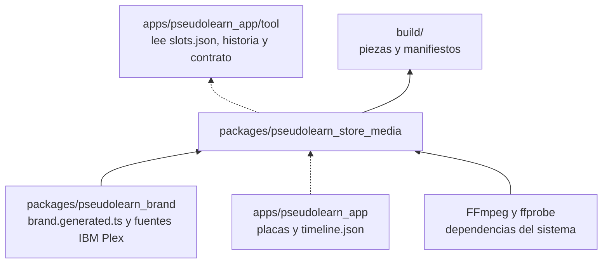
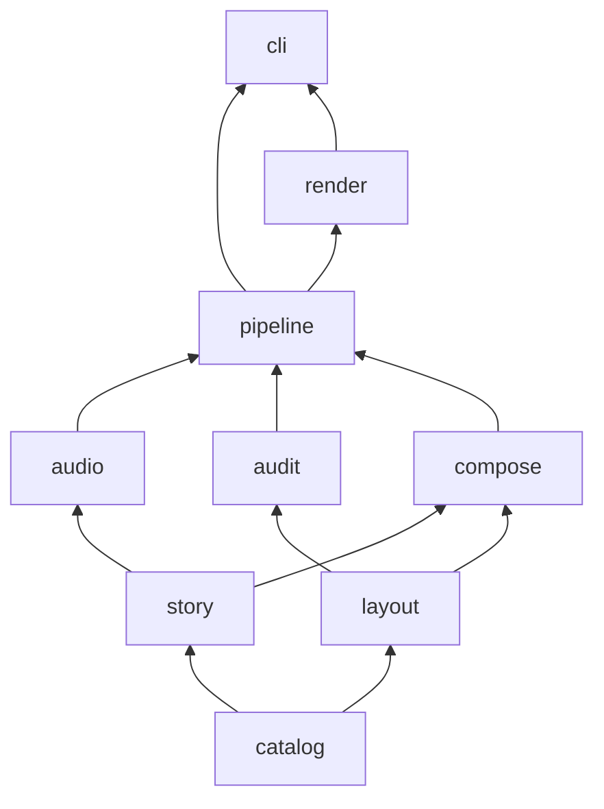
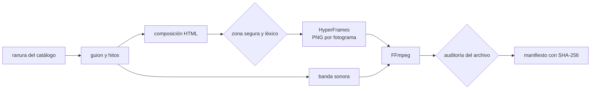
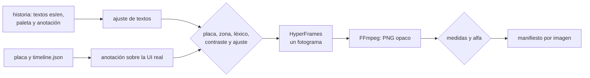

# pseudolearn_store_media

Motor que produce de forma determinista los assets de las tiendas donde se publica PseudoLearn: capturas, vídeos de
encabezado y de búsqueda e imagen universal de App Store, y capturas, arte y tráiler de Microsoft Store. Compone en HTML
con HyperFrames, sintetiza la banda sonora, codifica con FFmpeg y audita cada pieza contra el catálogo de su ranura.

**No hace:** generar imagen, vídeo ni audio con IA, inventar interfaz (la UI real llega como placas que graba la app),
subir nada a las tiendas ni producir *app previews* de App Store.

## Dónde encaja

Las líneas punteadas son contratos de datos, no imports: la app graba las placas que el motor lee, y su herramienta
`store_plates` lee de este paquete `catalog/slots.json`, `stories/app-store-screenshots.json` y
`tests/contracts/plate-timeline.json`.

## Arquitectura

Se omiten las aristas hacia `catalog`, que todas las capas importan, las de `story` y `layout` hacia `pipeline` y la de
`audit` hacia `render`.

| Capa       | Qué hace                                                                                                                          |
|:-----------|:----------------------------------------------------------------------------------------------------------------------------------|
| `catalog`  | Lee y valida `catalog/slots.json` y `catalog/lexicon.json`: ranuras, dispositivos, perfiles de códec y sonoridad                  |
| `story`    | Guiones con hitos e historias de capturas, de la lente y del tráiler; lectura del `timeline.json` de las placas                   |
| `layout`   | Zonas seguras, recorte por dispositivo, muestreo de fotogramas, ajuste de titulares, anclaje de anotaciones y geometría de lentes |
| `audio`    | Partitura, síntesis, ganancia y codificación WAV, sin dependencias                                                                |
| `audit`    | Hallazgos con regla estable sobre medidas, alfa, códec, fps, duración, audio, bucle, placa, léxico, contraste, ajuste y entrega   |
| `compose`  | Composiciones HTML: calibración, capturas editoriales y de escritorio, lente, lente muda y tráiler                                |
| `pipeline` | Plan ranura × idioma y producción de capturas, imágenes y vídeo, expresada contra los puertos de `ports.ts`                       |
| `render`   | Adaptadores de los puertos: HyperFrames, FFmpeg y ffprobe, ensamblado de placas, archivos y catálogo                              |
| `cli`      | Los ocho comandos de `pnpm media`                                                                                                 |

## Flujo principal

Flujo de datos de una pieza de vídeo, no de dependencias.

Flujo de una captura fija:

Si falla una regla previa al render (placa ausente o de otra medida, texto fuera de margen, léxico, contraste o
titular que no cabe), la imagen no se renderiza.

## Reglas que conviene saber

- Las capas solo importan lo que permite `architecture.json`; `node:`, `@hyperframes/` y `hyperframes` solo se importan
  desde `render` y `cli`.
- Archivos de 200 líneas, funciones de 40, 4 parámetros, 3 niveles de anidamiento y 7 métodos públicos por clase;
  rigen también en `tests/` y `scripts/`. Sin comentarios en ningún archivo de código.
- Un fallo esperable es un valor (`Outcome`, `Parsed`, `Finding`), no una excepción que cruce el CLI.
- `src/compose/brand.generated.ts` lo escribe `pseudolearn_brand`; está en el `.gitignore` y no se edita.
- Añadir una ranura es añadir una entrada a `catalog/slots.json`; el parser rechaza lo que no reconoce.
- Toda dependencia nueva debe llevar al menos 14 días publicada (`minimumReleaseAge` en `pnpm-workspace.yaml`).

## Comandos útiles

| Para qué                            | Comando                                                                          |
|:------------------------------------|:---------------------------------------------------------------------------------|
| Instalar dependencias               | `pnpm install`                                                                   |
| Generar el módulo de marca          | `pnpm generate:brand`                                                            |
| Tipos, capas, comentarios y tamaños | `pnpm check`                                                                     |
| Tests                               | `pnpm test`                                                                      |
| Listar las ranuras por idioma       | `pnpm media plan --lang es`                                                      |
| Calibración de una ranura de vídeo  | `pnpm media calibrate --slot apple.header.video --lang es`                       |
| Auditar una imagen                  | `pnpm media audit-image --slot apple.mac.screenshot --file x.png`                |
| Capturas de App Store               | `pnpm media screenshots` (`--slot`, `--lang`, `--story`, `--plates`, `--guides`) |
| Encabezado, búsqueda y universal    | `pnpm media creative` (`--slot`, `--lang`, `--story`)                            |
| Capturas de escritorio de Microsoft | `pnpm media desktop-screenshots` (`--lang`, `--story`, `--plates`)               |
| Héroe, póster y caja de Microsoft   | `pnpm media hero` (`--slot`, `--lang`)                                           |
| Tráiler de Microsoft con miniatura  | `pnpm media trailer` (`--lang`, `--plates`)                                      |

`screenshots` y `desktop-screenshots` leen por defecto las placas de `../../apps/pseudolearn_app/build/store-plates`;
`trailer`, las de `build/trailer-plates` de la app. `creative` y `hero` no necesitan placas.

Requisitos: Node 22.23.3, pnpm 12.8.1, FFmpeg y ffprobe en el `PATH` con `aac_at` (solo macOS) para el tráiler de
Microsoft, y Python 3 con `fonttools` para generar la marca. Las salidas quedan en `build/`, fuera de git.

## Pendientes declarados

- Las ranuras de búsqueda y universal de App Store no tienen perfiles de recorte medidos (`viewportProfiles` solo
  existe en `apple.header.video`); su revisión final es humana, en Preview de App Store Connect.
