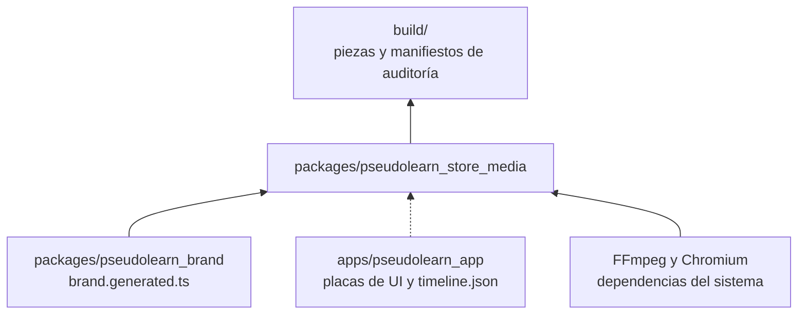
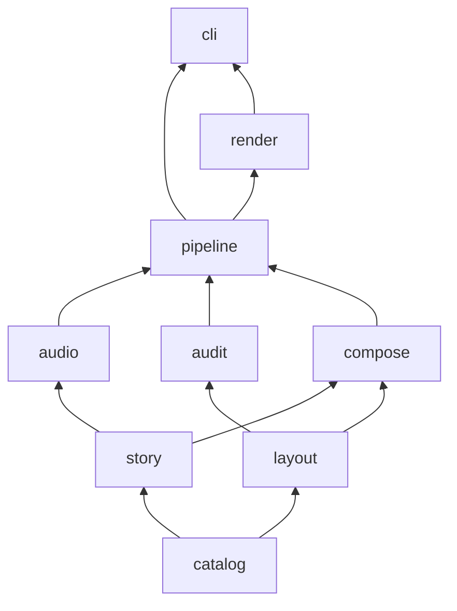
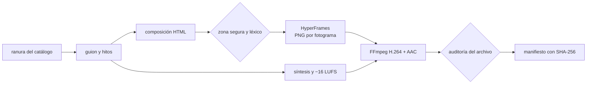
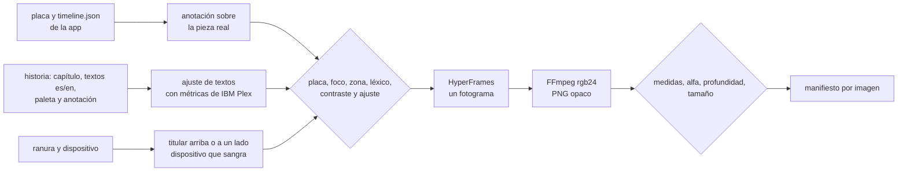
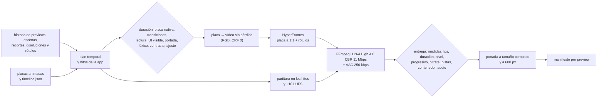

# pseudolearn_store_media

Motor que produce de forma automática y determinista los assets de las tiendas donde se publica PseudoLearn: capturas,
app previews, vídeos de encabezado y de búsqueda, imagen universal y arte de Microsoft Store. Compone en HTML con
HyperFrames, sintetiza la banda sonora, codifica con FFmpeg y audita cada pieza contra el catálogo de su ranura antes
de darla por buena.

**No hace:** generar imágenes, vídeo ni audio con IA, inventar interfaz (la UI real llega como placas exportadas por
la app), subir nada a App Store Connect ni al Centro de partners, ni decidir la narrativa: los guiones se aprueban con
la persona antes de escribirse.

## Dónde encaja

La línea punteada es un contrato de datos (`story/plate_timeline.ts`), no un import.

## Arquitectura

Se omiten las aristas hacia `catalog`, que todas las capas pueden importar, y las de `story` y `layout` hacia
`pipeline` y de `audit` hacia `render`.

| Capa       | Qué hace                                                                                         |
|:-----------|:-------------------------------------------------------------------------------------------------|
| `catalog`  | Lee y valida `catalog/slots.json` y `catalog/lexicon.json`: ranuras, dispositivos, códecs, sonoridad, léxico |
| `story`    | Guiones con hitos (`Beat`), historias de capturas y de previews, plan temporal de escenas y lectura de las placas de la app |
| `layout`   | Zonas seguras, recorte por dispositivo, métricas de fuentes, ajuste de textos, geometría editorial, rótulos de preview y anclaje de anotaciones |
| `audio`    | Partitura, síntesis en bucle exacto, ganancia y codificación WAV, sin dependencias              |
| `audit`    | Hallazgos con regla estable: medidas, alfa, códec, fps, duración, audio, bucle, placa, léxico, contraste, ajuste, entrega, transiciones, UI visible, portada y tiempo de lectura |
| `compose`  | Composiciones HyperFrames en HTML: calibración, captura editorial y preview con placas animadas    |
| `pipeline` | Plan objetivo × idioma, producción de capturas, vídeo y previews, banda sonora y manifiesto, contra puertos |
| `render`   | Adaptadores: productor de HyperFrames, FFmpeg y ffprobe, ensamblado de placas, archivos y catálogo |
| `cli`      | `plan`, `calibrate`, `screenshots`, `previews` y `audit-image`                                     |

## Flujo principal

Flujo de datos de una pieza de vídeo, no de dependencias.

Flujo de una captura fija:

Cada imagen tiene su manifiesto `<nn>-<capítulo>.audit.json` con un hallazgo por regla incumplida. Si falla una regla
previa (placa ausente o de otra medida, texto fuera del margen, léxico, contraste o titular que no cabe), la imagen no
se renderiza.

Flujo de una app preview:

Cada preview tiene su manifiesto `<nn>-<preview>.audit.json`, su portada a tamaño completo y su portada con el lado
largo a 600 px para revisarla como se verá con la reproducción automática apagada. Si falla una regla previa, la
preview no se renderiza.

## Fuentes de Apple para las app previews

Leídas el 2026-11-10. Cada regla del motor que viene de Apple sale de esta tabla; lo que no aparece aquí es una
**decisión propia** y figura como tal en «Decisiones y su porqué».

| Fuente | Qué dice | Qué hace el motor |
|:--|:--|:--|
| [App previews](https://developer.apple.com/app-store/app-previews/) | Metraje capturado de la app; solo contenido de la propia app, sin personas, manos ni planos del dispositivo | Las escenas son placas grabadas de la UI real con el motor real; `MEDIA-APP-UI` exige UI en todos los fotogramas |
| ↑ | Hasta tres previews por idioma y hasta 30 s; cada una enseña algo nuevo | La historia admite de 1 a 3 previews; el reparto se decide en el diálogo |
| ↑ | Se permiten gráficos como puntos de toque; se recomienda la resolución nativa de la UI en vez de ampliar | Los toques salen de los eventos `tap` que graba la app; `MEDIA-PLATE` rechaza una placa que no mida exactamente la ranura |
| ↑ | Transiciones sencillas, como disoluciones y fundidos, que no sugieran funciones inexistentes | Entre escenas solo hay disolución (`MEDIA-TRANSITION`); los rótulos entran y salen con fundido |
| ↑ | Suena en silencio por defecto: texto legible y en pantalla el tiempo necesario; sin precios, fechas ni referencias de temporada | `TEXT-READ-TIME`, `TEXT-FIT`, `TEXT-CONTRAST` y el léxico (`price`, `timely`) |
| ↑ | Si hay compras, suscripción o inicio de sesión, se indica en el metraje o en el fotograma final | Rótulo de rol `disclosure` |
| ↑ | Una sola banda sonora para dar continuidad; efectos de la UI y narración opcionales | Una partitura sintetizada por preview, anclada a los hitos de la app |
| ↑ | Portada que transmita la esencia; cambiarla en una preview aprobada exige una versión nueva | `posterSeconds` en la historia, `MEDIA-POSTER` y portada a 600 px |
| [Especificaciones](https://developer.apple.com/help/app-store-connect/reference/app-information/app-preview-specifications) | De 15 a 30 s, 500 MB, hasta tres por tamaño de dispositivo e idioma | `MEDIA-DURATION`, `MEDIA-SIZE` y la historia |
| ↑ | H.264 progresivo hasta High 4.0, 10–12 Mbps, 30 fps como máximo, en .mov, .m4v o .mp4 | Perfil `apple-preview` en CBR a 11 Mbps; `MEDIA-CODEC`, `MEDIA-BITRATE`, `MEDIA-FPS`, `MEDIA-CONTAINER` |
| ↑ | Audio estéreo AAC de 256 kbps a 44,1 o 48 kHz; todas las pistas habilitadas | AAC 256 kbps a 48 kHz; `MEDIA-AUDIO` y `MEDIA-TRACKS` |
| ↑ | iPhone 886 × 1920 (también Duo y Dynamic Island), iPad 13" 1200 × 1600, Mac 1920 × 1080 solo horizontal | Una ranura por medida, con su dispositivo de grabación |
| ↑ | Portada por defecto en el segundo 5; la preview va antes que las capturas y, si su proporción difiere, en «A Closer Look» | La portada se fija en la historia; las previews se graban en vertical en iPhone, como las capturas |
| [Guías de revisión 2.3](https://developer.apple.com/app-store/review/guidelines/) | 2.3.4: solo capturas de vídeo de la app, con narración y superposiciones de vídeo o texto para explicar | Igual que la fila de metraje: placas de la app y superposiciones |
| ↑ | 2.3.2 y 2.3.7: indicar compras; sin precios ni términos. 2.3.8: apto 4+. 2.3.9: derechos y datos de cuenta ficticios. 2.3.10: sin otras plataformas | Rótulo `disclosure`, léxico (`price`, `other-platform`) y la cuenta ficticia de las placas |
| [Catálogo de la API](https://developer.apple.com/documentation/appstoreconnectapi) `GET /v1/appAssetLibraryRefData` | `audioRequired: true`, 23–30 fps, 500 MB, tres por grupo; duración `PT5S`–`PT30S` con `shortName` `t15~30` | Audio obligatorio, 30 fps y 15–30 s (lo más estricto de las dos fuentes) |

## Decisiones y su porqué

- **HyperFrames y FFmpeg, no el flujo Swift de traceiron.** Node ya es una cadena del monorepo; Swift sería una sexta.
  HTML da tipografía y movimiento expresivos, y la vista previa en el navegador sirve para dialogar el estilo. Se
  reutilizan de traceiron las ideas (catálogo, zona segura, auditorías), no el código.
- **HyperFrames entrega PNG y el motor codifica.** El productor no garantiza los perfiles que exigen las tiendas
  (nivel 4.0, GOP cerrado de Microsoft, Rec.709, AAC a 256 o 384 kbps). Por eso se le pide `png-sequence` y FFmpeg
  codifica con argumentos que el motor controla y prueba.
- **GSAP local.** Las composiciones cargan `gsap.min.js` copiado de `node_modules`, nunca de una CDN: el render no
  depende de la red. GSAP tiene licencia «Standard no charge» y solo se usa como herramienta interna.
- **Telemetría apagada.** Antes de usar HyperFrames, el CLI fija `HYPERFRAMES_NO_TELEMETRY=1` y `DO_NOT_TRACK=1`.
- **Banda sonora sintetizada.** Sin muestras, bibliotecas de música ni IA. El colchón usa frecuencias con un número
  entero de ciclos en la duración del vídeo, y la cola de una nota tardía vuelve al principio, así el bucle no salta.
  Se normaliza a −16 LUFS con pico verdadero ≤ −1 dBTP (nivel de Microsoft; Apple no fija ninguno). El vídeo de
  búsqueda no lleva pista: Apple no deja activar su sonido.
- **Zonas seguras oficiales.** Encabezado, búsqueda y universal usan el rectángulo «Art Safe Area» de la plantilla
  Sketch de Apple (2026-08-28). Las de Microsoft salen de su documentación: lo crítico en los dos tercios superiores
  de capturas y arte, y un 10 % de margen arriba y abajo en tráileres, porque Microsoft solo dice que algunas
  disposiciones recortan «ligeramente».
- **Duraciones conservadoras.** Encabezado de 10 a 30 s y previews de 15 a 30 s: cumplen a la vez el campo
  `duration` y el `shortName` del catálogo de la API de App Store Connect, que no coinciden.
- **El catálogo es dato.** Añadir una ranura es una entrada en `slots.json`; el parser rechaza claves desconocidas,
  perfiles de códec inexistentes y zonas fuera del lienzo.
- **Dispositivos como datos.** `slots.json` declara cada dispositivo de captura con su tamaño lógico, la escala de su
  placa, el radio de pantalla, el tipo de marco y el eje del pliegue. Los tamaños del iPhone Duo son los medidos en el
  simulador (ver el README de la app). La app lee esta misma lista para grabar sus placas, así que no hay una segunda
  copia. Cada placa mide exactamente la ranura de su captura (por ejemplo, 951 × 669 pt × 3 = 2853 × 2007 px). El Mac
  es la excepción deliberada: se graba a 1152 × 720 pt × 2,5 en vez de 1440 × 900 × 2, para que la UI se lea un 25 %
  más grande dentro del portátil; sigue en la clase expandida de la app (más de 960 pt).
- **Concepto editorial (aprobado por la persona en F2).** Cada capítulo tiene su color de campo, su número y un
  titular grande con palabras subrayadas como con marcador (`*…*` en la historia). El pseudocódigo del programa de
  demostración aparece gigante y tenue como textura. El dispositivo sangra por abajo en vertical y por la derecha en
  apaisado. Una anotación con punto señala la pieza real de la UI que el capítulo cuenta, y un velo oscurece el resto
  de la pantalla. La primera captura es un manifiesto sin anotación: titular, subtítulo y un programa válido en una
  tarjeta de código. Se descartaron en el diálogo tres variantes de fondo liso con la captura al centro y dos
  conceptos más (panorama oscuro continuo y escenario negro con 3D).
- **La anotación sale de la UI real.** La placa de cada capítulo trae en `timeline.json` los rectángulos de sus
  piezas; la historia elige una (`focus`) y un punto relativo (`pin`). Si la placa no la grabó, `MEDIA-PLATE` rechaza
  la imagen. Un rectángulo que se sale de la placa (zona con desplazamiento) se recorta a ella.
- **Eje del pliegue del Duo: supuesto.** Apple no publica la posición de la bisagra. Se supone en el centro: vertical
  en la pantalla interior apaisada y horizontal en la vertical. Las dos mitades se giran 10° en 3D como un libro
  abierto; los puntos de las anotaciones se proyectan con el coseno de ese ángulo, sin perspectiva, así que pueden
  desviarse unos píxeles.
- **Margen de las capturas.** Apple no publica zona segura para capturas. El motor reserva un 4 % a los lados y un 3 %
  arriba y abajo (`text-inside-margin`) para que el texto no toque las esquinas redondeadas de las miniaturas. Es una
  decisión propia, no de Apple.
- **Los textos se ajustan antes de renderizar.** El motor lee los anchos de avance de `IBMPlexSans-Bold.ttf` (titular,
  número y anotación) y de `IBMPlexMono-Medium.ttf` (subtítulo y código) con sus tablas `cmap` formato 4 y `hmtx`, sin
  kerning, que solo estrecha, así que la medida es conservadora. Busca el mayor tamaño con el que todas las líneas
  caben; si ni el mínimo cabe, `TEXT-FIT` rechaza la imagen. Los saltos de línea se escriben en la historia; el motor
  no parte frases. Las fuentes se leen de `pseudolearn_brand/assets/fonts`, dueño de la identidad. Los glifos que IBM
  Plex no tiene (como ✓) se evitan en la historia, porque el navegador los sustituiría por otra fuente.
- **Captura fija con HyperFrames.** Se renderiza un único fotograma a 1 fps y FFmpeg lo reescribe en `rgb24`, porque
  Chromium entrega PNG con canal alfa aunque sea opaco. La auditoría de imagen vuelve a comprobar medida y alfa.
- **Historia como datos.** `stories/app-store-screenshots.json` fija el orden de capítulos, los textos `es` y `en`, el
  tipo (`manifesto` o `device`), la paleta (`paper`, `mint`, `sand`, `deep`, `peach`, `mist`), el tema de la app en la
  placa y la anotación. Las paletas viven en `compose` y la auditoría de contraste las prueba todas. El código que
  muestra el manifiesto lo verifica la app con el analizador real antes de grabar placas.
- **Léxico heredado.** Las reglas de titular de la composición antigua de la app que el catálogo no tenía (versiones
  previas y llamadas a la acción) pasaron a `lexicon.json` como `pre-release` y `call-to-action`.
- **Previews: placas animadas, a la medida exacta de la ranura.** La app graba cada escena en vivo, fotograma a
  fotograma, con su motor real y su tamaño lógico; el motor la dibuja a 1:1, sin ampliar ni reducir. Por eso las
  previews no llevan marcos de dispositivo. Los tamaños son decisión propia: iPhone 443 × 960 pt × 2 (clase compacta),
  iPad el tamaño real del iPad de 13", 1032 × 1376 pt × 1200/1032 (en doble precisión da exactamente 1200 × 1600), y
  Mac 1280 × 720 pt × 1,5 (clase expandida). Se descartaron 600 × 800 pt y 960 × 540 pt: en esos anchos, justo en el
  borde de clase, la fila del `ExecutionStepper` de la app se desborda 11 y 35 px.
- **Áreas seguras reales en las previews.** iPhone graba con 62 pt arriba y 34 abajo, e iPad con 24 y 20, como un
  dispositivo real; el Mac, sin márgenes. La barra de estado no se dibuja: no es UI de la app.
- **Fotogramas repetidos.** La app escribe un PNG solo cuando la imagen cambia y repite el nombre en `timeline.json`.
  El motor enlaza los fotogramas en orden y los ensambla en un vídeo RGB sin pérdida (`libx264rgb`, CRF 0) que
  HyperFrames reproduce con `data-media-start` y extracción en PNG.
- **CBR con relleno.** Una UI quieta comprime a menos de 1 Mbps, por debajo de los 10–12 Mbps de Apple; la
  calibración de F2 salía a 0,71 Mbps. El perfil `apple-preview` usa `nal-hrd=cbr` a 11 Mbps, así que el archivo queda
  en 10,9 Mbps aunque la imagen no cambie.
- **Umbrales de preview (decisiones propias).** Disolución entre 0,4 y 1,5 s; cada escena se ve sola al menos 2 s,
  para evitar cortes rápidos; un rótulo dura al menos 1 s más un tercio de segundo por palabra, nunca menos de 2 s; en
  cada fotograma se ve al menos el 50 % de la UI; el texto visible en la portada mide al menos 11 px con el lado largo
  a 600 px; los rótulos entran y salen en 0,3 s y un toque se ve 0,6 s. Las pistas habilitadas se leen de la
  disposición `default` que ffprobe deriva de la marca `enabled` de cada pista.
- **Concepto de las previews (aprobado por la persona en F3): tarjeta de marca sobre UI real.** Cada preview abre con
  el logotipo en una tarjeta breve (2,3 s) sobre la app ya en marcha y cierra con otra tarjeta (3,3 s) abajo; la UI
  sigue viéndose a su alrededor, como superposición que admite la guía 2.3.4. Entre medias, la UI a pantalla completa
  con el titular con marcador de F2 en la paleta del capítulo, puntos de toque y, solo en escenas quietas, una
  anotación con punto. Si una preview muestra una escena que exige sesión o compra (`disclosure.plates`, hoy
  `preview-nodo`), la tarjeta de cierre lleva el aviso; si no lo lleva ni hay rótulo `disclosure`,
  `MEDIA-DISCLOSURE` la rechaza. Se descartaron los rótulos solos (A) y una franja editorial de color fija (B), que
  tapaba la cabecera del documento. Tres previews por tamaño e idioma: «Resumen» (programa, diagrama y Nodo),
  «Ejecutar y entender» (diagrama y prueba de escritorio) y «Nodo, ruta y código»; portada en el segundo 5.
- **Banda sonora de las previews.** `PREVIEW_VOICE`: colchón suave en do y una nota breve por cada hito real de la
  app (toque, paso, mensaje de Nodo), elegida por la persona frente a una versión rítmica.
- **Rótulos que no tapan lo que importa.** Cada rol tiene su borde por defecto (titular arriba; nota y aviso abajo) y
  la historia puede moverlo con `anchor` cuando taparía una pieza que la escena necesita, como la etiqueta «Nodo · IA»
  del panel. Una anotación con punto se ancla al rectángulo de su pieza en el fotograma en que aparece; si la UI se
  desplaza debajo (el diagrama sigue la ejecución), el punto se queda donde estaba, así que solo conviene en escenas
  quietas.
- **Calibración.** `calibrate` produce una pieza neutra (marca, ruta animada y pulsos en los hitos) por ranura de vídeo
  para probar toda la cadena sin narrativa. No es material publicable.

## Reglas que conviene saber

- Las capas solo importan lo que permite `architecture.json`. `node:`, `@hyperframes/` y `hyperframes` solo se importan
  desde `render` y `cli`.
- Archivos de 200 líneas, funciones de 40, 4 parámetros, 3 niveles de anidamiento y 7 métodos públicos por clase,
  también en los tests. Sin comentarios en ningún archivo de código.
- Un fallo esperable es un valor (`Outcome`, `Parsed`, `Finding`), nunca una excepción que cruce el CLI.
- `src/compose/brand.generated.ts` lo escribe `pseudolearn_brand`; no se edita ni se versiona.
- Toda dependencia nueva debe tener al menos 14 días publicada (`minimumReleaseAge` en `pnpm-workspace.yaml`).

## Comandos útiles

| Para qué                                    | Comando                                                       |
|:--------------------------------------------|:--------------------------------------------------------------|
| Instalar dependencias y Chromium            | `pnpm install`                                                |
| Generar el módulo de marca                  | `pnpm generate:brand`                                         |
| Tipos, capas, comentarios y tamaños         | `pnpm check`                                                  |
| Tests                                       | `pnpm test`                                                   |
| Listar las ranuras por idioma               | `pnpm media plan --lang es`                                   |
| Producir una calibración                    | `pnpm media calibrate --slot apple.header.video --lang es`    |
| Ver la zona segura en la calibración        | `pnpm media calibrate --slot apple.header.video --guides`     |
| Auditar una imagen                          | `pnpm media audit-image --slot apple.mac.screenshot --file x.png` |
| Producir todas las capturas de App Store    | `pnpm media screenshots` (o `--lang es`, `--story otra.json`)  |
| Capturas de una ranura con el margen visible | `pnpm media screenshots --slot apple.mac.screenshot --guides`  |
| Producir las app previews                   | `pnpm media previews` (o `--slot`, `--lang`, `--story`, `--plates`) |

`previews` lee las placas animadas de `../../apps/pseudolearn_app/build/store-previews` y escribe en
`build/previews/<historia>/`. `screenshots` lee las placas de `../../apps/pseudolearn_app/build/store-plates` (o de `--plates`) y escribe en
`build/screenshots/<historia>/`. Sin `--slot`, produce todas las ranuras que declaran dispositivo.

Requisitos: Node 22.23.3 y pnpm 12.8.1, FFmpeg y ffprobe en el `PATH` (probado con 9.0.2), Python 3 con `fonttools`
para generar la marca. Las salidas quedan en `build/`, fuera de git.
