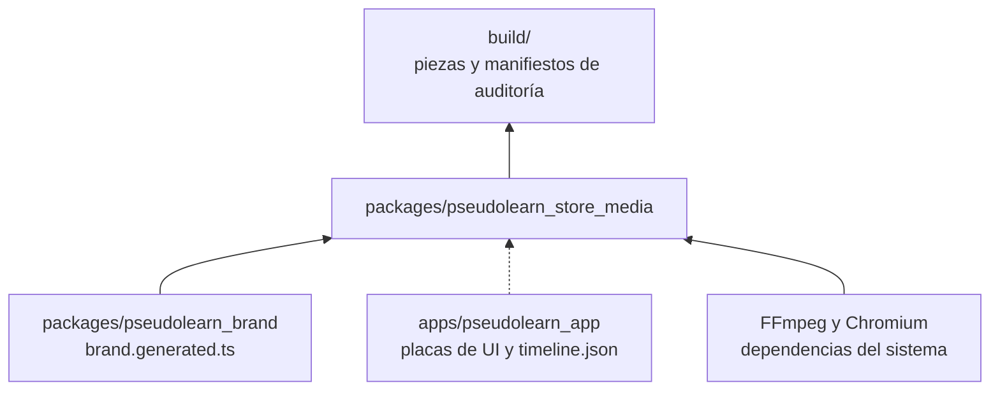
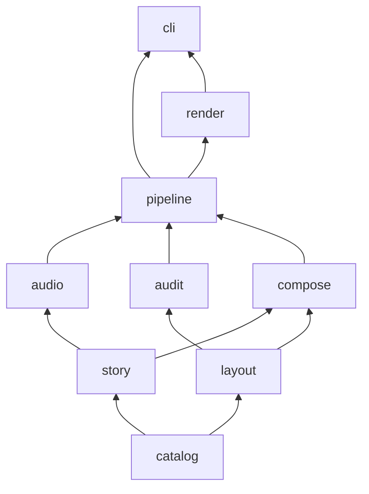
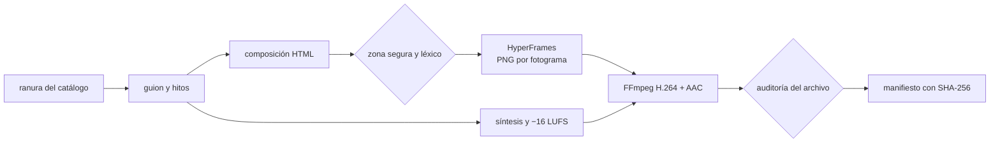

# pseudolearn_store_media

Motor que produce de forma automática y determinista los assets de las tiendas donde se publica PseudoLearn: capturas,
app previews, vídeos de encabezado y de búsqueda, imagen universal y arte de Microsoft Store. Compone en HTML con
HyperFrames, sintetiza la banda sonora, codifica con FFmpeg y audita cada pieza contra el catálogo de su ranura antes
de darla por buena.

**No hace:** generar imágenes, vídeo ni audio con IA, inventar interfaz (la UI real llega como placas exportadas por
la app), subir nada a App Store Connect ni al Centro de partners, ni decidir la narrativa: los guiones se aprueban con
la persona antes de escribirse.

## Dónde encaja

La línea punteada es un contrato de datos (`story/plate_timeline.ts`), no un import.

## Arquitectura

Se omiten las aristas hacia `catalog`, que todas las capas pueden importar, y las de `story` y `layout` hacia
`pipeline` y de `audit` hacia `render`.

| Capa       | Qué hace                                                                                         |
|:-----------|:-------------------------------------------------------------------------------------------------|
| `catalog`  | Lee y valida `catalog/slots.json` y `catalog/lexicon.json`: ranuras, códecs, sonoridad, léxico    |
| `story`    | Guiones con hitos (`Beat`) y lectura de la línea de tiempo de las placas de la app                |
| `layout`   | Zonas seguras, proyección de recorte por dispositivo y comprobación por fotograma                |
| `audio`    | Partitura, síntesis en bucle exacto, ganancia y codificación WAV, sin dependencias              |
| `audit`    | Hallazgos con regla estable: medidas, alfa, códec, fps, duración, audio, bucle, léxico, contraste |
| `compose`  | Composiciones HyperFrames en HTML; incluye el módulo de marca generado                           |
| `pipeline` | Plan objetivo × idioma, producción de vídeo, banda sonora y manifiesto, contra puertos           |
| `render`   | Adaptadores: productor de HyperFrames, FFmpeg y ffprobe, archivos y carga del catálogo           |
| `cli`      | `plan`, `calibrate` y `audit-image`                                                               |

## Flujo principal

Flujo de datos de una pieza de vídeo, no de dependencias.

## Decisiones y su porqué

- **HyperFrames y FFmpeg, no el flujo Swift de traceiron.** Node ya es una cadena del monorepo; Swift sería una sexta.
  HTML da tipografía y movimiento expresivos, y la vista previa en el navegador sirve para dialogar el estilo. Se
  reutilizan de traceiron las ideas (catálogo, zona segura, auditorías), no el código.
- **HyperFrames entrega PNG y el motor codifica.** El productor no garantiza los perfiles que exigen las tiendas
  (nivel 4.0, GOP cerrado de Microsoft, Rec.709, AAC a 256 o 384 kbps). Por eso se le pide `png-sequence` y FFmpeg
  codifica con argumentos que el motor controla y prueba.
- **GSAP local.** Las composiciones cargan `gsap.min.js` copiado de `node_modules`, nunca de una CDN: el render no
  depende de la red. GSAP tiene licencia «Standard no charge» y solo se usa como herramienta interna.
- **Telemetría apagada.** Antes de usar HyperFrames, el CLI fija `HYPERFRAMES_NO_TELEMETRY=1` y `DO_NOT_TRACK=1`.
- **Banda sonora sintetizada.** Sin muestras, bibliotecas de música ni IA. El colchón usa frecuencias con un número
  entero de ciclos en la duración del vídeo, y la cola de una nota tardía vuelve al principio, así el bucle no salta.
  Se normaliza a −16 LUFS con pico verdadero ≤ −1 dBTP (nivel de Microsoft; Apple no fija ninguno). El vídeo de
  búsqueda no lleva pista: Apple no deja activar su sonido.
- **Zonas seguras oficiales.** Encabezado, búsqueda y universal usan el rectángulo «Art Safe Area» de la plantilla
  Sketch de Apple (2026-08-28). Las de Microsoft salen de su documentación: lo crítico en los dos tercios superiores
  de capturas y arte, y un 10 % de margen arriba y abajo en tráileres, porque Microsoft solo dice que algunas
  disposiciones recortan «ligeramente».
- **Duraciones conservadoras.** Encabezado de 10 a 30 s y previews de 15 a 30 s: cumplen a la vez el campo
  `duration` y el `shortName` del catálogo de la API de App Store Connect, que no coinciden.
- **El catálogo es dato.** Añadir una ranura es una entrada en `slots.json`; el parser rechaza claves desconocidas,
  perfiles de códec inexistentes y zonas fuera del lienzo.
- **Calibración.** `calibrate` produce una pieza neutra (marca, ruta animada y pulsos en los hitos) por ranura de vídeo
  para probar toda la cadena sin narrativa. No es material publicable.

## Reglas que conviene saber

- Las capas solo importan lo que permite `architecture.json`. `node:`, `@hyperframes/` y `hyperframes` solo se importan
  desde `render` y `cli`.
- Archivos de 200 líneas, funciones de 40, 4 parámetros, 3 niveles de anidamiento y 7 métodos públicos por clase,
  también en los tests. Sin comentarios en ningún archivo de código.
- Un fallo esperable es un valor (`Outcome`, `Parsed`, `Finding`), nunca una excepción que cruce el CLI.
- `src/compose/brand.generated.ts` lo escribe `pseudolearn_brand`; no se edita ni se versiona.
- Toda dependencia nueva debe tener al menos 14 días publicada (`minimumReleaseAge` en `pnpm-workspace.yaml`).

## Comandos útiles

| Para qué                                    | Comando                                                       |
|:--------------------------------------------|:--------------------------------------------------------------|
| Instalar dependencias y Chromium            | `pnpm install`                                                |
| Generar el módulo de marca                  | `pnpm generate:brand`                                         |
| Tipos, capas, comentarios y tamaños         | `pnpm check`                                                  |
| Tests                                       | `pnpm test`                                                   |
| Listar las ranuras por idioma               | `pnpm media plan --lang es`                                   |
| Producir una calibración                    | `pnpm media calibrate --slot apple.header.video --lang es`    |
| Ver la zona segura en la calibración        | `pnpm media calibrate --slot apple.header.video --guides`     |
| Auditar una imagen                          | `pnpm media audit-image --slot apple.mac.screenshot --file x.png` |

Requisitos: Node 22.23.3 y pnpm 12.8.1, FFmpeg y ffprobe en el `PATH` (probado con 9.0.2), Python 3 con `fonttools`
para generar la marca. Las salidas quedan en `build/`, fuera de git.
