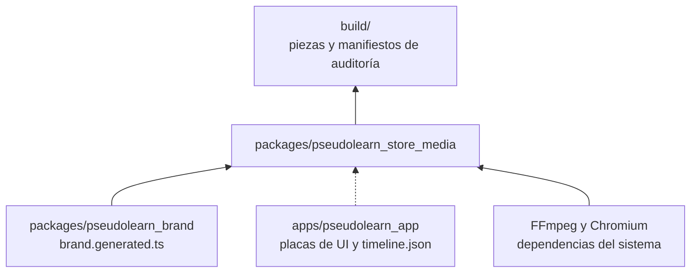
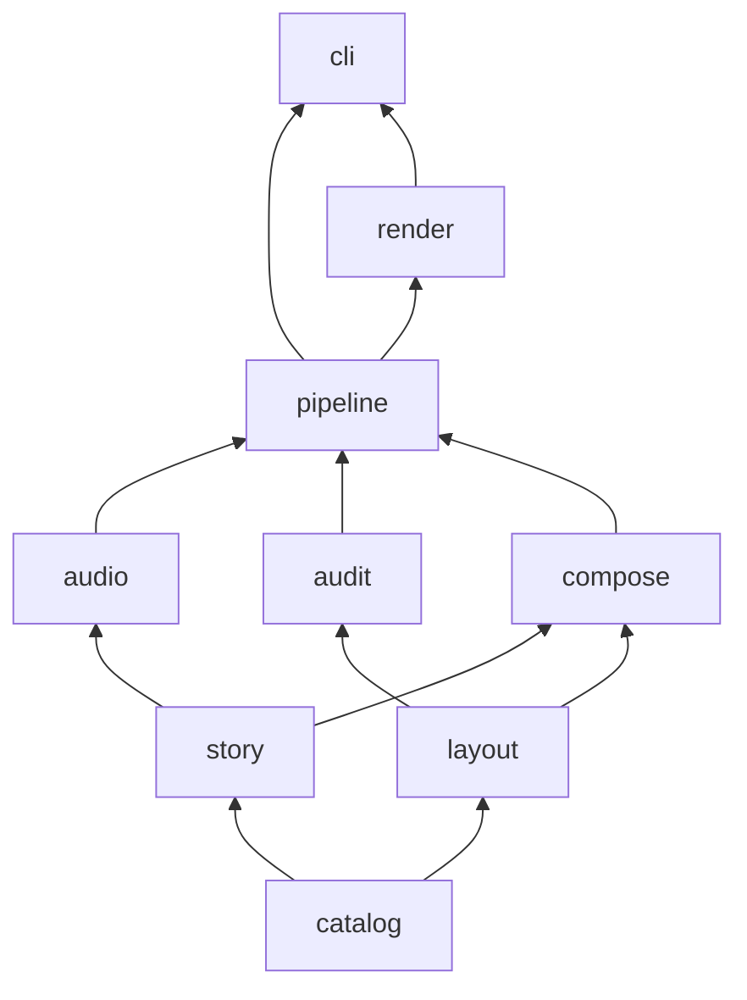
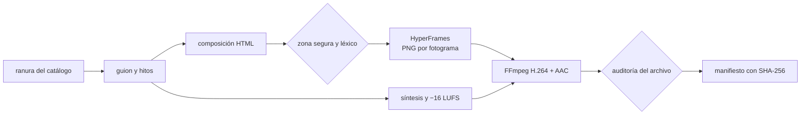
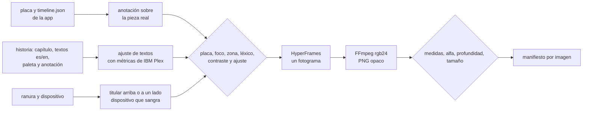

# pseudolearn_store_media

Motor que produce de forma automática y determinista los assets de las tiendas donde se publica PseudoLearn: capturas,
app previews, vídeos de encabezado y de búsqueda, imagen universal y arte de Microsoft Store. Compone en HTML con
HyperFrames, sintetiza la banda sonora, codifica con FFmpeg y audita cada pieza contra el catálogo de su ranura antes
de darla por buena.

**No hace:** generar imágenes, vídeo ni audio con IA, inventar interfaz (la UI real llega como placas exportadas por
la app), subir nada a App Store Connect ni al Centro de partners, ni decidir la narrativa: los guiones se aprueban con
la persona antes de escribirse.

## Dónde encaja

La línea punteada es un contrato de datos (`story/plate_timeline.ts`), no un import.

## Arquitectura

Se omiten las aristas hacia `catalog`, que todas las capas pueden importar, y las de `story` y `layout` hacia
`pipeline` y de `audit` hacia `render`.

| Capa       | Qué hace                                                                                         |
|:-----------|:-------------------------------------------------------------------------------------------------|
| `catalog`  | Lee y valida `catalog/slots.json` y `catalog/lexicon.json`: ranuras, dispositivos, códecs, sonoridad, léxico |
| `story`    | Guiones con hitos (`Beat`), historias de capturas por capítulos y lectura de las placas de la app |
| `layout`   | Zonas seguras, recorte por dispositivo, métricas de fuentes, ajuste de textos, geometría editorial y anclaje de anotaciones |
| `audio`    | Partitura, síntesis en bucle exacto, ganancia y codificación WAV, sin dependencias              |
| `audit`    | Hallazgos con regla estable: medidas, alfa, códec, fps, duración, audio, bucle, placa, léxico, contraste, ajuste |
| `compose`  | Composiciones HyperFrames en HTML: vídeo, y captura editorial con marcos de dispositivo y paletas  |
| `pipeline` | Plan objetivo × idioma, producción de vídeo, banda sonora y manifiesto, contra puertos           |
| `render`   | Adaptadores: productor de HyperFrames, FFmpeg y ffprobe, archivos y carga del catálogo           |
| `cli`      | `plan`, `calibrate`, `screenshots` y `audit-image`                                                |

## Flujo principal

Flujo de datos de una pieza de vídeo, no de dependencias.

Flujo de una captura fija:

Cada imagen tiene su manifiesto `<nn>-<capítulo>.audit.json` con un hallazgo por regla incumplida. Si falla una regla
previa (placa ausente o de otra medida, texto fuera del margen, léxico, contraste o titular que no cabe), la imagen no
se renderiza.

## Decisiones y su porqué

- **HyperFrames y FFmpeg, no el flujo Swift de traceiron.** Node ya es una cadena del monorepo; Swift sería una sexta.
  HTML da tipografía y movimiento expresivos, y la vista previa en el navegador sirve para dialogar el estilo. Se
  reutilizan de traceiron las ideas (catálogo, zona segura, auditorías), no el código.
- **HyperFrames entrega PNG y el motor codifica.** El productor no garantiza los perfiles que exigen las tiendas
  (nivel 4.0, GOP cerrado de Microsoft, Rec.709, AAC a 256 o 384 kbps). Por eso se le pide `png-sequence` y FFmpeg
  codifica con argumentos que el motor controla y prueba.
- **GSAP local.** Las composiciones cargan `gsap.min.js` copiado de `node_modules`, nunca de una CDN: el render no
  depende de la red. GSAP tiene licencia «Standard no charge» y solo se usa como herramienta interna.
- **Telemetría apagada.** Antes de usar HyperFrames, el CLI fija `HYPERFRAMES_NO_TELEMETRY=1` y `DO_NOT_TRACK=1`.
- **Banda sonora sintetizada.** Sin muestras, bibliotecas de música ni IA. El colchón usa frecuencias con un número
  entero de ciclos en la duración del vídeo, y la cola de una nota tardía vuelve al principio, así el bucle no salta.
  Se normaliza a −16 LUFS con pico verdadero ≤ −1 dBTP (nivel de Microsoft; Apple no fija ninguno). El vídeo de
  búsqueda no lleva pista: Apple no deja activar su sonido.
- **Zonas seguras oficiales.** Encabezado, búsqueda y universal usan el rectángulo «Art Safe Area» de la plantilla
  Sketch de Apple (2026-08-28). Las de Microsoft salen de su documentación: lo crítico en los dos tercios superiores
  de capturas y arte, y un 10 % de margen arriba y abajo en tráileres, porque Microsoft solo dice que algunas
  disposiciones recortan «ligeramente».
- **Duraciones conservadoras.** Encabezado de 10 a 30 s y previews de 15 a 30 s: cumplen a la vez el campo
  `duration` y el `shortName` del catálogo de la API de App Store Connect, que no coinciden.
- **El catálogo es dato.** Añadir una ranura es una entrada en `slots.json`; el parser rechaza claves desconocidas,
  perfiles de códec inexistentes y zonas fuera del lienzo.
- **Dispositivos como datos.** `slots.json` declara cada dispositivo de captura con su tamaño lógico, la escala de su
  placa, el radio de pantalla, el tipo de marco y el eje del pliegue. Los tamaños del iPhone Duo son los medidos en el
  simulador (ver el README de la app). La app lee esta misma lista para grabar sus placas, así que no hay una segunda
  copia. Cada placa mide exactamente la ranura de su captura (por ejemplo, 951 × 669 pt × 3 = 2853 × 2007 px). El Mac
  es la excepción deliberada: se graba a 1152 × 720 pt × 2,5 en vez de 1440 × 900 × 2, para que la UI se lea un 25 %
  más grande dentro del portátil; sigue en la clase expandida de la app (más de 960 pt).
- **Concepto editorial (aprobado por la persona en F2).** Cada capítulo tiene su color de campo, su número y un
  titular grande con palabras subrayadas como con marcador (`*…*` en la historia). El pseudocódigo del programa de
  demostración aparece gigante y tenue como textura. El dispositivo sangra por abajo en vertical y por la derecha en
  apaisado. Una anotación con punto señala la pieza real de la UI que el capítulo cuenta, y un velo oscurece el resto
  de la pantalla. La primera captura es un manifiesto sin anotación: titular, subtítulo y un programa válido en una
  tarjeta de código. Se descartaron en el diálogo tres variantes de fondo liso con la captura al centro y dos
  conceptos más (panorama oscuro continuo y escenario negro con 3D).
- **La anotación sale de la UI real.** La placa de cada capítulo trae en `timeline.json` los rectángulos de sus
  piezas; la historia elige una (`focus`) y un punto relativo (`pin`). Si la placa no la grabó, `MEDIA-PLATE` rechaza
  la imagen. Un rectángulo que se sale de la placa (zona con desplazamiento) se recorta a ella.
- **Eje del pliegue del Duo: supuesto.** Apple no publica la posición de la bisagra. Se supone en el centro: vertical
  en la pantalla interior apaisada y horizontal en la vertical. Las dos mitades se giran 10° en 3D como un libro
  abierto; los puntos de las anotaciones se proyectan con el coseno de ese ángulo, sin perspectiva, así que pueden
  desviarse unos píxeles.
- **Margen de las capturas.** Apple no publica zona segura para capturas. El motor reserva un 4 % a los lados y un 3 %
  arriba y abajo (`text-inside-margin`) para que el texto no toque las esquinas redondeadas de las miniaturas. Es una
  decisión propia, no de Apple.
- **Los textos se ajustan antes de renderizar.** El motor lee los anchos de avance de `IBMPlexSans-Bold.ttf` (titular,
  número y anotación) y de `IBMPlexMono-Medium.ttf` (subtítulo y código) con sus tablas `cmap` formato 4 y `hmtx`, sin
  kerning, que solo estrecha, así que la medida es conservadora. Busca el mayor tamaño con el que todas las líneas
  caben; si ni el mínimo cabe, `TEXT-FIT` rechaza la imagen. Los saltos de línea se escriben en la historia; el motor
  no parte frases. Las fuentes se leen de `pseudolearn_brand/assets/fonts`, dueño de la identidad. Los glifos que IBM
  Plex no tiene (como ✓) se evitan en la historia, porque el navegador los sustituiría por otra fuente.
- **Captura fija con HyperFrames.** Se renderiza un único fotograma a 1 fps y FFmpeg lo reescribe en `rgb24`, porque
  Chromium entrega PNG con canal alfa aunque sea opaco. La auditoría de imagen vuelve a comprobar medida y alfa.
- **Historia como datos.** `stories/app-store-screenshots.json` fija el orden de capítulos, los textos `es` y `en`, el
  tipo (`manifesto` o `device`), la paleta (`paper`, `mint`, `sand`, `deep`, `peach`, `mist`), el tema de la app en la
  placa y la anotación. Las paletas viven en `compose` y la auditoría de contraste las prueba todas. El código que
  muestra el manifiesto lo verifica la app con el analizador real antes de grabar placas.
- **Léxico heredado.** Las reglas de titular de la composición antigua de la app que el catálogo no tenía (versiones
  previas y llamadas a la acción) pasaron a `lexicon.json` como `pre-release` y `call-to-action`.
- **Calibración.** `calibrate` produce una pieza neutra (marca, ruta animada y pulsos en los hitos) por ranura de vídeo
  para probar toda la cadena sin narrativa. No es material publicable.

## Reglas que conviene saber

- Las capas solo importan lo que permite `architecture.json`. `node:`, `@hyperframes/` y `hyperframes` solo se importan
  desde `render` y `cli`.
- Archivos de 200 líneas, funciones de 40, 4 parámetros, 3 niveles de anidamiento y 7 métodos públicos por clase,
  también en los tests. Sin comentarios en ningún archivo de código.
- Un fallo esperable es un valor (`Outcome`, `Parsed`, `Finding`), nunca una excepción que cruce el CLI.
- `src/compose/brand.generated.ts` lo escribe `pseudolearn_brand`; no se edita ni se versiona.
- Toda dependencia nueva debe tener al menos 14 días publicada (`minimumReleaseAge` en `pnpm-workspace.yaml`).

## Comandos útiles

| Para qué                                    | Comando                                                       |
|:--------------------------------------------|:--------------------------------------------------------------|
| Instalar dependencias y Chromium            | `pnpm install`                                                |
| Generar el módulo de marca                  | `pnpm generate:brand`                                         |
| Tipos, capas, comentarios y tamaños         | `pnpm check`                                                  |
| Tests                                       | `pnpm test`                                                   |
| Listar las ranuras por idioma               | `pnpm media plan --lang es`                                   |
| Producir una calibración                    | `pnpm media calibrate --slot apple.header.video --lang es`    |
| Ver la zona segura en la calibración        | `pnpm media calibrate --slot apple.header.video --guides`     |
| Auditar una imagen                          | `pnpm media audit-image --slot apple.mac.screenshot --file x.png` |
| Producir todas las capturas de App Store    | `pnpm media screenshots` (o `--lang es`, `--story otra.json`)  |
| Capturas de una ranura con el margen visible | `pnpm media screenshots --slot apple.mac.screenshot --guides`  |

`screenshots` lee las placas de `../../apps/pseudolearn_app/build/store-plates` (o de `--plates`) y escribe en
`build/screenshots/<historia>/`. Sin `--slot`, produce todas las ranuras que declaran dispositivo.

Requisitos: Node 22.23.3 y pnpm 12.8.1, FFmpeg y ffprobe en el `PATH` (probado con 9.0.2), Python 3 con `fonttools`
para generar la marca. Las salidas quedan en `build/`, fuera de git.
